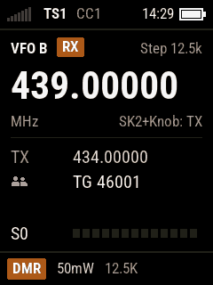
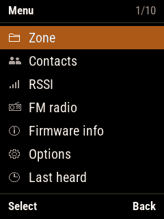
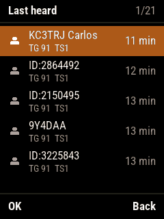
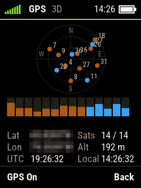
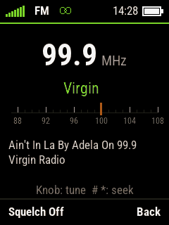

# OpenDMR — open firmware for the Baofeng DM-32UV

[中文](README.md) · **[Installation guide](docs/installation.en.md)** · **[User manual](docs/manual.en.md)**

Open firmware for the **Baofeng DM-32 / DM-32UV** (SoC **HR_C7000** = CK803S CPU + DMR modem + audio codec).
The source is open: free to use, change and share for non-commercial purposes; commercial use needs the author's
permission (see "Licences").

- Rewritten on FreeRTOS. The features come from RA4FHE's (Alexey's) OpenDM32 (the DM-32 port of OpenGD77, on
  uC/OS-III);
- A new user interface (native 240×320, English / Chinese);
- DMR uses our own AMBE+2 compatible vocoder (the `vocoder/` submodule): **no stock firmware code at all**.

Features: DMR / FM receive and transmit, channels and VFO, scan, dual watch, contacts, last heard, FM broadcast
radio, GPS, APRS beacons, amateur satellite passes, DMR hotspot (MMDVM), VOX, user-defined keys, ... See the
[user manual](docs/manual.en.md).

<p align="center">
  
  
  
</p>
<p align="center">
  
  
  
</p>

> ⚠️ **Flashing can brick the radio; you do it at your own risk. Before flashing anything, back up both SPI flash
> chips** (section 2 of the [installation guide](docs/installation.en.md)). The backup holds **this radio's own
> transmit and receive calibration**, which can't be recovered from another radio.

---

## Installing

Users: download the package from [Releases](../../releases) and follow the
[installation guide](docs/installation.en.md) (backup → firmware and Chinese font → codeplug with the OpenGD77 CPS).

## Layout

| Path | Contents |
|---|---|
| `src/` | The firmware source (`make`, see below) |
| `vocoder/` | Submodule, repository [va3bpf/dmr-vocoder](https://github.com/va3bpf/dmr-vocoder): our DMR vocoder (AMBE+2 compatible): algorithm, Python verification, fixed-point C (`c/ambe/`, used by the firmware), tests, documents |
| `docs/` | [Installation guide](docs/installation.en.md), [user manual](docs/manual.en.md) (screenshots in `docs/manual/`); developer documents: [architecture.md](docs/architecture.md) (architecture, Chinese), [ui-design.en.md](docs/ui-design.en.md) (user interface), [coding-style.md](docs/coding-style.md), [fd6818-registers.md](docs/fd6818-registers.md) (RF chip registers) |
| `tools/backup/` | `dm32_dump.py`: backup / write tool through the chip's bootloader (and `dumper/`, which it uploads to the radio) |
| `tools/debug/` | Cable update `fw_update.py` (and `updater/`), debug commands `dm32dbg.py`, screenshots `fshot.py`, simulated keys `fkey.py`, mic level `miclevel.py`, ... |
| `tools/fonts/` | Font conversion (`mkfont.py`), the Chinese font (`mkcjk.py` → `build/cjk.bin`, `upload_cjk.py` writes it to the radio) |
| `tools/text/` | The generator of the interface text tables and the original language files (from OpenGD77) |
| `tools/satellite/` | Writes the satellite keps (`write_keps.py`) |
| `tools/release/` | The release script `make_release.py` |

---

## Building

1. Get the source (the vocoder is a submodule):

   ```powershell
   git clone --recursive https://github.com/va3bpf/OpenDMR.git
   ```

   The default branch is `develop`, where development goes on; for the source of the releases add `-b main` (or
   `-b v<version>`). In a clone made without `--recursive`: `git submodule update --init` in the root.

2. The toolchain (not in the repository): **Xuantie-800 GCC 13.3.0 (csky-elfabiv2)**, part of the C-Sky Development
   Suite (CDS) 5.2.21: download it (after registering) from
   <https://www.xrvm.cn/community/download?versionId=4498138066258563072>. Put the MinGW folder of the CDS into
   `toolchain/` in the repository root, so that there are `toolchain/MinGW/csky-elfabiv2-tools/bin` and
   `toolchain/MinGW/msys/1.0/bin` (make).

3. Put those two on the PATH and run `make` in `src/`:

   ```powershell
   $env:PATH = "$PWD\toolchain\MinGW\csky-elfabiv2-tools\bin;$PWD\toolchain\MinGW\msys\1.0\bin;$env:PATH"
   cd src; make
   ```

The output is `src/build/opendmr.bin` (and `.elf`, `.map`, and `opendmr_BFUV32.bin` with the header of the stock
update mode). The vocoder is built straight from `vocoder/c/ambe/` by `src/Makefile`. The Chinese font:
`py tools/fonts/mkcjk.py` → `tools/fonts/build/cjk.bin`.

## Flashing (development)

- First install, or a radio that doesn't start: `dm32_dump.py --write` (radio off, run, switch on within 30 s); see
  section 3 of the [installation guide](docs/installation.en.md):

  ```powershell
  py -u tools\backup\dm32_dump.py COM6 program src\build\opendmr.bin --write --start 0xC000
  py -u tools\backup\dm32_dump.py COM6 data tools\fonts\build\cjk.bin --write --start 0x280000
  ```

- Otherwise, with OpenDMR running and the cable in: `py tools\debug\fw_update.py src\build\opendmr.bin --port COM6`.
  Only the changed sectors are written (about 35 s), the radio restarts at the end.

## Branches and releases

- **`develop`**: the development branch, where changes are merged (send pull requests to `develop`);
- **`main`**: releases only. `develop` is merged into it once tested, and each release is tagged `v<version>` on
  `main`.

```powershell
git switch main; git merge develop; git push      # before a release: develop into main
py tools\release\make_release.py              # builds, packs dist\OpenDMR-<version>.zip and SHA256SUMS.txt
py tools\release\make_release.py --publish    # also the GitHub release (tag v<version>; gh auth login, HEAD pushed)
```

The package holds what the table in section 1 of the [installation guide](docs/installation.en.md) lists. The script
refuses a working tree with uncommitted changes (the firmware shows the commit it was built from); `--publish` works
only on `main`, once `main` is pushed.

---

## Related projects

| Project | What for |
|---|---|
| [OpenGD77](https://www.opengd77.com/) | Where this firmware comes from (DMR engine, hotspot, interface texts); its CPS writes the codeplug |
| OpenDM32 (RA4FHE), [forum thread](http://infotex58.ru/forum/index.php?topic=1168.0) | The DM-32 port of OpenGD77, the reference for the features |
| [rogerclarkmelbourne/DM32](https://github.com/rogerclarkmelbourne/DM32) | DM-32 flash backup / write scripts (the bootloader handshake) |
| [M7OCM/DM-32UV](https://github.com/M7OCM/DM-32UV) | Stock CPS and stock firmware archive (to go back to the stock firmware) |
| [infamy/DM32-Protocol-Spec](https://github.com/infamy/DM32-Protocol-Spec) | The DM-32 programming protocol |
| [gzalo/RadioFoundry](https://github.com/gzalo/RadioFoundry) | Another open DMR firmware with DM-32UV support |

## Licences

Each file's header decides; the full text is in [LICENSE](LICENSE):

| Part | Licence |
|---|---|
| Our own files (header with only `Copyright (C) 2026 Junqiang Shi, VA3BPF / BG8AM`: most of `src/`, including the rewritten files marked `After OpenDM32 ...`), `tools/` | BSD-style licence, clause 4: **commercial use only with Junqiang Shi's (VA3BPF's) written permission** |
| Code taken from OpenGD77 (`src/dmr/hr_c7000.*`, `src/dmr/codec.*`, `src/dmr/dmr*.c/h`, `src/services/hotspot.c`, `src/hal/util.h`; the original authors kept in the headers) | OpenGD77's BSD-style licence, **clause 4: no commercial use** |
| Files partly taken from OpenDM32 (`src/graphics/font_cjk.c`, `src/services/fm_broadcast.c`, `src/services/debug.c`; copyright OpenDM32 contributors + Junqiang Shi) | The same, **no commercial use** |
| `src/startup/crt0.S` | C-SKY's startup file, no licence statement |
| `src/graphics/fonts/roboto*.c`, `src/ui/text/text*` | Generated data (fonts below; the text tables come from OpenGD77's language files) |
| `src/freertos/` | FreeRTOS, MIT |
| `vocoder/` | Our own; the decoder is ported from mbelib (ISC). AMBE+2 is DVSI's patented technology: search the patents before any commercial use |
| Fonts `tools/fonts/ttf/` | Roboto Condensed and Noto Sans SC, both SIL Open Font License 1.1 (licence texts in the same folder) |

So the firmware as a whole **can't be used commercially** for now: that would at least need a new DMR engine and
hotspot, and the AMBE+2 patents checked.

## Thanks

RA4FHE (Alexey), the OpenDM32 author, said on the forum that the code may be freely distributed and modified.
Thanks to Roger Clark VK3KYY, Kai Ludwig DG4KLU and the other OpenGD77 authors, to andynvkz (OpenUV008, flash
tools), and to everyone in the DM-32 forum thread.
