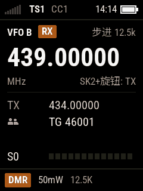
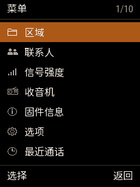
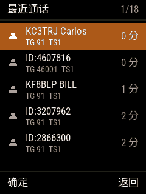
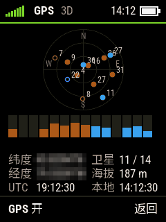
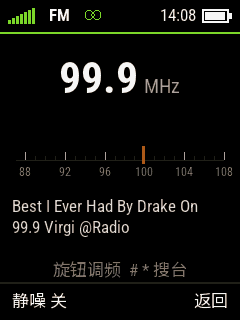
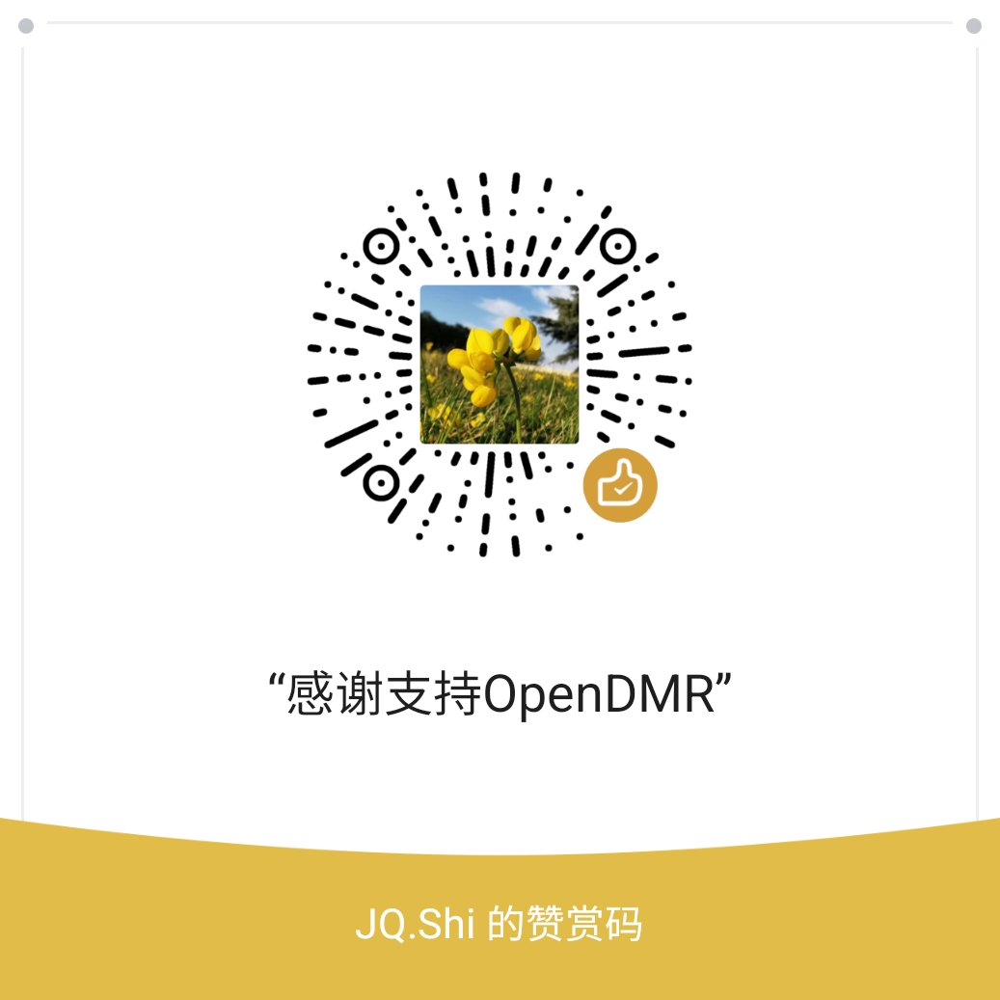

# OpenDMR — Baofeng DM-32UV 开源固件

[English](README.en.md) · **[安装手册](docs/installation.md)** · **[使用说明书](docs/manual.md)** · [支持这个项目](#支持这个项目)

**Baofeng DM-32 / DM-32UV**（SoC **HR_C7000** = CK803S CPU + DMR 调制解调 + 音频编解码）的开源固件。
源码公开：非商业用途可以自由使用、修改、传播；商用须经作者同意（见「许可」）。

- 在 FreeRTOS 上重写，功能从 RA4FHE（Alexey）的 OpenDM32（OpenGD77 的 DM-32 移植，uC/OS-III）搬过来；
- 界面重新设计（240×320 原生分辨率，中文 / English / Español）；
- DMR 用我们自己的 AMBE+2 兼容声码器（子模块 `vocoder/`），P25 用我们自己的 IMBE 声码器和空中接口（子模块 `p25/`），
  **不含任何原厂代码**。

功能：DMR / FM / **P25**（Phase 1 直通组呼）收发、信道和 VFO、扫描、双守、联系人、最近通话、FM 收音机、GPS、APRS 信标、业余卫星过境、
DMR 热点（MMDVM）、VOX、可自定义的按键……见 [使用说明书](docs/manual.md)。

<p align="center">
  
  
  
</p>
<p align="center">
  
  
  
</p>

> ⚠️ **刷机有变砖风险，后果自负。刷任何东西之前，务必先把两颗 SPI Flash 完整备份下来**（[安装手册](docs/installation.md) 第 2 节）。
> 备份里包含**本机独有的收发校准数据**，丢了无法从别的机器恢复。

---

## 安装

普通用户：从 [Releases](../../releases) 下载发布包，按 [安装手册](docs/installation.md) 操作（备份 → 写固件和中文字库 → 用 OpenGD77 CPS 写码表）。

## 目录结构

| 路径 | 内容 |
|---|---|
| `src/` | 固件源码（`make` 编译，见下） |
| `vocoder/` | 子模块，仓库 [va3bpf/dmr-vocoder](https://github.com/va3bpf/dmr-vocoder)：我们的 DMR 声码器（AMBE+2 兼容），算法、Python 验证、定点 C（`c/ambe/`，固件直接用）、测试、文档 |
| `p25/` | 子模块，仓库 [va3bpf/p25-core](https://github.com/va3bpf/p25-core)：P25 Phase 1 的 IMBE 声码器和空中接口（帧、纠错），C 代码和电脑上的测试；电台这一侧见 [docs/p25.md](docs/p25.md) |
| `docs/` | [安装手册](docs/installation.md)、[使用说明书](docs/manual.md)（截图在 `docs/manual/`）；开发文档：[architecture.md](docs/architecture.md)（架构）、[ui-design.md](docs/ui-design.md)（界面设计和界面框架）、[coding-style.md](docs/coding-style.md)、[fd6818-registers.md](docs/fd6818-registers.md)（射频芯片寄存器）、[i18n.md](docs/i18n.md)（多语言设计，想加语言的看这里） |
| `tools/backup/` | `dm32_dump.py`：走芯片引导程序的备份 / 写入工具（和它上传到电台的 `dumper/`） |
| `tools/debug/` | 数据线升级 `fw_update.py`（和 `updater/`）、调试命令 `dm32dbg.py`、截屏 `fshot.py`、模拟按键 `fkey.py`、话筒电平 `miclevel.py` 等 |
| `tools/fonts/` | 字体转换（`mkfont.py`）、中文字库（`mkcjk.py` → `build/cjk.bin`，`upload_cjk.py` 写入电台） |
| `tools/text/` | 界面文字表的生成脚本和原始语言文件（来自 OpenGD77） |
| `tools/satellite/` | 业余卫星轨道根数写入（`write_keps.py`） |
| `tools/release/` | 发布脚本 `make_release.py` |

---

## 编译

1. 取得源码（声码器和 P25 是子模块）：

   ```powershell
   git clone --recursive https://github.com/va3bpf/OpenDMR.git
   ```

   默认分支是开发分支 `develop`；要发布版的源码加 `-b main`（或 `-b v<版本>`）。
   已经 clone 的，在根目录运行 `git submodule update --init`。

2. 工具链（不在仓库里）：**玄铁 Xuantie-800 GCC 13.3.0（csky-elfabiv2）**，随 C-Sky Development Suite (CDS) 5.2.21
   提供，注册后从 <https://www.xrvm.cn/community/download?versionId=4498138066258563072> 下载。
   把 CDS 自带的 MinGW 目录放到仓库根目录的 `toolchain/`，得到 `toolchain/MinGW/csky-elfabiv2-tools/bin` 和
   `toolchain/MinGW/msys/1.0/bin`（make）。

3. 把这两个目录加到 PATH，在 `src/` 里运行 `make`：

   ```powershell
   $env:PATH = "$PWD\toolchain\MinGW\csky-elfabiv2-tools\bin;$PWD\toolchain\MinGW\msys\1.0\bin;$env:PATH"
   cd src; make
   ```

输出 `src/build/opendmr.bin`（另有 `.elf`、`.map`，和带原厂升级模式文件头的 `opendmr_BFUV32.bin`）。
声码器由 `src/Makefile` 直接从 `vocoder/c/ambe/` 编进来。中文字库：`py tools/fonts/mkcjk.py` → `tools/fonts/build/cjk.bin`。

## 刷机（开发时）

- 第一次装、电台起不来时：`dm32_dump.py --write`（关机，运行，30 秒内开机），步骤见 [安装手册](docs/installation.md) 第 3 节：

  ```powershell
  py -u tools\backup\dm32_dump.py COM6 program src\build\opendmr.bin --write --start 0xC000
  py -u tools\backup\dm32_dump.py COM6 data tools\fonts\build\cjk.bin --write --start 0x280000
  ```

- 平时：电台跑着 OpenDMR 时插着写频线 `py tools\debug\fw_update.py src\build\opendmr.bin --port COM6`，只写变了的扇区，约 35 秒，写完自动重启。

## 分支和发布

- **`develop`**：开发分支，改动都合并到这里（贡献请向 `develop` 提 Pull Request）；
- **`main`**：只用于发布，`develop` 测试好以后合并进来，每次发布在 `main` 上打 tag `v<版本>`。

```powershell
git switch main; git merge develop; git push      # 发布前：develop 合并进 main
py tools\release\make_release.py              # 编译，打包 dist\OpenDMR-<版本>.zip 和 SHA256SUMS.txt
py tools\release\make_release.py --publish    # 再建 GitHub Release（tag v<版本>；要先 gh auth login、推送 HEAD）
```

发布包的内容和 [安装手册](docs/installation.md) 第 1 节的表一致。工作区有未提交的改动时脚本拒绝打包（固件里显示的提交号要对得上）；
`--publish` 只在 `main` 上、并且 `main` 已经推送时才发布。

---

## 相关项目

| 项目 | 用途 |
|---|---|
| [OpenGD77](https://www.opengd77.com/) | 本固件的源头（DMR 引擎、热点、界面文字）；写码表用它的 CPS |
| OpenDM32（RA4FHE），[论坛帖](http://infotex58.ru/forum/index.php?topic=1168.0) | OpenGD77 的 DM-32 移植，本固件的功能参考 |
| [rogerclarkmelbourne/DM32](https://github.com/rogerclarkmelbourne/DM32) | DM-32 Flash 备份 / 写入脚本（引导程序握手） |
| [M7OCM/DM-32UV](https://github.com/M7OCM/DM-32UV) | 原厂 CPS 和各版本原厂固件存档（恢复原厂用） |
| [infamy/DM32-Protocol-Spec](https://github.com/infamy/DM32-Protocol-Spec) | DM-32 写频串口协议 |
| [gzalo/RadioFoundry](https://github.com/gzalo/RadioFoundry) | 另一个开源 DMR 固件，支持 DM-32UV |

## 许可

各文件以文件头为准，全文见 [LICENSE](LICENSE)：

| 部分 | 许可 |
|---|---|
| 自己写的文件（文件头只有 `Copyright (C) 2026 Junqiang Shi, VA3BPF / BG8AM`：`src/` 的绝大部分，包括写着 `After OpenDM32 ...` 的重写文件）、`tools/` | BSD 式许可，第 4 条：**商用须经 Junqiang Shi（VA3BPF）书面同意** |
| 从 OpenGD77 搬来的代码（`src/dmr/hr_c7000.*`、`src/dmr/codec.*`、`src/dmr/dmr*.c/h`、`src/services/hotspot.c`、`src/hal/util.h`，文件头保留原作者） | OpenGD77 的 BSD 式许可，**第 4 条禁止商业用途** |
| 部分取自 OpenDM32 的文件（`src/graphics/font_cjk.c`、`src/services/fm_broadcast.c`、`src/services/debug.c`，版权人 OpenDM32 contributors + Junqiang Shi） | 同上，**禁止商业用途** |
| `src/startup/crt0.S` | C-SKY 的启动文件，无许可声明 |
| `src/graphics/fonts/roboto*.c`、`src/ui/text/text*` | 生成的数据（字体见下；文字表来自 OpenGD77 的语言文件） |
| `src/freertos/` | FreeRTOS，MIT |
| `vocoder/` | 自己写的；解码器从 mbelib（ISC）移植。AMBE+2 是 DVSI 的专利技术，商用前要做专利检索 |
| `p25/` | 自己写的；IMBE 参数解码和表从 mbelib、帧内位置从 DSD 移植（ISC）。IMBE 也是 DVSI 的技术，同上 |
| 字体 `tools/fonts/ttf/` | Roboto Condensed、Noto Sans SC，都是 SIL Open Font License 1.1（许可文本在同一目录） |

所以整个固件目前**不能商用**：要商用，至少要重写 DMR 引擎和热点，并确认 AMBE+2 的专利。

## 支持这个项目

OpenDMR 是业余时间做的免费项目，开发和测试要花不少时间和 AI 工具的费用。如果它对你有用，欢迎捐赠，支持后续的维护和新功能。

- **微信赞赏**：扫下面的赞赏码
- **Ko-fi**（信用卡等，国外用户）：<https://ko-fi.com/opendmr>

<p align="center">
  
</p>

<a href="https://ko-fi.com/opendmr"></a>

## 致谢

OpenDM32 作者 RA4FHE（Alexey）在论坛声明可以自由传播和修改代码。
感谢 Roger Clark VK3KYY、Kai Ludwig DG4KLU 和 OpenGD77 的各位作者，andynvkz（OpenUV008、Flash 工具），以及 DM-32 论坛里的各位。
