# OpenDMR user manual

For the **Baofeng DM-32 / DM-32UV** running the OpenDMR firmware. Español: [manual.es.md](https://github.com/va3bpf/opendmr-languages/blob/main/docs/manual.es.md) · 中文版：[manual.md](manual.md).

Every picture is a real screenshot from the radio (`tools/debug/fshot.py`, 240×320). The location on the GPS and
radio info screens is blurred.

> This manual matches firmware 25340747 (2026-11-07). Installing, upgrading and going back to the stock firmware:
> the [installation guide](installation.en.md).
> **Back up both flash chips before flashing anything**: the backup holds this radio's own calibration.

## Contents

1. [Keys](#1-keys)
2. [The screen](#2-the-screen)
3. [Channel mode](#3-channel-mode)
4. [VFO mode](#4-vfo-mode)
5. [Receiving](#5-receiving)
6. [Transmitting](#6-transmitting)
7. [Scanning](#7-scanning)
8. [Dual watch](#8-dual-watch)
9. [Contacts and who you call](#9-contacts-and-who-you-call)
10. [The main menu](#10-the-main-menu)
11. [Options](#11-options)
12. [Lock, quick keys, key settings](#12-lock-quick-keys-key-settings)
13. [CPS, hotspot, firmware update](#13-cps-hotspot-firmware-update)
14. [Current limits](#14-current-limits)

---

## 1. Keys

| Key | What it does |
|---|---|
| **Menu key** (left, under the screen) | Menu / OK. On the main screens a **short press opens the menu of that screen** (quick menu), a **long press the main menu** |
| **Back key** (right, under the screen) | Back / delete a digit. **Long press: home.** On the channel screen a short press goes to the VFO, on the VFO back to the channel |
| ▲ ▼ | Channel (channel mode), frequency (VFO), move in lists |
| ◀ ▶ | Change the value of the selected row in lists; on the main screens the talk group (DMR) or the squelch (FM) |
| Knob | As ▲ ▼ |
| SK1, SK2 (side keys) | Alone they have their own function; held with another key they make combinations (below) |
| PTT | Transmit |
| Digits, *, # | Channel numbers, frequencies, numbers; shortcuts on the main screens |

The two labels of the bottom bar say what the menu key and the back key do on that screen (Select, OK, Save, Edit,
Back, Delete, ...).

### Shortcuts on the main screens (defaults)

All of these can be changed in Options → Key settings (see [12](#12-lock-quick-keys-key-settings)).

| Keys | DMR | FM |
|---|---|---|
| # | Enter a talk group / private call number | Enter DTMF |
| SK2 + # | Contact list | DTMF contact list |
| # long | Reverse repeater (channel mode only) | Same |
| * | Timeslot | Bandwidth 12.5 / 25 kHz |
| * long | Back to the channel's (VFO's) own timeslot | — |
| SK1 + * | Mode: FM → AM → USB → LSB → DMR → P25 → NXDN → M17 → YSF | Same |
| ▶ / ◀ | Talk group + / − (through the RX group list) | Squelch + / − |
| SK2 + ▶ / ◀ | Power + / − | Same |
| SK2 + ▶ long | User power | Same |
| SK2 + ▲ / ▼ | Zone + / − (channel mode); which frequency ▲ ▼ and the knob change, RX or TX (VFO) | Same |
| SK2 alone | Call back the talk group just heard | — |
| SK1 alone | FM broadcast radio | Same |
| SK1 held alone | Lock the keypad (SK1 + * unlocks) | Same |
| SK1 + ▲ / ▼ | Scan up / down | Same |
| SK1 + 1 | APRS on / off | Same |
| SK1 + 3 | Send an APRS beacon now | Same |

**What the keys change on a channel is for now**: squelch, power, timeslot, mode, bandwidth, and a talk group or
contact picked go back to the channel's own after another channel, the VFO, the channel details or power off; nothing
is written into the codeplug. To change a channel for good, use the channel details (SK2 + menu key). The timeslot is
the channel's: its own contact doesn't change it; a contact picked for now (contacts, # entry, call back, stepping
through the TG list) brings its own timeslot. On a VFO, what the keys change is kept.

Also: SK2 + menu key opens the channel details directly; SK2 + a digit is a quick key (see [12](#12-lock-quick-keys-key-settings)).

---

## 2. The screen

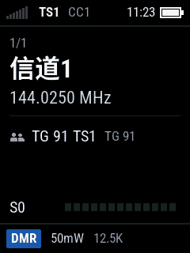 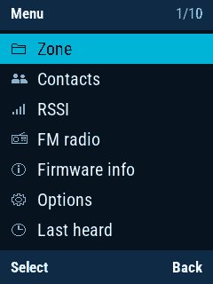

- **Status bar** (top, on the theme's band): signal bars (all there as on the S meter, the ones with signal lit white), timeslot `TS1`/`TS2`, colour code `CC1`
  (DMR), scan icon, GPS pin (when the GPS is on: dim while it searches, lit with a fix), time, battery. The whole bar
  turns green while receiving and red while transmitting (the transmit icon in place of the signal bars, nothing
  else moves).
- **Main area**: on the channel screen the zone and position, the channel name (large), the frequency, the talk
  group, the S meter.
- **Bottom bar** (on the band too): on the main screens the mode (`DMR`/`FM`/`AM`/`USB`/`LSB`), power and bandwidth; on lists what the two keys do.
- **Lists** (menus, settings): the title bar shows the name and the position (`1/10`), the selected row is in the
  theme's highlight colour (cyan in Deep sea), 7 rows a page, ▲ ▼ wrap around at the ends.

Colours mean something: green = receive, red = transmit, the highlight colour = selected / current, amber = warning
(low battery, scan, timeout near). The colours themselves come from the theme (Display options → Theme); the
screenshots here are in Deep sea.

---

## 3. Channel mode

The radio starts in channel mode (in the VFO when it was left there).


| To | Keys |
|---|---|
| Change channel | ▲ ▼ or the knob |
| Go to channel N of the zone | Type the number, then the menu key (back key cancels) |
| Change zone | SK2 + ▲ ▼, or main menu → Zone |
| Talk group / squelch | ▶ ◀ |
| Power | SK2 + ▶ ◀ |
| Timeslot / bandwidth | * |
| Go to the VFO | Back key |
| Menu of the channel | Menu key |
| Channel details | SK2 + menu key, or the first row of the menu |
| Set a temporary target (incl. All Call) | `#` cycles TG → PC → All Call → contact; menu key takes it |

**All Call**: on the channel screen press `#` until `All Call`, then the menu key: the channel transmits to all for
now (until you change channel, go to the VFO or power off). On a YSF channel All Call sends `ALL` as the destination
and keeps the channel's DG-ID; with no contact picked the target is `ALL` too. See [9](#9-contacts-and-who-you-call).

### Channel quick menu (menu key)

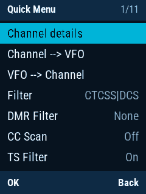 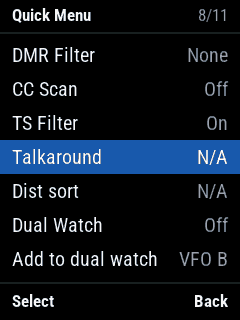

▲ ▼ choose a row, ◀ ▶ or the knob change its value (at once, to be heard); the menu key is OK: keeps the changes
(or does the row's action) and closes the menu; the back key is Cancel: puts back the values of when the menu was
opened and closes it. The VFO quick menu works the same.

| Row | What it does |
|---|---|
| Dual Watch | Dual watch on / off (see [8](#8-dual-watch)) |
| Channel details | All the settings of this channel (below) |
| Channel --> VFO | Copy this channel into the VFO in use, then go to the VFO |
| VFO --> Channel | Overwrite this channel with the VFO in use (asks first) |
| Filter | Analogue tone filter: `CTCSS\|DCS` hears only signals with the right tone, `None` hears all |
| DMR Filter | None / this talk group / this contact / the talk groups of the RX group list |
| CC Scan | On: finds the colour code by itself (the colour code filter off) |
| TS Filter | On: only the channel's timeslot is heard |
| Talkaround | On a repeater channel: talk direct on the receive frequency |
| Dist sort | Channels of the zone in order of distance from you (needs your location) |

### Channel details

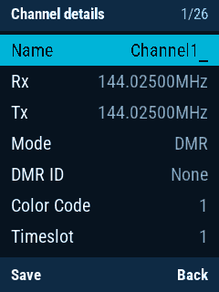 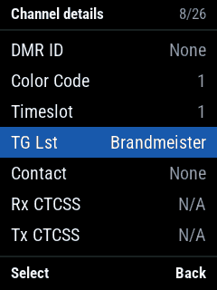 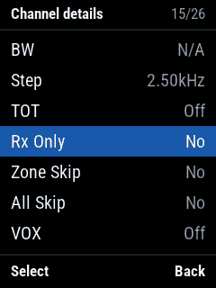 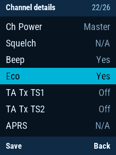

Name, receive and transmit frequencies, mode, DMR ID, colour code (the NAC on a P25 channel, the RAN on an NXDN channel, the CAN on an M17 channel, the DG-ID on a YSF channel), timeslot, TG list, contact, receive and transmit
CTCSS/DCS, bandwidth, step, transmit timeout, Rx only, zone skip, all skip, VOX, channel power, squelch, beep, eco,
talker alias transmit on TS1 / TS2, APRS configuration.

- ▲ ▼ choose, ◀ ▶ or the knob change;
- Frequencies and the DMR ID are typed with the digits (8 digits, ◀ deletes one); ◀ ▶ on Rx / Tx set Tx to Rx plus a
  repeater shift;
- Name: letters on the digit keys, ◀ ▶ move, SK2 + ◀ deletes, SK2 + ▶ inserts;
- TG list, contact and APRS configuration are chosen by name;
- **The menu key saves** (into the codeplug) and goes home; **the back key leaves without saving**.

---

## 4. VFO mode

The back key on the channel screen goes to the VFO, the back key again back to the channel. There are two VFOs (A
and B): **hold the back key** to switch, or choose in the VFO menu.

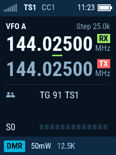 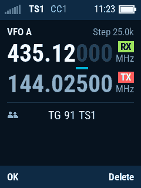

| To | Keys |
|---|---|
| Change the frequency chosen | ▲ ▼ or the knob (one step) |
| Choose the receive / the transmit frequency | SK2 + ▲ / SK2 + ▼ |
| Type a frequency | Digits (e.g. `43500000`: it is set after the 8th digit, or with the menu key; the back key deletes one) |
| Swap Rx and Tx while held | SK1 + SK2 |
| Mode: FM → AM → USB → LSB → DMR → P25 → NXDN → M17 → YSF | SK1 + * |
| Squelch (FM, AM, SSB) / talk group (DMR, P25, NXDN) | ▶ ◀ |

Both frequencies are shown large: the receive one with `RX` (green) on its right, the transmit one with `TX` (red).
The one the keys change is white, with a ^ in its colour under each digit its step changes: a 12.5 kHz step marks
the 2nd to 4th decimals, 25 kHz the 2nd and 3rd, 6.25 kHz the 3rd to 5th, 5 and 10 kHz one digit. The top line shows the VFO and the step itself.

**AM, USB and LSB are receive only** (the RF chip can only transmit FM): the bottom bar shows `Rx Only`, and the PTT
shows "Switch to FM or DMR". Their squelch is on the signal strength (0 %: always open); it closes after the signal
stayed under it for 0.2 s (AM) or 0.5 s (USB, LSB), so the pauses in speech don't cut the audio. In USB and LSB the knob
tunes 100 Hz a click; tune to the suppressed carrier (e.g. 144.300 MHz), then a little either way until the voice sounds
right. The mode is kept with the channel and the VFO; the CPS sees such a channel as analog.

**108 – 137 MHz (aviation) is receive only**, in any mode: set AM (SK1 + \*) to listen. The radio's front end is made for
137 MHz and up, so it is less sensitive there; the PTT shows "OUT OF BAND".

**P25** (APCO P25 Phase 1 conventional voice: simplex, group calls, clear): the bottom bar shows `P25`; below the frequency
comes the talk group, with the NAC on the right of its line (e.g. `NAC 293`).

- The **NAC** (network access code, 12 bits in hex, 293 by default) works like DMR's colour code: only calls with the
  same NAC are received; `F7E` receives them all. It is set in the channel details (on a P25 channel the colour code
  row becomes the NAC; ◀ ▶ step 1, held 0x10).
- The **talk group** is chosen as in DMR (▶ ◀, typed, contacts); only group calls are sent.
- An encrypted call only shows a lock and is not played. The CPS sees a P25 channel as DMR: **editing that channel in
  the CPS may change its NAC**.
- Known issues and the technical details: [docs/p25.md](p25.md) (in Chinese).

**NXDN** (NXDN48, 6.25 kHz, conventional simplex voice, clear): the bottom bar shows `NXDN` and `6.25K`; below the
frequency comes the target transmitted to (a group or an individual call), with the RAN on the right of its line
(e.g. `RAN 1`).

- The **RAN** (radio access number, 0 - 63, 1 by default) works like DMR's colour code: only calls with the same RAN
  are received; 0 receives them all (and transmits 0). It is set in the channel details (on an NXDN channel the
  colour code row becomes the RAN; ◀ ▶ step 1, held 8).
- The **target** is chosen as in DMR (▶ ◀, typed, contacts): a group gets a group call, a private contact an
  individual call. NXDN IDs have 16 bits: a group or contact over 65535 goes to group 1 instead. Individual calls
  to other radios are not played.
- **Your NXDN ID** is set in General options → NXDN ID (1 - 65535; NXDN IDs are registered apart from DMR IDs); not
  set: your DMR ID (its low 16 bits over 65535).
- Receive: the radio records the discriminator and demodulates and decodes it in software; transmit: our own AMBE+2
  encoder, NXDN48's ±1050 Hz deviation. Tested with an MMDVM hotspot (0 % bit errors). Encrypted calls are not decoded.
- CPS versions after 0.7.1 support NXDN channels (mode, RAN, NXDN ID).

**M17** (4FSK, 12.5 kHz, simplex voice, Codec 2 3200): the bottom bar shows `M17` and `12.5K`; below the frequency
comes the target, `ALL`, with the CAN on the right of its line (e.g. `CAN 0`).

- The **CAN** (channel access number, 0 - 15) is set in the channel details (on an M17 channel the colour code row
  becomes the CAN). It is transmitted with each call; received calls are not filtered by CAN, all are played.
- **Transmit**: always to ALL (broadcast), from the callsign under General in the CPS. A received call shows the
  caller's callsign in large letters.
- Receive: demodulated and decoded in software, as NXDN; transmit: our own Codec 2 3200 encoder, checked against the
  reference libcodec2 (nearly the same frames).
- **The voice quality is not yet what we want**: Codec 2 3200 itself sounds duller than the AMBE+2 of DMR and NXDN,
  with less treble.
- CPS 0.10.0 and later support M17 channels (mode, CAN).

**YSF** (Yaesu Fusion / C4FM, 12.5 kHz, conventional simplex voice, clear): the bottom bar shows `YSF` and
`12.5K`; below the frequency comes the target transmitted to, `ALL` by default, with the DG-ID on the right of the
status bar.

- The **DG-ID** (0 - 127 in the editor; a Yaesu uses 0 - 99, 0 by default) works like DMR's colour code: only calls
  with the same DG-ID are received; 0 receives them all (and transmits 0). In the channel details, ▲ ▼ select the
  DG-ID row (the colour code row on other modes), ◀ ▶ or the knob change it by 1, the menu key saves. It is carried
  in the FICH of every frame.
- The **target** is the contact's name, or `ALL` for a group call; your callsign (General options in the CPS) is
  sent as the source. The line under the frequency shows the destination and `DG-ID n`. A received call shows the
  caller's callsign in large letters, the destination over the S meter, and the DG-ID in the status bar; it also
  goes into Last heard.
- **Keys**: `SK1 + *` steps to YSF; `SK2 + #` picks a contact (its name is sent as the destination); `▶ ◀` steps
  through the channel's RX group; `#` → All Call → menu key sends `ALL`. With no contact picked, the target is `ALL`.
  Use contacts with callsign names: a numeric TG/PC goes on the air as `TG n` / `PC n`.
- Receive: the discriminator is recorded and demodulated in software, as NXDN; transmit: our own AMBE+2 encoder
  and YSF V/D-1 frames, at ±1350 Hz deviation on narrow channels and ±2700 Hz on wide ones, with the 200 ms `0x77`
  preamble MMDVM expects. With an external MMDVM/Pi-Star hotspot in YSF mode, use `LoDev=1` for a narrow 12.5 kHz
  channel and keep the hotspot's frequency offset calibrated.
- V/D-1 and DN (V/D-2) voice are supported; VW (IMBE) is not, since this firmware has no IMBE vocoder. Wire
  mode order: FM, AM, USB, LSB, DMR, P25, NXDN, M17, YSF. See [docs/ysf.md](ysf.md) for the frame details.

### VFO quick menu (menu key)

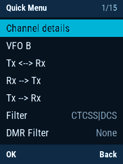 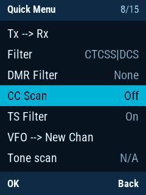 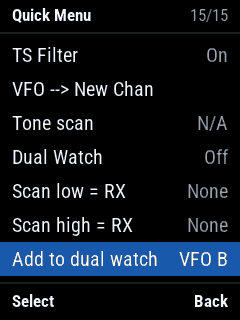

| Row | What it does |
|---|---|
| Dual Watch | See [8](#8-dual-watch) |
| Channel details | All the settings of this VFO (as the channel details) |
| VFO B / VFO A | ◀ ▶ or the knob switch VFO |
| Tx <--> Rx | Swap the frequencies |
| Rx --> Tx / Tx --> Rx | Copy the receive frequency to transmit / the other way |
| Filter, DMR Filter, CC Scan, TS Filter | As in the channel menu |
| VFO --> New Chan | Save the VFO as a new channel ("New channel N", in All Channels) |
| Tone scan | Find the CTCSS / DCS tone the other station uses (any key stops on the tone found) |
| Scan low = RX / Scan high = RX | The receive frequency becomes the lower / upper limit of the VFO scan |

---

## 5. Receiving

 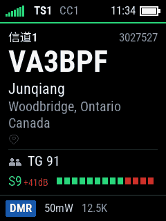

- A received signal: the whole status bar green, the signal bars lit, the S meter value in green; above S9
  the excess is shown in small red figures (`+xxdB`).
- The S meter's scale: S1 at -121 dBm, 6 dB a unit, S9 at -73 dBm. The signal bars follow it: one from S1, all from
  S8. A quiet channel outdoors shows S0; indoors, the noise of computers and other electronics can light a unit or
  two.
- DMR, the caller panel (its lines stay where they are, whatever is known):
  - the channel or VFO name, and on the right the caller's DMR ID;
  - the caller's callsign, large (its DMR ID when not known);
  - the name, the city and state, the country (from the DMR ID database, see
    [13](#13-cps-hotspot-firmware-update); the city and state can be hidden: Display options → Caller's place). The
    country also shows without the database: it comes from the ID's first 3 digits;
  - the position: the pin lights up when the call carries one (ETSI GPS Info, as sent by other radios), with the
    distance and the direction from your position ("12.3 km NE"); without your position, the caller's coordinates;
  - the talk group (or whom a private call is for), the S meter, the bottom bar as on the screen under it.
  The caller shows within about 0.7 s. Names come from the contacts, the DMR ID database, or the caller's talker alias.
- Calls go into Last heard. **SK2** calls back the talk group just heard (a private call: the caller).
- On DMR and P25 channels, the channel screen shows the last two callers of Last heard of that same protocol (callsign
  and name, how long ago, and the talk group or `PC` of each call). The caller shows there within about 0.7 s.
  Display options → **Recent callers** turns the block off (it is on by default); FM, AM, USB, LSB and NXDN channels never show it.
- FM: audio when the squelch opens; ▶ ◀ change the squelch, shown on the screen for a moment. 0 % is always open
  (the noise is heard); a receive tone still applies. The squelch changed on a channel is for now (back to the
  channel's own after another channel, the VFO or power off); on a VFO it is kept. A channel without its own squelch
  uses the band's default squelch of Radio options.

---

## 6. Transmitting

Hold the **PTT** to transmit, release it to stop. The transmit screen (no screenshot in this manual):

- The status bar turns red, the transmit icon in place of the signal bars (the timeslot and colour code in DMR as
  before);
- Main area: who is called ("Group Call" and the talk group, or the zone and the channel / VFO), the channel and the
  frequency, a large timer (with a transmit timeout: the time left and a bar, amber near the end), an 8 segment mic
  level;
- Repeaters: "Waking repeater" while waking it, "No repeater" when it doesn't answer;
- When the radio can't transmit (out of band, Rx only channel, timeout, no repeater) the reason stays on the screen
  until the PTT is released.

While transmitting:

- **FM**: **SK2** sends the 1750 Hz repeater tone; the digits send DTMF;
- Start / end tones, MDC1200 and the tail elimination are set in Sound options → FM Tx tones;
- **VOX**: Sound options → VOX Thres. (0 = off) and VOX Tail;
- **PTT latch** (Radio options): the transmission goes on after the PTT is released; another press of the PTT (or
  RED) ends it. Only on a channel with a TX timeout (TOT), so it never transmits without end, and the timeout ends it;
  not for VOX.

---

## 7. Scanning

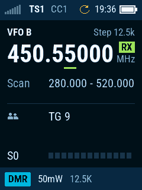

- **SK1 + ▲** scans up, **SK1 + ▼** down. In channel mode the zone is scanned (channels with Zone Skip are skipped;
  in All Channels those with All Skip); in the VFO between the scan limits (without limits: the whole band). The
  status bar shows the scan icon.
- While scanning: **▲** goes on at once; **◀** reverses; when it has stopped on a signal, **\*** locks that channel /
  frequency out: **short** (a click) until the radio is switched off (nuisance delete, up to 64), **held** (a
  confirmation tone) for good: a channel gets Zone Skip (All Skip in All Channels) in the codeplug, a VFO frequency
  is kept in the radio (up to 32). The scan goes on, and shows how many are locked out. **PTT** stops the scan and
  transmits; **any other key** stops it.
- The channel or VFO quick menu's **Scan lockout** (On / Off, with ◀ ▶ or the knob) is the current channel or
  frequency: On locks it out for good (also after a Stop mode scan ended on it), Off puts it back in the scans,
  however it was locked out.
- Main menu → **Scan lockouts** lists all of them, the kind on the right: Temp (until power off), Saved (a VFO
  frequency), Zone skip / All skip (a channel, from the codeplug: also those set in the CPS or the channel details).
  The menu key on a row unlocks it, the last row unlocks them all.
- Radio options: Scan delay (how long it stays), Scan dwell (the time on each channel / frequency), Scan mode (Hold /
  Pause / Stop), Scan On Boot.
- DMR, P25, NXDN and YSF channels take at least 50 ms each; where the signal strength rises over the noise, the scan waits up to
  0.4 s for the DMR sync (P25: a data unit), then up to 3 s for the audio, so it also stops in the middle of a call.

---

## 8. Dual watch

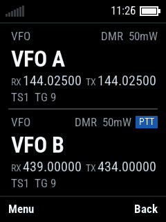

Two paths watched at once, each **any channel or VFO A / B** (both may be the same). The dual watch is the home
screen with one more path watched: the **selected path** is the home screen's channel or VFO, and the keys work as there.

- **Switch it on**: Dual Watch, the first item of the channel or VFO menu (menu key): ◀ ▶ or the knob to On,
  then the menu key (OK). The channel / VFO in use becomes
  the selected path, on top; the other path is the other one of the last time (the first time VFO A, or VFO B when
  VFO A is in use).
- **Select**: ▲ / ▼ select the upper / lower path, which has the `PTT` badge; the home screen goes to it too.
- **Change the selected path** as on the channel / VFO screen: the knob steps the channel or the frequency (on a VFO,
  SK2 + ▲ ▼ choose receive or transmit; the one changed has a green or red ^ under the digits its step changes, as on the VFO screen); the digits enter a channel
  number or a frequency; ◀ ▶ talk group or squelch; SK2 + ◀ ▶ power; \*, # and the SK1 / SK2 combinations as there;
  the back key switches between channel and VFO (held: VFO A ↔ B). To put another channel or VFO in a path, select it
  and change it there.
- Both paths the same: both panels shown, the same, one path watched; a change shows on both.
- The paths are watched in turn; a path with a signal is kept while the signal lasts and a moment after (for the
  answer).
- Each path: channel number or VFO, mode and power; the name large; the receive and transmit frequencies; the
  timeslot and talk group, or the tone.
- A path with a signal: a green bar on its left, its S meter on the last line. A DMR call: the caller's callsign
  replaces the name (its ID when not known), the ID goes top right and the path's name to the left of the header.
- **Transmit**: on the selected path; within 10 s after a signal on the other path, the PTT answers on that path (the
  `PTT` badge is there then).
- Bottom bar: Menu on the left; on the right where the back key goes (VFO or Channel), Close while SK2 is held.
- **Switch it off**: **SK2 + back key**, or Dual Watch (the first item) in the selected path's menu (menu key);
  starting a scan (SK1 + ▲ ▼) switches it off too. Off: back on the selected path's home screen. Menu key held: the
  main menu. Kept over power off.

---

## 9. Contacts and who you call

### Entering a talk group / private call (#)

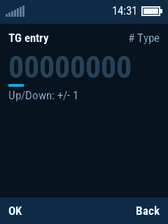

- **#** on a main screen. **#** cycles TG → PC → All Call → contact; ▲ ▼ add / subtract 1.
- The menu key takes it: a TG, PC or the All Call (16777215, nothing to type) replaces the channel's contact for
  now (on a channel: until another channel, the VFO or power off); a contact also brings its timeslot. Your own DMR ID is set in Settings (User DMR ID), not here.
- In FM # is the DTMF entry: digits, * and # type the code, ◀ deletes, the menu key sends it.

### Contact list (SK2 + #)

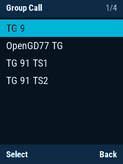

SK2 + # on a main screen: choose one and press the menu key, it becomes the transmit target at once.

### Main menu → Contacts

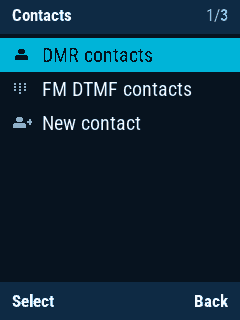  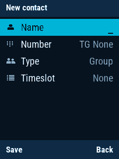

- **DMR contacts**: one call type at a time, **#** changes it (group / private / all call). The menu key opens the
  actions: Select TX, Edit Contact, Delete Contact (deleting asks first; a talk group used by an RX group list can't
  be deleted).
- **FM DTMF contacts**: DTMF numbers for FM.
- **New contact**: name (letters on the digit keys), number, type, timeslot; the menu key saves it.

---

## 10. The main menu

**Hold the menu key** on a main screen.

 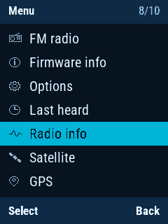

### Zone

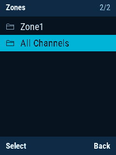

Choose the zone; "All Channels" is every channel of the codeplug.

### RSSI

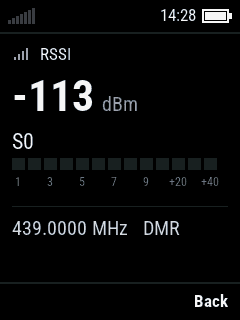

dBm (large), S meter, frequency and mode. * shows the raw signal and noise readings too.

### FM radio (SK1)

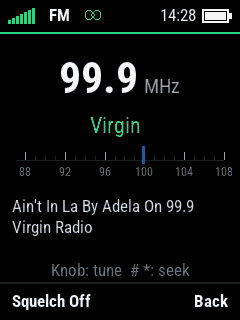

87 – 108 MHz broadcast, with the RDS station name and text, stereo in the status bar.

- Knob or ◀ ▶: 100 kHz steps; **#** / **\***: seek up / down; digits: a frequency (`999` = 99.9 MHz, `1071` =
  107.1 MHz);
- Menu key: squelch on / off (muted when there is no station);
- Back key, SK1 or PTT: leave (the receiver off). The frequency and the squelch are kept; turned off on this screen,
  the radio starts on it again.

### Firmware info

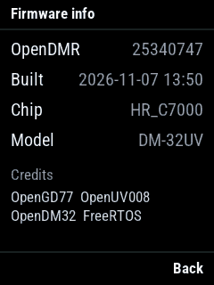

Version (git commit), build time, chip, model, credits.

### Last heard

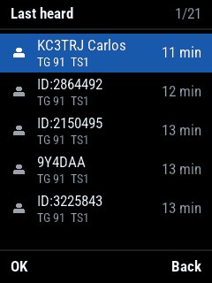

Two lines a call: the caller (callsign and name, or ID), the talk group and timeslot, how long ago on the right.
▲ ▼ move (SK2 + ▲ ▼: first / last); menu key: transmit to that talk group from now on (SK2 + menu key: a private
call to the caller); **#** held clears the list.

### Messages

Main menu → **Messages** (with the number of unread ones): **Inbox**, **Outbox**, **Write message**, **Quick texts**. Each box
keeps 32 messages; when full, the oldest is replaced. A DMR channel sends DMR messages, an M17 channel M17 messages; other
modes can't send ("A DMR or M17 channel is needed"), all receive.

**Inbox / Outbox**: two lines a message: who (callsign or ID, a talk group as TG) and when (the outbox: its state, Sending /
Sent / Delivered / Not sent), then the start of the text; unread ones have the envelope icon. ▲ ▼ select, the left key reads.

**Reading**: who as the title, the mode, the ID and when under it, the text wrapped, ▲ ▼ scroll. The left key **replies** in
the inbox (to the same radio or talk group) and **sends it again** in the outbox (as it was, on the channel now).

**Deleting**: hold **SK2**: the left soft key turns into **Delete**; press the left key to delete, after a question. Reading,
it deletes that message; in the inbox or outbox list, the selected one, without opening it. The CPS's Messages page deletes
many at once.

**Writing**:

- The top row is **To**: on DMR the ID typed with the digits, **#** switches between a talk group (TG) and a private
  message, ◀ deletes a digit; it starts with the channel's transmit target. On M17 a callsign; empty sends to all.
- Below is the text: the digits type letters and digits (several presses), **\*** symbols, **#** inserts a quick text;
  ◀ ▶ move the cursor, **SK2 + ◀** deletes the character before it, **SK2 + ▶** inserts a space, ◀ / ▶ held go to the
  start / end. The title counts the characters (140 at most).
- ▲ ▼ move between To and the text, the left key sends. The result shows as a notice at the top, and in the outbox.

**Quick texts**: written with the CPS's Messages page (any language). Pick one from the menu to start a new message with
it; while writing, **#** inserts one at the cursor.

**A new message** shows a notice with a sound: the left key reads it, the right key closes the notice. The status bar shows
the number of unread messages.

**DMR SMS format** (Options → Radio options): **Motorola** (TMS, the default; the other radio acknowledges it and the
outbox shows Delivered), **Hytera** or **DMR** (AnyTone's). Messages in any of them are received.

### Radio info

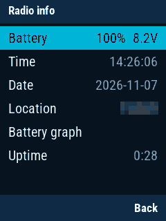

Battery, time, date, location (Maidenhead locator), battery graph, up time. The menu key on time, date or location
opens its page to type it with the digits (the menu key sets it; on the location page ▲ ▼ choose N / S, SK2 + ▲ ▼
E / W). The battery graph has a point every 40 s (6.4 – 8.2 V).

### Satellite

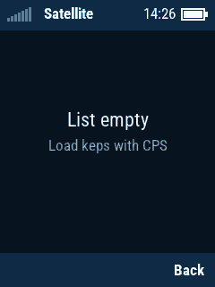

Needs **the time and your location** (Radio info, or the GPS) and **the satellite keps written by the CPS**. Then:
the coming passes of all the satellites; open one for the pass (polar track, azimuth / elevation) and the Doppler
corrected frequencies (the menu key switches voice / APRS / other). The pass screen tunes the radio with the Doppler
correction, and the PTT transmits on the corrected frequency of that moment. On the **APRS** frequencies the PTT sends
an APRS beacon through the satellite's digipeater instead of voice (as OpenGD77): it uses the APRS configuration
**named as the satellite** (one named ISS with the path RS0ISS, SONATE-2 with DP0SNX ...), made on the CPS's APRS page,
and the position of the APRS options (the GPS or the fixed one). No configuration of that name, or no position: an
error tone. Without keps: "List empty — Load keps
with CPS".

### GPS

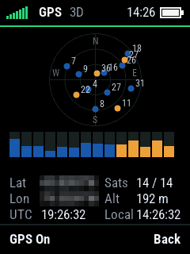

Sky plot (GPS blue, BeiDou orange, filled when used), signal bars of the satellites, latitude and longitude,
satellites, altitude, UTC and local time. **The menu key switches the GPS on / off.** With a fix the clock is set from
the GPS; APRS and the satellite screen can use the GPS location.

---

## 11. Options

Main menu → Options. On every settings list: ▲ ▼ choose, **◀ ▶ (or the knob) change the value**, the menu key opens
a sub list or does an action (it doesn't change a value; "Select" shows where it does something), the back key goes
back. Settings work at once and are saved at power off. **The CPS doesn't read or write
these settings.**

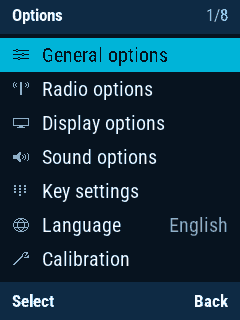

### General options

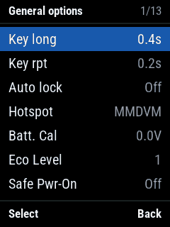 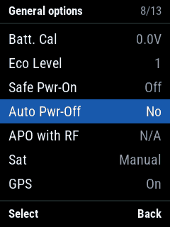

| Row | |
|---|---|
| Key long / Key rpt | Long press time; repeat interval of a held key |
| Auto lock | Locks the keypad and the PTT after this long without use (Off / minutes) |
| Lock PIN / Power-on PIN / Change PIN | See [PINs](#pins) |
| Hotspot | Off / MMDVM / BlueDV (see [13](#13-cps-hotspot-firmware-update)) |
| Batt. Cal | Correction of the battery voltage shown (±0.5 V) |
| Eco Level | How much the receiver saves power |
| Safe Pwr-On | Kept for later: no effect in this firmware yet |
| Auto Pwr-Off / APO with RF | Power off after this long without use; with the second on, a received signal counts as use |
| Sat | Kept for later (Manual / Auto): no effect yet |
| GPS | Off / On / NMEA (NMEA sentences out of the programming cable) |
| Keep menu places | On: the menus open where they were left, also after power off (off: only until power off) |
| User DMR ID | Your DMR ID; the menu key opens the number entry |
| NXDN ID | Your NXDN ID (1 - 65535); the menu key opens the number entry, 0 clears it; not set: "(DMR ID)", the DMR ID used |

### Radio options

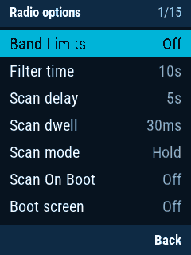 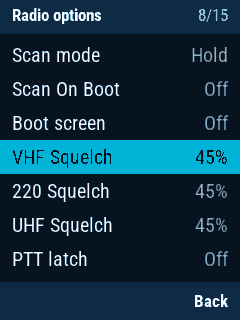 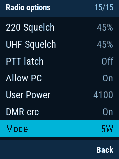

| Row | |
|---|---|
| Band Limits | Off / On (amateur bands) / CPS (as set in the CPS) |
| Filter time | After a DMR talk group is heard, only that one is heard for this long |
| Scan delay, Scan dwell, Scan mode, Scan On Boot | See [7](#7-scanning) |
| Boot screen | Boot screen and boot melody at power on (off by default: straight to the main screen) |
| VHF / 220 / UHF Squelch | Default squelch of the channels of each band |
| PTT latch | One press of the PTT starts transmitting, another one stops; needs the channel's TOT |
| Allow PC | Off / On / PTT (a private call heard: the PTT calls back) |
| Default Power | Power of a new channel and of a VFO used the first time (each keeps its own after), and of old channels set to "radio" |
| Power To All | The default power into every channel and VFO A / B (asked first) |
| User Power | PA drive of the "user" power level (+W-), 0 - 4100 (steps of 10 with SK2 held) |
| DMR crc | Off: DMR data CRC errors are ignored |
| DMR SMS format | The format DMR messages are sent in, see [Messages](#messages) |

RAS repeaters need `DMR crc = Off`: their LC CRC is computed with a secret key, so the standard check fails on purpose.
The FEC still runs; only the final CRC check is skipped.

Power levels: 50mW, 500mW, 1W, 2W, 3W, 4W, 5W, 7W, 10W, +W-. 1W / 4W / 10W are the factory calibration of the stock
Low / Middle / High; the others are estimated from them, not measured. Each channel, VFO A and VFO B has its own power:
SK2 + ▶ ◀ changes the one in use; on a VFO it is kept, on a channel it is for now (the channel details change it
for good).

### Display options

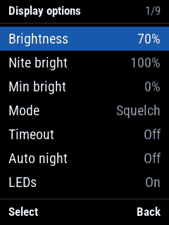 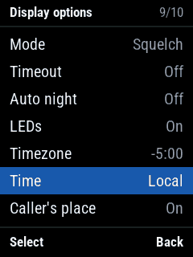

Brightness (day), Nite bright, Min bright (the backlight when "off"); Mode (Auto / Squelch / Manual / Buttons),
Timeout; Auto night; LEDs; Timezone (an hour a step, a quarter with SK2 held); Time shown in UTC or local time;
Caller's place (the city and state of a DMR caller on the receive screen; the country always shows); Recent callers
(the last two callers under the talk group line on a DMR or P25 channel, on by default); Theme (the whole look,
colours and bands):

| Theme | |
|---|---|
| Auto (the default) | Light theme from sunrise to sunset, dark theme overnight. Uses a GPS fix or the saved location. Without a location, daylight is 07:00–19:00 local time. Without a valid clock, the theme is dark. Auto night uses the same night period for backlight brightness |
| Deep sea | Dark: navy, a sea blue band, cyan for what is selected |
| Sunlight | Light, for outdoors: black text, every layer dark enough for bright light |
| Clear sky | Light: white, a royal blue band, orange for what is selected |
| Graphite | Dark: graphite and orange |
| Night amber | Dark: amber on black, as night vision gear |
| High contrast | Light: black on white, a black band, yellow for what is selected |

In Display options, enable Auto timezone and select Local time to display local time including daylight saving.
The radio uses a GPS fix or the saved location. The built-in database covers 2026–2040. The manual Timezone
setting applies when the location has no match or the date is outside that range.

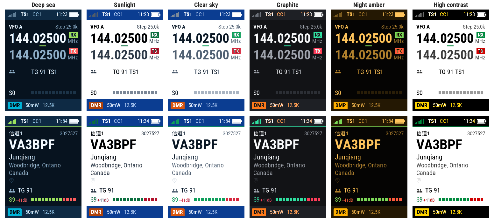

Outdoors take a light theme and the brightness up: a dark background can't be seen in daylight. New themes are a file
each in the source (`src/graphics/themes/`).

### Sound options

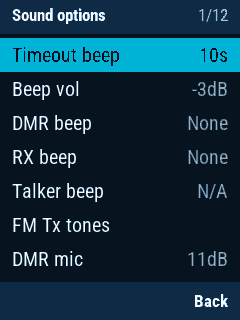 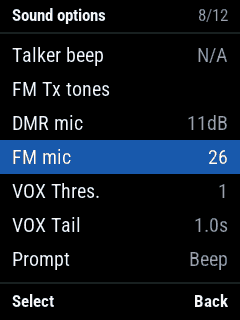

| Row | |
|---|---|
| Timeout beep | Seconds before the transmit timeout when the warning starts |
| Beep vol | Volume of the key beeps and other beeps |
| DMR beep | DMR transmit start / stop beeps |
| RX beep | Beeps on receive: None / Carrier (when it ends) / Talker (when a DMR talker ends) / Talker+start (when it starts too) / Both (carrier and talker) / All |
| FM Tx tones | FM transmit tones (below) |
| DMR mic / FM mic | Microphone gain of each mode |
| VOX Thres. / VOX Tail | VOX: 0 = off, smaller is more sensitive; how long it keeps transmitting after you stop |
| Prompt | Silent (no key beeps, no prompt beeps) / Beep / No Keys (key beeps off, prompts still beep); no voice prompts yet |
| DMR Rx AGC | Automatic gain of DMR receive (off / 0 – 21 dB) |

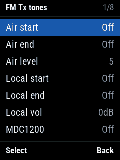

**FM Tx tones**: Air start / Air end (sent on the air, the other station hears them), Air level; Local start / Local
end (only on your speaker), Local vol; MDC1200 PTT ID (start / end / both); Tail elim (Off / Phase 240° / 55Hz).

### Key settings

See [12](#12-lock-quick-keys-key-settings).

### Language

The menu key or ◀ ▶ on Options → Language switches the language: English (built in) and the languages written to
the radio with the OpenDMR CPS's Languages page (from [opendmr-languages](https://github.com/va3bpf/opendmr-languages), see section 5 of the installation guide). The row is called Language in every language, so it can be found from one you cannot read. When a
language's font is not in the radio, its text shows as "??" and the menu gives its English name.

### Calibration

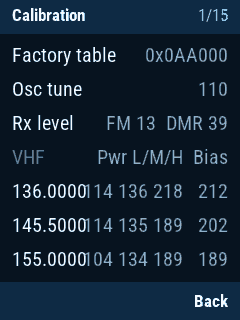

Read only: the factory calibration table (oscillator tune, receive level, power values at each frequency).
**This firmware never changes the factory calibration.**

The first row says where the calibration comes from:
- An address (e.g. 0x0C0000): the stock calibration sector. The firmware also keeps a copy of it in its own area.
- **Copy**: the stock sector is gone (another firmware or tool wrote over it); the copy kept earlier is used.
- **Default**: neither the stock sector nor a copy exists; a generic default table is used (two radios averaged, the
  lower power of the two). Digital modes transmit and receive, but frequency and power are not this radio's own.

Once the stock sector is back (a backup written back, for example), it is used again from the next start.

### APRS options

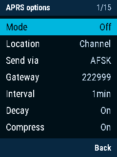 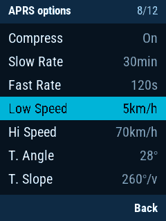

- Mode: Off / Manual (SK1 + 3 sends one) / PTT (after each transmission) / Auto (on the interval, with decay) /
  Smart (SmartBeaconing);
- Location: the fixed location of the channel's APRS configuration, or the GPS;
- Interval, Decay, Compress; for Smart: Slow / Fast Rate, Low / Hi Speed, Turn Angle / Slope / Time.
- SK1 + 1 switches APRS on / off at any time. Beacons are sent as AFSK (1200 baud) in FM.
- A bubble in the middle of the screen, over any screen, shows the beacon: a manual one (SK1 + 3, the menu's Send
  now), the PTT mode's and the satellite screen's show "APRS Sending..." and then "APRS Sent", or "Channel busy, not
  sent", "Not sent", "No fix"; Auto and Smart beacons show only "APRS Sent" (a busy channel is tried again and again,
  not shown each time). The bubble closes after a few seconds or at any key (that press only closes it; the PTT
  still transmits).
- The APRS configuration's "Beacon Tx frequency" (in the CPS) is the frequency the beacon is sent on, in every mode but
  PTT (the beacon goes out on the channel after each transmission). A channel opts in by naming a configuration: one
  without it never beacons, and a receive-only channel never beacons either. With no beacon frequency, an FM channel
  beacons on its own frequency; a DMR, P25, NXDN, AM or USB channel never beacons. PTT mode beacons only on FM
  channels. The radio's channel editor offers the APRS configuration only on FM channels; on a DMR, P25 or NXDN channel
  it can only be set with the CPS. While the beacon goes out the radio tunes FM to that frequency for the frame and
  comes back: the channel you had selected is left as it was, and a call being received holds the beacon for the next
  round.
- "Transmit QSY" (in the APRS configuration, in the CPS): the beacon's comment begins with the channel's voice
  frequency, its Tx tone and offset, e.g. "146.520MHz T100 +000" (Toff: no tone; lower case on a narrow channel),
  which aprs.fi and APRS radios read as the frequency to call you on.
- Send via: **AFSK** (the default: the FM beacon above) / **DMR** / **Both**. DMR: on a DMR channel the position goes
  to an APRS gateway as an LRRP data report, without retuning, on the channel's own timeslot and colour code; it waits
  for a free channel first (2 s at most), and a PTT pressed while it is sent waits for it, then the voice goes out. The
  radio needs its DMR ID. Both: each path the channel can take; on a DMR channel with a beacon frequency the AFSK
  beacon goes first, then the LRRP report.
- Gateway: the DMR ID of the gateway that receives the LRRP reports, 222999 by default (BrandMeister's APRS gateway);
  the menu key opens the number entry.
- Send via and the gateway are kept in the radio, not in the CPS's settings. Sending over DMR is still experimental: a
  gateway decoding the report hasn't been confirmed yet.

---

## 12. Lock, quick keys, key settings

### Keypad lock

- In the main menu, **\*** locks the keypad, **#** locks the PTT (again: unlocks the PTT); the radio goes home.
- On a main screen, **SK1 held alone** (about half a second, then released) locks the keypad too; Key settings →
  Lock moves it to other keys. Held with another key (SK1 + ▲ ...) it doesn't lock. SK2 held is a modifier (Delete
  in the messages, Close in the dual watch) and doesn't lock.
- While locked, a key shows the lock page for a moment; **SK1 + \*** unlocks (SK2 + \* can't be pressed on the
  DM-32: a held SK2 hides the keys 1, 4, 7, \*). With only the keypad locked the PTT still transmits.
- General options → Auto lock: locks the keypad and the PTT after a time without use.
- While the cable is in use (CPS, firmware update) the radio doesn't lock, and the auto lock time starts again after
  it.

### PINs

Both are off by default; General options → **Lock PIN** and **Power-on PIN** turn them on (the first one asks for a
new PIN, 4 - 6 digits, twice), **Change PIN** sets another one (for both).

- **Lock PIN**: a lock (manual or auto) also locks the PTT and shows the lock screen (the time, nothing of the
  channel); any key asks for the PIN (a digit counts as its first one). Reception goes on; the VOX does not
  transmit. The radio also starts locked.
- **Power-on PIN**: the radio asks for the PIN when it starts, with the receiver off; nothing else works until it is
  entered.
- While the radio waits for the PIN or is locked with the lock PIN, the cable answers nothing: no CPS, no firmware
  update, no hotspot. The CPS can't change the PINs, and a firmware update keeps them.
- Five wrong PINs in a row: wait 30 s before the next try.
- **Don't forget the PIN.** A forgotten PIN can only be cleared through the chip's bootloader: switch the radio
  off, run `tools/debug/pin_wipe.py COMx`, switch the radio on (no key) within 30 s. It clears the PIN only (the
  codeplug and the settings stay); switch the radio off and on.
- The PINs keep the radio from being used. They don't keep its flash from being read: the chip's bootloader reads
  the whole flash for anyone with the cable and a tool.

### Quick keys (SK2 + digit)

- On a menu row, or on a contact or zone in their lists, **SK2 + a digit** stores it on that digit (a confirmation
  beep).
- On a main screen **SK2 + the digit** opens that menu / goes to that zone / uses that contact.

### Key settings

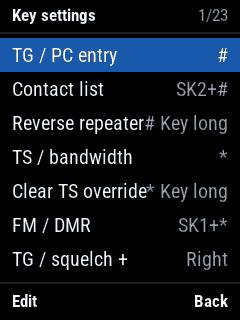 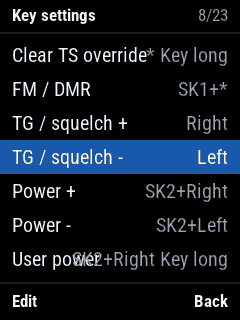 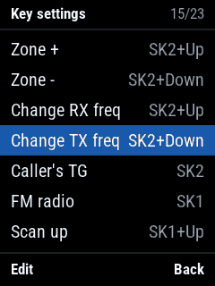

One row an action with its keys (the defaults: [1](#shortcuts-on-the-main-screens-defaults)); a long press shows as
`long` after the keys (`SK2+Right long`).

- The menu key on a row, then the new keys: SK1 / SK2 held with another key, a short or a long press, or SK1 or SK2
  alone. The back key keeps the old keys.
- The menu key, the back key and the PTT can't be used; ▲ ▼ and the digits only with a side key.
- Keys that belonged to another action are taken from it (shown).
- The last row puts the defaults back. Saved when the screen is left.

---

## 13. CPS, hotspot, firmware update

### Writing the codeplug (CPS)

The OpenGD77 CPS (download it from <https://www.opengd77.com/>: see the [installation guide](installation.en.md)), Radio type **DM32/UV008**. While it reads or writes, the radio shows which part
(channels, zones, contacts, ...) and how far. The CPS doesn't read or write the radio's settings.

It writes: channels, zones, contacts, TG lists, DTMF contacts, APRS configurations, satellite keps, the DMR ID
database (for the callers' names).

### DMR ID database with places

OpenDMR also reads a database of its own, with each caller's callsign, name, city, state and country (from
RadioID's list: about 317 000 IDs in 3.5 MB). It is written with the programming cable, from a computer with Python 3
and pyserial:

```
py tools\ids\id_db.py build                  (downloads RadioID's list and packs it: ids.bin)
py tools\ids\id_db.py write COM6             (the radio on, the cable in)
```

`build --countries "Canada,United States"` keeps only those countries (smaller, written faster). The first write takes
about 3 minutes (the cable goes up to 750 000 baud; `--baud 250000` or so for a cable that isn't reliable); writing a newer list again only sends the parts that changed.
While it is there it is used instead of the CPS's database; RadioID's list has no surnames.

### DMR hotspot (MMDVM)

1. General options → Hotspot: **MMDVM** or **BlueDV**;
2. Plug in the programming cable and run MMDVMHost (or BlueDV) on the computer with the cable's serial port;
3. When the computer starts talking MMDVM, the radio shows the hotspot screen: the calls in and out or the host's IP
   address, the frequency and the power.

Simplex (DMO); the frequency, colour code and power are set by the host. The hotspot ends when MMDVMHost is silent for
20 s; with BlueDV, with the back key. The CPS works while the hotspot runs.

### Firmware update

With OpenDMR running and the cable in: `python tools\debug\fw_update.py`. Only the changed sectors are written
(about 35 s), the screen shows the progress, the radio restarts at the end. First install and going back to the stock
firmware: see the README.

---

## 14. Current limits

- No voice prompts (the radio has no voice data).
- The calibration is read only: power and oscillator can't be changed.
- Safe Pwr-On and Sat (Manual / Auto) have no effect yet.
- P25: simplex group calls in clear only; known issues in [docs/p25.md](p25.md), section 6.
- NXDN: NXDN48 simplex in clear only (no NXDN96, trunking or encryption); a caller shows as its ID, there is no NXDN
  ID to callsign database yet.
- M17: simplex voice and text messages only (no other packet data, no encryption), always to ALL; the voice is duller than DMR / NXDN (Codec 2
  3200).
- YSF: simplex V/D-1 and DN voice in the clear only (no VW/IMBE, encryption, trunking or data); no callsign database
  yet. The MMDVM hotspot mode remains DMR-only.
- Not fully tested on the air yet: YSF, the hotspot's CW ID, satellite passes, talkaround, distance sort.
