# OpenDMR user manual

For the **Baofeng DM-32 / DM-32UV** running the OpenDMR firmware. 中文版：[manual.md](manual.md).

Every picture is a real screenshot from the radio (`tools/debug/fshot.py`, 240×320). The location on the GPS and
radio info screens is blurred.

> This manual matches firmware 25340747 (2026-11-07). Installing, upgrading and going back to the stock firmware:
> the [installation guide](installation.en.md).
> **Back up both flash chips before flashing anything**: the backup holds this radio's own calibration.

## Contents

1. [Keys](#1-keys)
2. [The screen](#2-the-screen)
3. [Channel mode](#3-channel-mode)
4. [VFO mode](#4-vfo-mode)
5. [Receiving](#5-receiving)
6. [Transmitting](#6-transmitting)
7. [Scanning](#7-scanning)
8. [Dual watch](#8-dual-watch)
9. [Contacts and who you call](#9-contacts-and-who-you-call)
10. [The main menu](#10-the-main-menu)
11. [Options](#11-options)
12. [Lock, quick keys, key settings](#12-lock-quick-keys-key-settings)
13. [CPS, hotspot, firmware update](#13-cps-hotspot-firmware-update)
14. [Current limits](#14-current-limits)

---

## 1. Keys

| Key | What it does |
|---|---|
| **Menu key** (left, under the screen) | Menu / OK. On the main screens a **short press opens the menu of that screen** (quick menu), a **long press the main menu** |
| **Back key** (right, under the screen) | Back / delete a digit. **Long press: home.** On the channel screen a short press goes to the VFO, on the VFO back to the channel |
| ▲ ▼ | Channel (channel mode), frequency (VFO), move in lists |
| ◀ ▶ | Change the value of the selected row in lists; on the main screens the talk group (DMR) or the squelch (FM) |
| Knob | As ▲ ▼ |
| SK1, SK2 (side keys) | Alone they have their own function; held with another key they make combinations (below) |
| PTT | Transmit |
| Digits, *, # | Channel numbers, frequencies, numbers; shortcuts on the main screens |

The two labels of the bottom bar say what the menu key and the back key do on that screen (Select, OK, Save, Edit,
Back, Delete, ...).

### Shortcuts on the main screens (defaults)

All of these can be changed in Options → Key settings (see [12](#12-lock-quick-keys-key-settings)).

| Keys | DMR | FM |
|---|---|---|
| # | Enter a talk group / private call number | Enter DTMF |
| SK2 + # | Contact list | DTMF contact list |
| # long | Reverse repeater (channel mode only) | Same |
| * | Timeslot | Bandwidth 12.5 / 25 kHz |
| * long | Back to the channel's own timeslot | — |
| SK1 + * | FM / DMR | Same |
| ▶ / ◀ | Talk group + / − (through the RX group list) | Squelch + / − |
| SK2 + ▶ / ◀ | Power + / − | Same |
| SK2 + ▶ long | User power | Same |
| SK2 + ▲ / ▼ | Zone + / − (channel mode); transmit frequency + / − (VFO) | Same |
| SK2 alone | Call back the talk group just heard | — |
| SK1 alone | FM broadcast radio | Same |
| SK1 + ▲ / ▼ | Scan up / down | Same |
| SK1 + 1 | APRS on / off | Same |
| SK1 + 2 | Send an APRS beacon now | Same |

Also: SK2 + menu key opens the channel details directly; SK2 + a digit is a quick key (see [12](#12-lock-quick-keys-key-settings)).

---

## 2. The screen

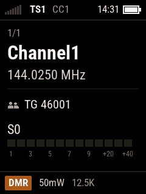 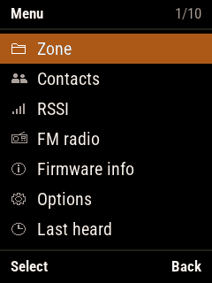

- **Status bar** (top): signal bars, timeslot `TS1`/`TS2`, colour code `CC1`, scan icon, time, battery. A green line
  under it while receiving; the whole bar turns red while transmitting.
- **Main area**: on the channel screen the zone and position, the channel name (large), the frequency, the talk
  group, the S meter.
- **Bottom bar**: on the main screens the mode (`DMR`/`FM`), power and bandwidth; on lists what the two keys do.
- **Lists** (menus, settings): the title bar shows the name and the position (`1/10`), the selected row is orange,
  7 rows a page, ▲ ▼ wrap around at the ends.

Colours mean something: green = receive, red = transmit, orange = selected / current, amber = warning (low battery,
scan, timeout near).

---

## 3. Channel mode

The radio starts in channel mode (in the VFO when it was left there).

| To | Keys |
|---|---|
| Change channel | ▲ ▼ or the knob |
| Go to channel N of the zone | Type the number, then the menu key (back key cancels) |
| Change zone | SK2 + ▲ ▼, or main menu → Zone |
| Talk group / squelch | ▶ ◀ |
| Power | SK2 + ▶ ◀ |
| Timeslot / bandwidth | * |
| Go to the VFO | Back key |
| Menu of the channel | Menu key |
| Channel details | SK2 + menu key, or the first row of the menu |

### Channel quick menu (menu key)

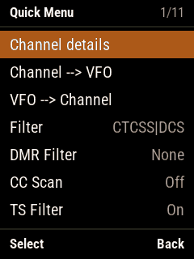 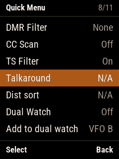

▲ ▼ choose a row, ◀ ▶ change its value, the menu key applies it and closes the menu, the back key closes it without
changes.

| Row | What it does |
|---|---|
| Channel details | All the settings of this channel (below) |
| Channel --> VFO | Copy this channel into the VFO in use, then go to the VFO |
| VFO --> Channel | Overwrite this channel with the VFO in use (asks first) |
| Filter | Analogue tone filter: `CTCSS\|DCS` hears only signals with the right tone, `None` hears all |
| DMR Filter | None / this talk group / this contact / the talk groups of the RX group list |
| CC Scan | On: finds the colour code by itself (the colour code filter off) |
| TS Filter | On: only the channel's timeslot is heard |
| Talkaround | On a repeater channel: talk direct on the receive frequency |
| Dist sort | Channels of the zone in order of distance from you (needs your location) |
| Dual Watch | Dual watch on / off (see [8](#8-dual-watch)) |
| Add to dual watch | Put this channel into a dual watch path (the path it replaces is shown on the right) |

### Channel details

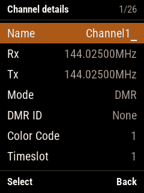 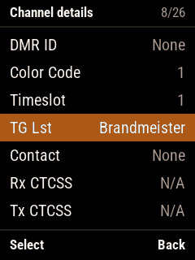 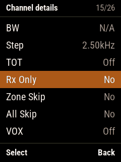 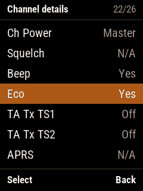

Name, receive and transmit frequencies, mode, DMR ID, colour code, timeslot, TG list, contact, receive and transmit
CTCSS/DCS, bandwidth, step, transmit timeout, Rx only, zone skip, all skip, VOX, channel power, squelch, beep, eco,
talker alias transmit on TS1 / TS2, APRS configuration.

- ▲ ▼ choose, ◀ ▶ or the knob change;
- Frequencies and the DMR ID are typed with the digits (8 digits, ◀ deletes one); ◀ ▶ on Rx / Tx set Tx to Rx plus a
  repeater shift;
- Name: letters on the digit keys, ◀ ▶ move, SK2 + ◀ deletes, SK2 + ▶ inserts;
- TG list, contact and APRS configuration are chosen by name;
- **The menu key saves** (into the codeplug) and goes home; **the back key leaves without saving**.

---

## 4. VFO mode

The back key on the channel screen goes to the VFO, the back key again back to the channel. There are two VFOs (A
and B): **hold the back key** to switch, or choose in the VFO menu.

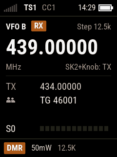 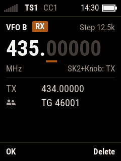

| To | Keys |
|---|---|
| Change the receive frequency | ▲ ▼ or the knob (one step) |
| Change the transmit frequency | SK2 + knob, or SK2 + ▲ ▼ |
| Type a frequency | Digits (e.g. `43500000`: it is set after the 8th digit, or with the menu key; the back key deletes one) |
| Swap Rx and Tx while held | SK1 + SK2 |
| FM / DMR | SK1 + * |
| Squelch (FM) / talk group (DMR) | ▶ ◀ |

The top line shows which frequency is being changed (`RX` or `TX`) and the step.

### VFO quick menu (menu key)

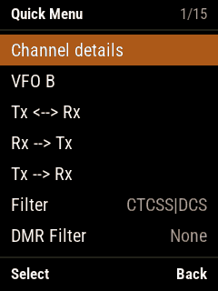 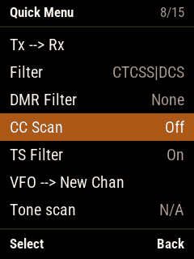 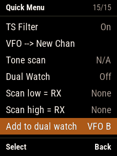

| Row | What it does |
|---|---|
| Channel details | All the settings of this VFO (as the channel details) |
| VFO B / VFO A | The menu key on this row switches VFO |
| Tx <--> Rx | Swap the frequencies |
| Rx --> Tx / Tx --> Rx | Copy the receive frequency to transmit / the other way |
| Filter, DMR Filter, CC Scan, TS Filter | As in the channel menu |
| VFO --> New Chan | Save the VFO as a new channel ("New channel N", in All Channels) |
| Tone scan | Find the CTCSS / DCS tone the other station uses (any key stops on the tone found) |
| Dual Watch, Add to dual watch | See [8](#8-dual-watch) |
| Scan low = RX / Scan high = RX | The receive frequency becomes the lower / upper limit of the VFO scan |

---

## 5. Receiving

 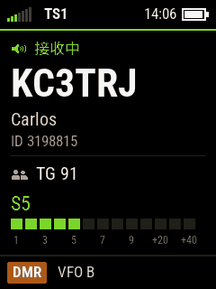

(These two were taken with the Chinese interface: "接收中" is "Receiving".)

- A received signal: the green line under the status bar, green signal bars, the S meter value in green; above S9
  the excess is shown in small red figures (`+xxdB`).
- DMR: "Receiving", the caller (callsign or DMR ID, large), the name, the ID, the talk group. The caller shows within
  about 0.7 s. Names come from the contacts and from the DMR ID database written by the CPS.
- Calls go into Last heard. **SK2** calls back the talk group just heard (a private call: the caller).
- FM: audio when the squelch opens; ▶ ◀ change the squelch, shown on the screen for a moment.

---

## 6. Transmitting

Hold the **PTT** to transmit, release it to stop. The transmit screen (no screenshot in this manual):

- The status bar turns red, with `TX` (and the timeslot and colour code in DMR);
- Main area: who is called ("Group Call" and the talk group, or the zone and the channel / VFO), the channel and the
  frequency, a large timer (with a transmit timeout: the time left and a bar, amber near the end), an 8 segment mic
  level;
- Repeaters: "Waking repeater" while waking it, "No repeater" when it doesn't answer;
- When the radio can't transmit (out of band, Rx only channel, timeout, no repeater) the reason stays on the screen
  until the PTT is released.

While transmitting:

- **FM**: **SK2** sends the 1750 Hz repeater tone; the digits send DTMF;
- Start / end tones, MDC1200 and the tail elimination are set in Sound options → FM Tx tones;
- **VOX**: Sound options → VOX Thres. (0 = off) and VOX Tail;
- **PTT latch** (Radio options): one press of the PTT starts transmitting, another one stops.

---

## 7. Scanning

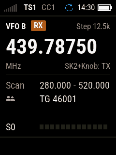

- **SK1 + ▲** scans up, **SK1 + ▼** down. In channel mode the zone is scanned (channels with Zone Skip are skipped;
  in All Channels those with All Skip); in the VFO between the scan limits (without limits: the whole band). The
  status bar shows the scan icon.
- While scanning: **▲** goes on at once; **◀** reverses; when it has stopped on a signal, **\*** skips that channel /
  frequency as a nuisance (for this scan); **PTT** stops the scan and transmits; **any other key** stops it.
- Radio options: Scan delay (how long it stays), Scan dwell, Scan mode (Hold / Pause / Stop), Scan On Boot.

---

## 8. Dual watch

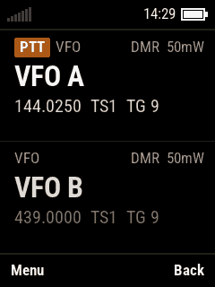

Two paths watched at once, each **any channel or VFO A / B** (both may be the same).

- Switch it on: Dual Watch in the channel or VFO menu. The default paths are VFO A and VFO B; "Add to dual watch" on
  a channel or VFO puts it in (into the path shown on the right; the next add replaces the other path).
- The paths are watched in turn; a path with a signal is kept while the signal lasts and a moment after (for the
  answer).
- Transmit: on the path heard last (it has the `PTT` badge); ▲ / ▼ fix the upper / lower path for transmit.
- Menu key: the main menu; menu key held: the dual watch menu (off, the transmit path). Back key: back to the single
  watch. Kept over power off.

---

## 9. Contacts and who you call

### Entering a talk group / private call (#)

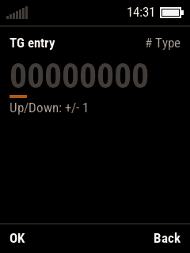

- **#** on a main screen. **#** cycles TG → PC → contact → own ID; ▲ ▼ add / subtract 1.
- The menu key takes it: a TG or PC replaces the channel's contact for now; a contact also brings its timeslot;
  **the own ID is written into the codeplug** (kept after power off).
- In FM # is the DTMF entry: digits, * and # type the code, ◀ deletes, the menu key sends it.

### Contact list (SK2 + #)

SK2 + # on a main screen: choose one and press the menu key, it becomes the transmit target at once.

### Main menu → Contacts

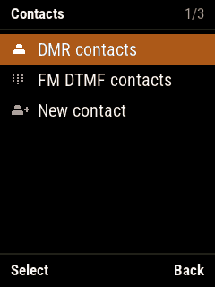 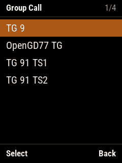 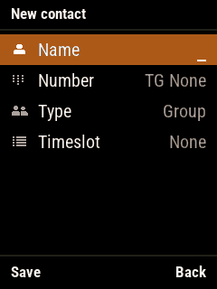

- **DMR contacts**: one call type at a time, **#** changes it (group / private / all call). The menu key opens the
  actions: Select TX, Edit Contact, Delete Contact (deleting asks first; a talk group used by an RX group list can't
  be deleted).
- **FM DTMF contacts**: DTMF numbers for FM.
- **New contact**: name (letters on the digit keys), number, type, timeslot; the menu key saves it.

---

## 10. The main menu

**Hold the menu key** on a main screen.

 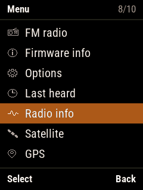

### Zone

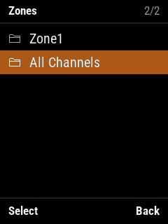

Choose the zone; "All Channels" is every channel of the codeplug.

### RSSI

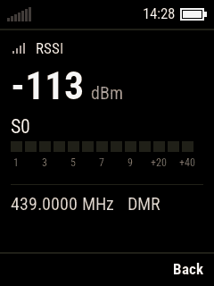

dBm (large), S meter, frequency and mode. * shows the raw signal and noise readings too.

### FM radio (SK1)

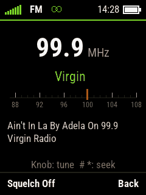

87 – 108 MHz broadcast, with the RDS station name and text, stereo in the status bar.

- Knob or ◀ ▶: 100 kHz steps; **#** / **\***: seek up / down; digits: a frequency (`999` = 99.9 MHz, `1071` =
  107.1 MHz);
- Menu key: squelch on / off (muted when there is no station);
- Back key, SK1 or PTT: leave (the receiver off). The frequency and the squelch are kept; turned off on this screen,
  the radio starts on it again.

### Firmware info

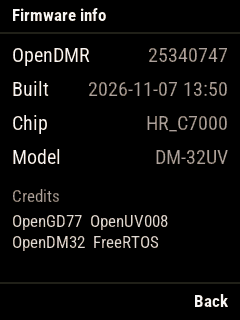

Version (git commit), build time, chip, model, credits.

### Last heard

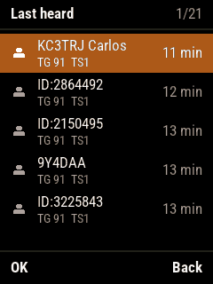

Two lines a call: the caller (callsign and name, or ID), the talk group and timeslot, how long ago on the right.
▲ ▼ move (SK2 + ▲ ▼: first / last); menu key: transmit to that talk group from now on (SK2 + menu key: a private
call to the caller); **#** held clears the list.

### Radio info

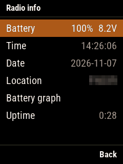

Battery, time, date, location (Maidenhead locator), battery graph, up time. The menu key on time, date or location
opens its page to type it with the digits (the menu key sets it; on the location page ▲ ▼ choose N / S, SK2 + ▲ ▼
E / W). The battery graph has a point every 40 s (6.4 – 8.2 V).

### Satellite

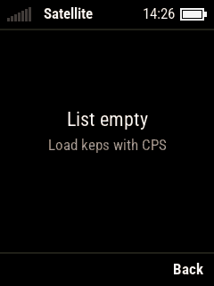

Needs **the time and your location** (Radio info, or the GPS) and **the satellite keps written by the CPS**. Then:
the coming passes of all the satellites; open one for the pass (polar track, azimuth / elevation) and the Doppler
corrected frequencies (the menu key switches voice / APRS / other). The pass screen tunes the radio with the Doppler
correction, and the PTT transmits on the corrected frequency of that moment. Without keps: "List empty — Load keps
with CPS".

### GPS

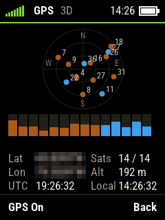

Sky plot (GPS blue, BeiDou orange, filled when used), signal bars of the satellites, latitude and longitude,
satellites, altitude, UTC and local time. **The menu key switches the GPS on / off.** With a fix the clock is set from
the GPS; APRS and the satellite screen can use the GPS location.

---

## 11. Options

Main menu → Options. On every settings list: ▲ ▼ choose, **◀ ▶ change the value**, the menu key opens a sub list or
toggles, the back key goes back. Settings work at once and are saved at power off. **The CPS doesn't read or write
these settings.**

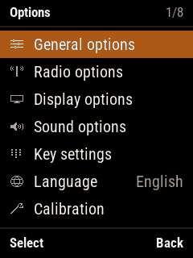

### General options

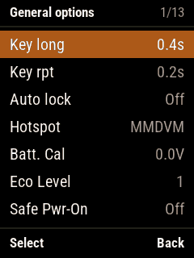 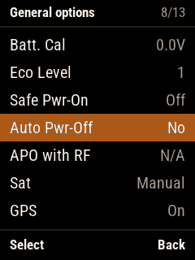

| Row | |
|---|---|
| Key long / Key rpt | Long press time; repeat interval of a held key |
| Auto lock | Locks the keypad and the PTT after this long without use (Off / minutes) |
| Hotspot | Off / MMDVM / BlueDV (see [13](#13-cps-hotspot-firmware-update)) |
| Batt. Cal | Correction of the battery voltage shown (±0.5 V) |
| Eco Level | How much the receiver saves power |
| Safe Pwr-On | Kept for later: no effect in this firmware yet |
| Auto Pwr-Off / APO with RF | Power off after this long without use; with the second on, a received signal counts as use |
| Sat | Kept for later (Manual / Auto): no effect yet |
| GPS | Off / On / NMEA (NMEA sentences out of the programming cable) |
| Keep menu places | On: the menus open where they were left, also after power off (off: only until power off) |
| User DMR ID | Your DMR ID; the menu key opens the number entry |

### Radio options

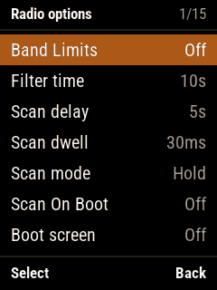 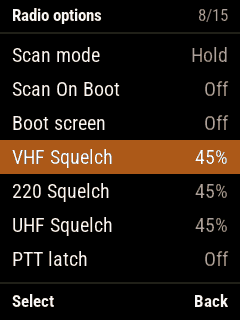 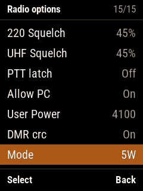

| Row | |
|---|---|
| Band Limits | Off / On (amateur bands) / CPS (as set in the CPS) |
| Filter time | After a DMR talk group is heard, only that one is heard for this long |
| Scan delay, Scan dwell, Scan mode, Scan On Boot | See [7](#7-scanning) |
| Boot screen | Boot screen and boot melody at power on (off by default: straight to the main screen) |
| VHF / 220 / UHF Squelch | Default squelch of the channels of each band |
| PTT latch | One press of the PTT starts transmitting, another one stops |
| Allow PC | Off / On / PTT (a private call heard: the PTT calls back) |
| User Power | PA drive of the "user" power level (steps of 10 with SK2 held) |
| DMR crc | Off: DMR data CRC errors are ignored |
| Mode | 5 W or 10 W radio |

### Display options

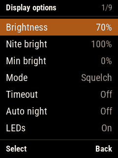 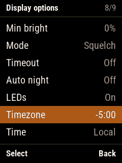

Brightness (day), Nite bright, Min bright (the backlight when "off"); Mode (Auto / Squelch / Manual / Buttons),
Timeout; Auto night; LEDs; Timezone (an hour a step, a quarter with SK2 held); Time shown in UTC or local time.

### Sound options

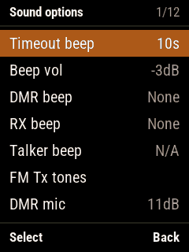 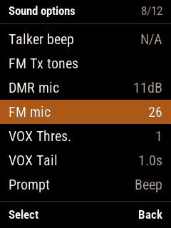

| Row | |
|---|---|
| Timeout beep | Seconds before the transmit timeout when the warning starts |
| Beep vol | Volume of the key beeps and other beeps |
| DMR beep | DMR transmit start / stop beeps |
| RX beep | Beep at the end of a carrier / talker |
| Talker beep | Beep when a talker starts too |
| FM Tx tones | FM transmit tones (below) |
| DMR mic / FM mic | Microphone gain of each mode |
| VOX Thres. / VOX Tail | VOX: 0 = off, smaller is more sensitive; how long it keeps transmitting after you stop |
| Prompt | Silent / Beep / No Keys (no voice prompts yet) |
| DMR Rx AGC | Automatic gain of DMR receive (off / 0 – 21 dB) |

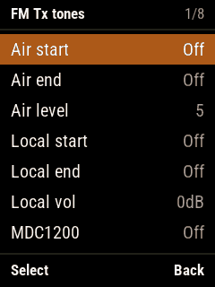

**FM Tx tones**: Air start / Air end (sent on the air, the other station hears them), Air level; Local start / Local
end (only on your speaker), Local vol; MDC1200 PTT ID (start / end / both); Tail elim (Off / Phase 240° / 55Hz).

### Key settings

See [12](#12-lock-quick-keys-key-settings).

### Language

The menu key or ◀ ▶ on Options → Language switches English / 中文.

### Calibration

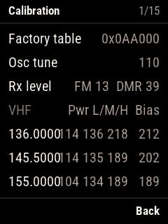

Read only: the factory calibration table (oscillator tune, receive level, power values at each frequency).
**This firmware never changes the calibration.**

### APRS options

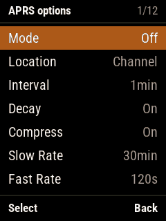 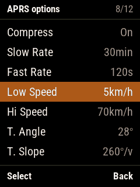

- Mode: Off / Manual (SK1 + 2 sends one) / PTT (after each transmission) / Auto (on the interval, with decay) /
  Smart (SmartBeaconing);
- Location: the fixed location of the channel's APRS configuration, or the GPS;
- Interval, Decay, Compress; for Smart: Slow / Fast Rate, Low / Hi Speed, Turn Angle / Slope / Time.
- SK1 + 1 switches APRS on / off at any time. Beacons are sent as AFSK (1200 baud) in FM.

---

## 12. Lock, quick keys, key settings

### Keypad lock

- In the main menu, **\*** locks the keypad, **#** locks the PTT (again: unlocks the PTT); the radio goes home.
- While locked, a key shows the lock page for a moment; **SK2 + \*** unlocks. With only the keypad locked the PTT
  still transmits.
- General options → Auto lock: locks the keypad and the PTT after a time without use.

### Quick keys (SK2 + digit)

- On a menu row, or on a contact or zone in their lists, **SK2 + a digit** stores it on that digit (a confirmation
  beep).
- On a main screen **SK2 + the digit** opens that menu / goes to that zone / uses that contact.

### Key settings

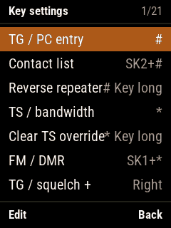 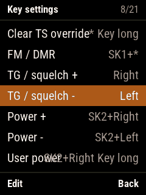 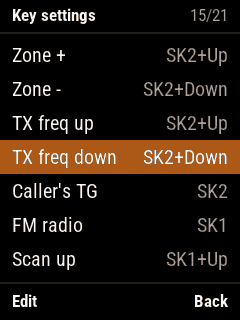

One row an action with its keys (the defaults: [1](#shortcuts-on-the-main-screens-defaults)).

- The menu key on a row, then the new keys: SK1 / SK2 held with another key, a short or a long press, or SK1 or SK2
  alone. The back key keeps the old keys.
- The menu key, the back key and the PTT can't be used; ▲ ▼ and the digits only with a side key.
- Keys that belonged to another action are taken from it (shown).
- The last row puts the defaults back. Saved when the screen is left.

---

## 13. CPS, hotspot, firmware update

### Writing the codeplug (CPS)

The OpenGD77 CPS (download it from <https://www.opengd77.com/>: see the [installation guide](installation.en.md)), Radio type **DM32/UV008**. While it reads or writes, the radio shows which part
(channels, zones, contacts, ...) and how far. The CPS doesn't read or write the radio's settings.

It writes: channels, zones, contacts, TG lists, DTMF contacts, APRS configurations, satellite keps, the DMR ID
database (for the callers' names).

### DMR hotspot (MMDVM)

1. General options → Hotspot: **MMDVM** or **BlueDV**;
2. Plug in the programming cable and run MMDVMHost (or BlueDV) on the computer with the cable's serial port;
3. When the computer starts talking MMDVM, the radio shows the hotspot screen: the calls in and out or the host's IP
   address, the frequency and the power.

Simplex (DMO); the frequency, colour code and power are set by the host. The hotspot ends when MMDVMHost is silent for
20 s; with BlueDV, with the back key. The CPS works while the hotspot runs.

### Firmware update

With OpenDMR running and the cable in: `python tools\debug\fw_update.py`. Only the changed sectors are written
(about 35 s), the screen shows the progress, the radio restarts at the end. First install and going back to the stock
firmware: see the README.

---

## 14. Current limits

- No voice prompts (the radio has no voice data).
- The calibration is read only: power and oscillator can't be changed.
- No themes: the interface has fixed colours.
- Safe Pwr-On and Sat (Manual / Auto) have no effect yet.
- Not fully tested on the air yet: APRS decoding, the hotspot's CW ID, satellite passes, talkaround, distance sort.
