# Manual de usuario de OpenDMR

Para el transceptor **Baofeng DM-32 / DM-32UV** ejecutando el firmware OpenDMR. English: [manual.en.md](manual.en.md) | 中文版：[manual.md](manual.md).

Todas las imágenes corresponden a capturas de pantalla reales tomadas directamente desde el radio (`tools/debug/fshot.py`, resolución 240×320). La ubicación en las pantallas de GPS e información de radio se encuentra difuminada por privacidad.

> Este manual corresponde a las versiones de firmware 25340747 y superiores. Instalación, actualización y retorno al firmware original: consulta la [guía de instalación](installation.es.md).  
> **Haz una copia de seguridad de ambos chips de memoria flash antes de flashear**: el respaldo almacena los datos de calibración propios e irrepetibles de tu radio.

## Contenido

1. [Teclas](#1-teclas)
2. [La pantalla](#2-la-pantalla)
3. [Modo canal](#3-modo-canal)
4. [Modo VFO](#4-modo-vfo)
5. [Recepción](#5-recepción)
6. [Transmisión](#6-transmisión)
7. [Escaneo](#7-escaneo)
8. [Doble escucha (Dual Watch)](#8-doble-escucha-dual-watch)
9. [Contactos y llamadas](#9-contactos-y-llamadas)
10. [El menú principal](#10-el-menú-principal)
11. [Opciones](#11-opciones)
12. [Bloqueo, teclas rápidas y configuración de teclas](#12-bloqueo-teclas-rápidas-y-configuración-de-teclas)
13. [CPS, punto de acceso (hotspot) y actualización de firmware](#13-cps-punto-de-acceso-hotspot-y-actualización-de-firmware)
14. [Limitaciones actuales](#14-limitaciones-actuales)

---

## 1. Teclas

| Tecla | Función |
|---|---|
| **Tecla de Menú** (izquierda, bajo la pantalla) | Menú / Aceptar. En pantallas principales, una **pulsación corta abre el menú rápido** de esa pantalla; una **pulsación larga abre el menú principal** |
| **Tecla de Retorno** (derecha, bajo la pantalla) | Atrás / borrar dígito. **Pulsación larga: volver a la pantalla de inicio**. En modo canal una pulsación corta pasa a VFO; en VFO vuelve a canal |
| ▲ ▼ | Cambiar canal (modo canal), cambiar frecuencia (VFO), desplazarse por listas y menús |
| ◀ ▶ | Cambiar el valor del elemento seleccionado en listas; en pantallas principales ajusta el Talkgroup (DMR) o el silenciador / squelch (FM) |
| Perilla superior | Misma función que ▲ ▼ |
| SK1, SK2 (teclas laterales) | Solas tienen funciones directas; mantenidas junto a otra tecla realizan combinaciones especiales (ver tabla abajo) |
| PTT | Transmitir |
| Teclas numéricas, *, # | Números de canal, frecuencias y datos; atajos directos en las pantallas principales |

Las dos etiquetas de la barra inferior indican en todo momento la función de la tecla de menú y de retorno en esa pantalla concreta (Selecc., OK, Guardar, Editar, Atrás, Eliminar, etc.).

### Atajos en las pantallas principales (por defecto)

Todos estos atajos pueden personalizarse en Opciones → Config. teclas (ver sección [12](#12-bloqueo-teclas-rápidas-y-configuración-de-teclas)).

| Teclas | Modo DMR | Modo FM |
|---|---|---|
| # | Ingresar número de Talkgroup o llamada privada | Ingresar código DTMF |
| SK2 + # | Lista de contactos DMR | Lista de contactos DTMF |
| # sostenido | Invertir frecuencias de repetidor (Reverse, solo en canal) | Misma función |
| * | Alternar ranura de tiempo (Timeslot TS1 / TS2) | Alternar ancho de banda 12.5 / 25 kHz |
| * sostenido | Volver al timeslot configurado en el canal | — |
| SK1 + * | Cambiar modo: FM → AM → USB → LSB → DMR → P25 → NXDN | Misma función |
| ▶ / ◀ | Talkgroup + / − (a través de la lista de grupos RX) | Nivel de squelch + / − |
| SK2 + ▶ / ◀ | Nivel de potencia + / − | Misma función |
| SK2 + ▶ sostenido | Acceso directo a potencia de usuario (+W-) | Misma función |
| SK2 + ▲ / ▼ | Zona + / − (modo canal); en VFO conmuta qué frecuencia modifican ▲ ▼ y la perilla (RX o TX) | Misma función |
| SK2 solo | Responder al último Talkgroup escuchado | — |
| SK1 solo | Radio comercial de difusión FM (87–108 MHz) | Misma función |
| SK1 + ▲ / ▼ | Iniciar escaneo hacia arriba / hacia abajo | Misma función |
| SK1 + 1 | Activar / desactivar balizas APRS | Misma función |
| SK1 + 3 | Enviar baliza APRS manualmente de inmediato | Misma función |

Además: **SK2 + tecla de menú** abre directamente los detalles del canal en uso; **SK2 + dígito** funciona como tecla rápida de acceso directo (ver sección [12](#12-bloqueo-teclas-rápidas-y-configuración-de-teclas)).

---

## 2. La pantalla

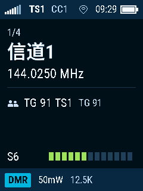 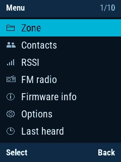

- **Barra de estado** (superior, sobre la franja del tema visual): nivel de señal (todas las barras visibles como en el medidor S, las activas en blanco), ranura de tiempo `TS1`/`TS2`, código de color `CC1` (en DMR), icono de escaneo, chincheta de GPS (apagada si el GPS está apagado, tenue mientras busca satélites, encendida con posición fijada), reloj y nivel de batería. Durante la recepción la barra completa pasa a color verde; en transmisión pasa a rojo con el icono de emisión en lugar de las barras de señal.
- **Área principal**: en modo canal muestra la zona y posición, nombre del canal (en tamaño grande), frecuencia de operación, Talkgroup y el medidor S.
- **Barra inferior**: en pantallas principales muestra el modo activo (`DMR`/`FM`/`AM`/`USB`/`LSB`/`P25`/`NXDN`), la potencia y el ancho de banda; en menús y listas describe las acciones de ambas teclas inferiores.
- **Listas y menús**: la barra de título muestra el nombre de la sección y la posición actual (`1/10`). La fila seleccionada utiliza el color de resalte del tema visual (azul cian en Deep sea). Cada página contiene 7 filas; al llegar al inicio o final de lista, ▲ ▼ giran cíclicamente.

El esquema de colores transmite información clara: verde = recepción, rojo = transmisión, color de resalte = elemento seleccionado, ámbar = avisos preventivos (batería baja, escaneo, límite de tiempo de transmisión próximo). El tema visual puede cambiarse en Opciones de pantalla → Tema.

---

## 3. Modo canal

El radio arranca normalmente en modo canal (o en VFO si se apagó estando allí).


| Para | Teclas |
|---|---|
| Cambiar de canal | ▲ ▼ o la perilla |
| Ir directo al canal número N de la zona | Escribir el número numérico y pulsar la tecla de menú (retorno cancela) |
| Cambiar de zona | SK2 + ▲ ▼, o desde Menú principal → Zona |
| Modificar Talkgroup / nivel de squelch | ▶ ◀ |
| Modificar potencia de salida | SK2 + ▶ ◀ |
| Alternar Timeslot / ancho de banda | * |
| Cambiar a modo VFO | Tecla de retorno |
| Abrir menú rápido del canal | Tecla de menú |
| Abrir detalles y parámetros del canal | SK2 + tecla de menú, o primera opción del menú rápido |

### Menú rápido de canal (tecla de menú)

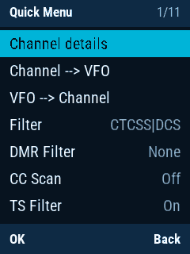 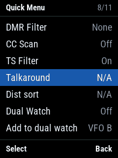

▲ ▼ seleccionan una opción, ◀ ▶ modifican su valor, la tecla de menú aplica el cambio y regresa, y la tecla de retorno cancela sin guardar.

| Opción | Acción |
|---|---|
| Detalles canal | Muestra y permite editar todos los parámetros del canal actual (ver abajo) |
| Canal --> VFO | Copia los parámetros de este canal al VFO en uso y conmuta al modo VFO |
| VFO --> Canal | Sobrescribe este canal con los datos del VFO en uso (solicita confirmación) |
| Filtro | Filtro de subtonos analógicos: `CTCSS\|DCS` reproduce únicamente transmisiones con el subtono exacto; `Ninguno` abre con cualquier señal |
| Filtro DMR | Ninguno / solo este Talkgroup / solo este contacto / Talkgroups de la lista RX |
| Escáner CC | Activado: detecta y sigue automáticamente el código de color de la transmisión |
| Filtro TS | Activado: únicamente se escucha la ranura de tiempo (timeslot) asignada al canal |
| Habla directa (Talkaround) | En canales de repetidor: conmuta a transmisión y recepción directa en la frecuencia de salida |
| Ordenar por dist. | Ordena los canales de la zona actual de más cercano a más lejano (requiere fijación GPS o coordenadas) |
| Doble escucha | Activa o desactiva la doble escucha (ver sección [8](#8-doble-escucha-dual-watch)) |
| Añadir a DW | Asigna este canal a una de las vías de la doble escucha |

### Detalles del canal

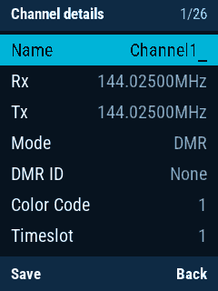 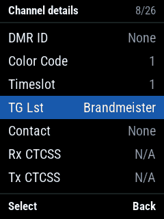 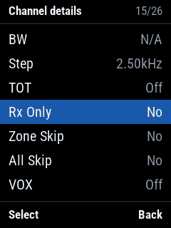 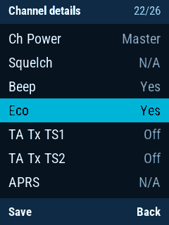

Nombre, frecuencias de recepción y transmisión, modo de modulación, ID de DMR, código de color (o código NAC en P25, RAN en NXDN), timeslot, lista de grupos TG, contacto TX, subtonos CTCSS/DCS de RX y TX, ancho de banda, salto de frecuencia (step), límite de tiempo de transmisión (TOT), solo recepción (Rx Only), omitir en escaneo de zona, omitir en escaneo total, VOX, potencia individual del canal, squelch, pitidos, modo de ahorro de energía (eco), transmisión de Talker Alias en TS1/TS2 y configuración de balizas APRS.

- ▲ ▼ seleccionan el parámetro, ◀ ▶ o la perilla ajustan su valor;
- Las frecuencias y el ID de DMR se ingresan numéricamente con el teclado (8 dígitos, ◀ borra el último número ingresado); al pulsar ◀ ▶ en Rx o Tx se aplica automáticamente el desplazamiento estándar de repetidor;
- Nombre: escritura alfanumérica en el teclado, ◀ ▶ desplazan el cursor, SK2 + ◀ borra, SK2 + ▶ inserta;
- **La tecla de menú guarda** los cambios directamente en el codeplug y regresa; **la tecla de retorno sale sin guardar**.

---

## 4. Modo VFO

Pulsar la tecla de retorno en la pantalla de canal conmuta al modo VFO; pulsándola de nuevo vuelve a canal. Existen dos VFO independientes (VFO A y VFO B): **mantén pulsada la tecla de retorno** para alternar entre ambos, o cámbialo en el menú rápido de VFO.

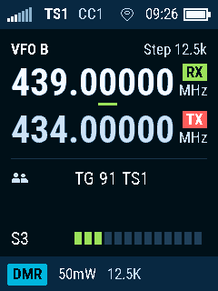 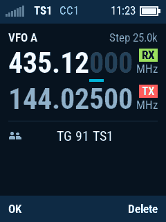

| Para | Teclas |
|---|---|
| Modificar la frecuencia activa | ▲ ▼ o la perilla (un salto o step) |
| Seleccionar si modificar RX o TX | SK2 + ▲ para RX / SK2 + ▼ para TX |
| Digitar una frecuencia directamente | Teclado numérico (ej. `43500000`: se establece al octavo dígito o con la tecla de menú; tecla de retorno borra) |
| Intercambiar momentáneamente RX y TX | SK1 + SK2 (mientras se mantengan presionadas) |
| Alternar modo: FM → AM → USB → LSB → DMR → P25 → NXDN | SK1 + * |
| Squelch (FM, AM, SSB) / Talkgroup (DMR, P25, NXDN) | ▶ ◀ |

Ambas frecuencias se muestran en dígitos grandes: la de recepción identificada con `RX` en verde y la de transmisión con `TX` en rojo. La frecuencia seleccionada para edición aparece en color blanco con el dígito correspondiente al step subrayado. La línea superior indica el VFO en uso (A o B) y el tamaño del step seleccionado.

**AM, USB y LSB son modos exclusivamente de recepción** (el chip de RF solo transmite en FM): la barra inferior mostrará `Solo RX`, y al pulsar PTT indicará "Cambie a FM o DMR". Su squelch se basa en el nivel de señal (0%: siempre abierto); se cierra cuando la señal cae por debajo del umbral durante 0.2 s (en AM) o 0.5 s (en USB/LSB), permitiendo que las pausas naturales de la voz no corten el audio. En USB y LSB la perilla permite sintonía fina a pasos de 100 Hz.

**Banda aérea (108 – 137 MHz)**: es **únicamente de recepción** en cualquier modo; utiliza modulación AM (SK1 + \*) para escucharla. El circuito frontal de RF del radio está optimizado para 137 MHz en adelante, por lo que la sensibilidad en banda aérea es menor. Al pulsar PTT mostrará "FUERA DE BANDA".

**P25** (Voz convencional APCO P25 Fase 1: simplex, llamadas de grupo, sin cifrado): la barra inferior muestra `P25`; bajo la frecuencia aparece el Talkgroup y a la derecha de esa línea el código NAC (ej. `NAC 293`).
- El **NAC** (código de acceso de red, 12 bits en hexadecimal, 293 por defecto) funciona de manera análoga al código de color de DMR: solo se escuchan transmisiones con el mismo NAC; el valor `F7E` abre con cualquier señal.
- Las llamadas cifradas se indican con un icono de candado y su audio no se reproduce.

**NXDN** (NXDN48, canalización estrecha de 6.25 kHz, voz convencional simplex en abierto): la barra inferior muestra `NXDN` y `6.25K`; bajo la frecuencia aparece el destino de transmisión junto con el código RAN a la derecha (ej. `RAN 1`).
- El **RAN** (número de acceso de radio, 0 al 63, 1 por defecto) actúa como el código de color: 0 recibe cualquier señal.
- Configura tu **ID de NXDN** en Opciones generales → ID NXDN (1 a 65535).

### Menú rápido de VFO (tecla de menú)

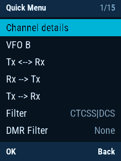 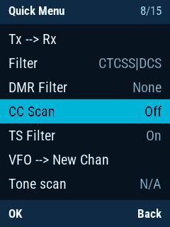 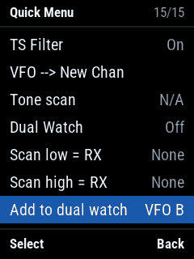

| Opción | Acción |
|---|---|
| Detalles canal | Muestra y permite ajustar todos los parámetros de este VFO |
| VFO B / VFO A | Conmuta entre el VFO A y el VFO B |
| Tx <--> Rx | Intercambia las frecuencias de recepción y transmisión |
| Rx --> Tx / Tx --> Rx | Copia la frecuencia de RX a TX o viceversa |
| Filtro, Filtro DMR, Escáner CC, Filtro TS | Mismas funciones descritas en el menú de canal |
| VFO --> Nuevo canal | Guarda la configuración actual del VFO como un canal nuevo en memoria |
| Rastreo subtono | Identifica automáticamente el subtono CTCSS o DCS de la estación recibida |
| Doble escucha, Añadir a DW | Funciones de doble escucha (ver sección [8](#8-doble-escucha-dual-watch)) |
| Lím. inf. escaneo / Lím. sup. escaneo | Define la frecuencia actual como límite inferior o superior del rango de escaneo en VFO |

---

## 5. Recepción

 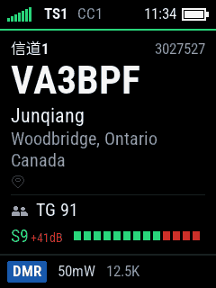

- Al recibir una señal: la barra de estado superior cambia a verde, las barras de señal se iluminan y el valor en dBm del medidor S se resalta en verde. Señales por encima de S9 se indican con el exceso en pequeños números rojos (`+xxdB`).
- Escala del medidor S: S1 corresponde a -121 dBm, con 6 dB por unidad, y S9 a -73 dBm. Las barras de señal siguen fielmente esta escala (1 barra en S1, escala completa a partir de S8).
- **Panel de corresponsal en DMR**:
  - Nombre del canal o VFO, con el ID de DMR del corresponsal a la derecha;
  - Indicativo (Callsign) en letras grandes (o su ID si no está en la base de datos);
  - Nombre de pila, ciudad, estado/provincia y país (procedentes de la base de datos de IDs; el país se deduce automáticamente de los primeros 3 dígitos del ID sin requerir base de datos);
  - Posición geográfica: si la transmisión incluye datos de ubicación GPS (ETSI GPS Info), se ilumina el icono de chincheta indicando la distancia y rumbo relativo respecto a tu posición actual (ej. `"12.3 km NE"`); si no tienes posición fijada, muestra las coordenadas del emisor;
  - Talkgroup de la llamada (o receptor en llamadas privadas) y medidor S.
- Todas las llamadas recibidas se registran en **Últ. escuchado**. Pulsar **SK2** permite responder de inmediato al Talkgroup recién escuchado (o al autor en una llamada privada).
- En canales DMR y P25, la pantalla muestra los dos últimos corresponsales recibidos (indicativo, nombre, tiempo transcurrido y Talkgroup o `PC`). Puede desactivarse en Opciones de pantalla → **Últ. llamadas**.
- En FM: el audio se reproduce al abrirse el squelch; pulsa ▶ ◀ para ajustar el umbral en pantalla. 0% mantiene el silenciador permanentemente abierto.

---

## 6. Transmisión

Mantén presionado el **PTT** para transmitir y suéltalo al finalizar. La pantalla de transmisión muestra:
- La barra de estado en rojo con el icono de emisión;
- Información del destinatario (Llamada de grupo y número de TG, o zona y canal), frecuencias activas, temporizador de transmisión con barra gráfica de aviso y un vúmetro de modulación de micrófono de 8 segmentos;
- En repetidores DMR: mensaje de "Activando repetidor" mientras envía la ráfaga de sincronismo, o "Sin repetidor" si no responde;
- Si la transmisión no está permitida (frecuencia fuera de banda, canal solo RX, tiempo agotado), el motivo permanecerá visible en pantalla hasta soltar el PTT.

Funciones durante la transmisión:
- **FM**: **SK2** envía el tono de 1750 Hz para apertura de repetidores; el teclado numérico genera tonos DTMF;
- **VOX**: ajustable en Opciones de sonido → Umbral VOX (0 = desactivado) y Retardo VOX;
- **Bloqueo PTT (PTT latch)**: disponible en Opciones de radio; una pulsación inicia la transmisión continua sin tener que mantener el PTT presionado, y una segunda pulsación (o tecla roja de retorno) la detiene. Requiere un límite TOT configurado para evitar transmisiones accidentales indefinidas.

---

## 7. Escaneo

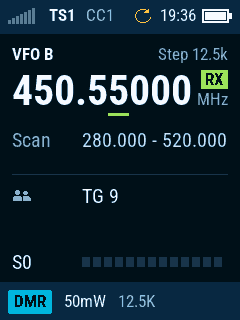

- **SK1 + ▲** inicia el escaneo ascendente; **SK1 + ▼** descendente. En modo canal escanea los canales de la zona (omitiendo aquellos marcados con Omitir zona); en VFO rastrea entre los límites definidos. La barra superior muestra el icono de escaneo.
- Controles durante el rastreo: **▲** continúa de inmediato; **◀** invierte el sentido; al detenerse sobre una portadora, pulsar **\*** bloquea temporalmente esa frecuencia o canal (**pulsación corta** hasta apagar el equipo; **pulsación larga** bloqueo permanente en el codeplug). **PTT** detiene el escaneo y transmite; **cualquier otra tecla** cancela el rastreo.
- Opciones de radio asociadas: Retardo escaneo (tiempo de permanencia al cesar la señal), Tiempo escaneo (permanencia en cada canal activo), Modo escaneo (Retener / Pausar / Detener) y Escaneo al encender.

---

## 8. Doble escucha (Dual Watch)

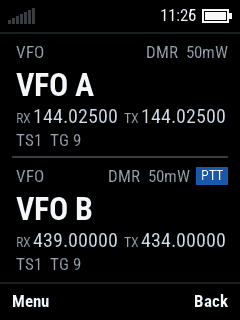

Permite monitorizar dos frecuencias o vías simultáneamente, combinando libremente **cualquier canal de memoria o los VFO A / B**:

- Se activa desde el menú rápido de canal o VFO (Doble escucha). Las vías por defecto son VFO A y VFO B; "Añadir a DW" permite incorporar el canal o VFO activo en pantalla.
- Las dos vías se comprueban secuencialmente. Cuando una recibe señal, permanece sintonizada mientras dure la transmisión y un breve lapso posterior para permitir contestar.
- Al transmitir, la emisión sale por la vía que haya transmitido en último lugar (señalizada con la etiqueta `PTT`); con las teclas ▲ / ▼ puedes forzar la vía superior o inferior para transmitir.
- La configuración se conserva al apagar y encender el radio.

---

## 9. Contactos y llamadas

### Entrada directa de Talkgroup / llamada privada (#)

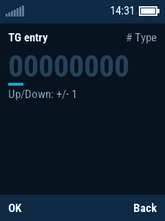

- Pulsa **#** en la pantalla principal. Cada pulsación consecutiva de **#** conmuta entre TG → Llamada Privada (PC) → Contacto → Mi propio ID; ▲ ▼ suman o restan 1.
- La tecla de menú confirma la selección para transmitir temporalmente a ese destino.
- En canales FM, la tecla # permite enviar secuencias DTMF directamente desde el teclado.

### Lista rápida de contactos (SK2 + #)


Permite elegir rápidamente un contacto de la lista y asignarlo como objetivo de transmisión pulsando la tecla de menú.

### Menú principal → Contactos

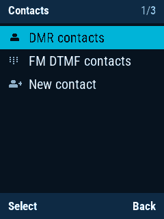 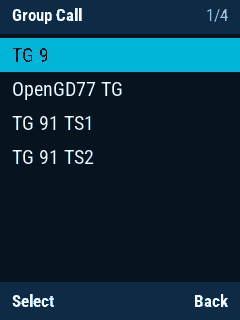 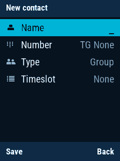

- **Contactos DMR**: organizados por tipo de llamada (Grupo / Privada / Todas las llamadas), alternables con **#**. La tecla de menú ofrece: Selecc. TX, Editar contacto o Eliminar contacto.
- **Contactos DTMF**: lista de marcaciones abreviadas en FM.
- **Nuevo contacto**: permite crear un contacto directamente en el radio ingresando nombre alfanumérico, número de ID, tipo y timeslot asignado.

---

## 10. El menú principal

Accede **manteniendo presionada la tecla de menú** en la pantalla principal.

 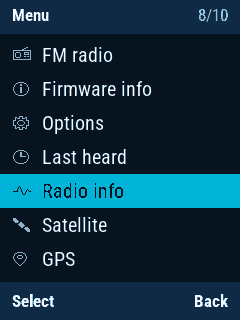

### Zona

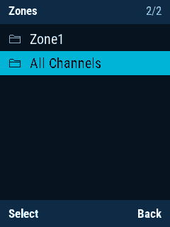

Permite cambiar de zona de trabajo. La opción "Todos los canales" agrupa la totalidad de canales almacenados en el codeplug.

### RSSI

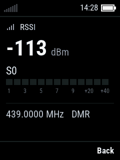

Visualiza la intensidad de señal de forma analítica en dBm (números grandes), medidor S, frecuencia y modo. Al pulsar **\*** muestra lecturas en bruto de señal y piso de ruido.

### Radio FM comercial (SK1)

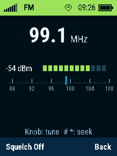

Receptor de difusión FM de 87 a 108 MHz, con decodificación de texto y nombre de estación por RDS e indicador de estéreo. Perilla o ◀ ▶ para pasos de 100 kHz; **#** y **\*** para búsqueda automática; tecla de menú para activar o desactivar silenciador de ruido.

### Info firmware

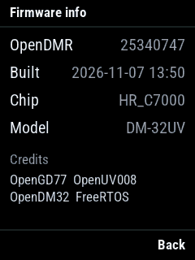

Versión del firmware (commit de git), fecha y hora de compilación, microcontrolador, modelo del equipo y créditos.

### Últ. escuchado

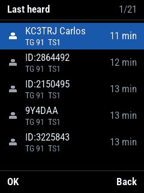

Registro cronológico de estaciones recibidas: indicativo, nombre o ID, Talkgroup, timeslot y tiempo transcurrido desde la recepción. La tecla de menú asigna de inmediato ese Talkgroup como objetivo TX (o llamada privada con SK2 + menú). Mantener pulsada la tecla **#** borra el historial.

### Info radio

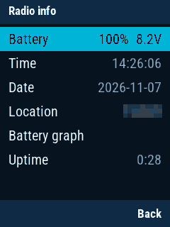

Tensión de batería, hora, fecha, localizador Maidenhead (Grid locator), gráfica de descarga de batería y tiempo de actividad. Pulsar la tecla de menú sobre la fecha, hora o ubicación permite editarlas manualmente.

### Satélite

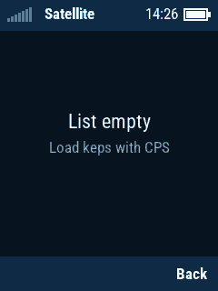

Requiere **hora exacta y tu ubicación geográfica** (ingresadas en Info radio o por GPS) junto con los **elementos orbitales keplerianos (keps)** cargados previamente mediante el CPS.  
Calcula y predice los pases orbitales de satélites de radioaficionados: diagrama de trayectoria polar, acimut, elevación y cálculo de corrección por efecto Doppler en tiempo real. La pantalla de pase sintoniza automáticamente las frecuencias corregidas y el PTT transmite con la compensación de Doppler al instante. En las frecuencias **APRS**, el PTT envía una baliza APRS a través del digirrepetidor del satélite en lugar de voz (como OpenGD77): usa la configuración APRS **con el mismo nombre que el satélite** (una llamada ISS con la ruta RS0ISS, SONATE-2 con DP0SNX...), creada en la página APRS del CPS, y la posición de las opciones APRS (GPS o fija). Sin una configuración con ese nombre, o sin posición: tono de error.

### GPS

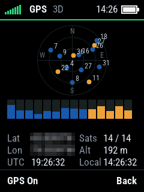

Vista de constelación (satélites GPS en azul, BeiDou en naranja), barras de intensidad relativa de cada satélite, coordenadas de latitud y longitud, altitud sobre el nivel del mar y hora UTC/local. **La tecla de menú enciende o apaga el módulo GPS**. Con posición fijada, sincroniza automáticamente el reloj interno del equipo y alimenta la ubicación para APRS y satélites.

---

## 11. Opciones

Acceso desde Menú principal → Opciones. En todas las listas: ▲ ▼ seleccionan, **◀ ▶ o la perilla cambian el valor**, la tecla de menú accede a submenús o confirma, y la tecla de retorno vuelve atrás. Los cambios se aplican de inmediato y se guardan al apagar.

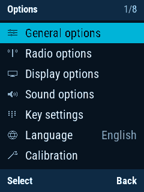

### Opciones generales

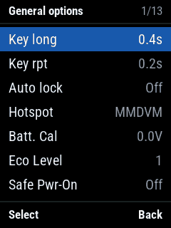 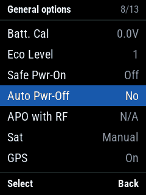

- **Puls. larga / Repet. tecla**: tiempos de respuesta del teclado para pulsación larga e intervalo de repetición continua;
- **Bloqueo autom.**: tiempo de inactividad para bloquear teclado y PTT;
- **PIN bloqueo / PIN encendido / Cambiar PIN**: ver sección [PINs](#seguridad-por-pin);
- **Punto de acceso (Hotspot)**: Desactivado / MMDVM / BlueDV (ver sección [13](#13-cps-punto-de-acceso-hotspot-y-actualización-de-firmware));
- **Calibr. batería**: compensación fina del voltaje de batería medido (±0.5 V);
- **Nivel ahorro**: nivel de ahorro energético del receptor en reposo;
- **Apagado autom.**: temporizador de apagado por inactividad;
- **GPS**: Apagado / Encendido / NMEA (emisión de tramas NMEA por el cable de datos);
- **Conservar menús**: recuerda la posición de los menús al cerrarlos;
- **ID usuario DMR**: tu número de identificación de DMR;
- **ID NXDN**: tu número de identificación para redes NXDN (1 a 65535).

### Opciones de radio

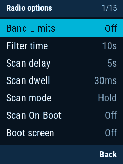 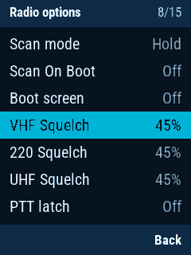 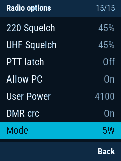

- **Límites de banda**: Desactivado / Activado (exclusivo para bandas de radioaficionados) / CPS;
- **Tiempo filtro**: ventana de tiempo para retener exclusivamente un Talkgroup recién recibido;
- **Pantalla inicio**: animación y melodía al encender;
- **Squelch VHF / 220 / UHF**: niveles de squelch predeterminados para cada banda;
- **Bloqueo PTT**: permite transmitir en modo manos libres con una sola pulsación de inicio y otra de parada;
- **Permitir PC**: gestión de llamadas privadas entrantes;
- **Potencia por defecto**: nivel de potencia asignado a canales nuevos;
- **Potencia a todos**: replica la potencia por defecto a todos los canales del codeplug;
- **Potencia usuario**: ajuste fino manual (+W-) del nivel de potencia del paso final (0 a 4100).

Niveles de potencia disponibles: 50mW, 500mW, 1W, 2W, 3W, 4W, 5W, 7W, 10W y +W-. Los valores de 1W, 4W y 10W corresponden a las calibraciones de fábrica de potencias Baja, Media y Alta. Cada canal y VFO recuerda su potencia de forma independiente con **SK2 + ▶ ◀**.

### Opciones de pantalla

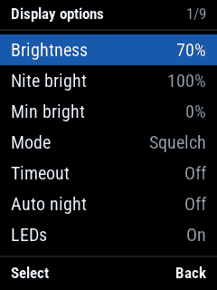 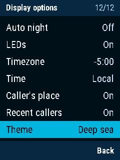

Brillo diurno, brillo nocturno, brillo mínimo en reposo, modo de iluminación, temporizador de apagado de pantalla, modo noche automático, indicadores LED, zona horaria, visualización de hora UTC o local, ubicación del corresponsal, **Últ. llamadas** (mostrar u ocultar los dos últimos corresponsales en pantalla de canal) y **Tema visual**:

| Tema | Características |
|---|---|
| Auto (por defecto) | Aplica automáticamente Sunlight de 7:00 a 19:00 hora local y Deep sea de noche |
| Deep sea | Modo oscuro: fondo azul marino oscuro con franja azul mar y selección en color cian |
| Sunlight | Modo claro para exteriores: texto negro de alto contraste para visibilidad bajo luz solar directa |
| Clear sky | Modo claro: fondo blanco con franja azul real y selección en naranja |
| Graphite | Modo oscuro: grafito y naranja |
| Night amber | Modo nocturno de bajo brillo: texto ámbar sobre negro para visión nocturna |
| High contrast | Blanco y negro de máximo contraste con selección en amarillo |

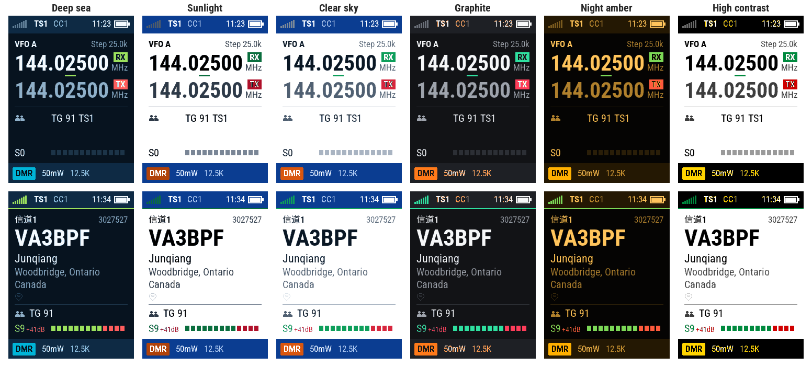

### Opciones de sonido

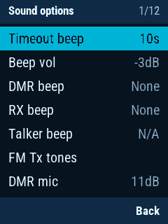 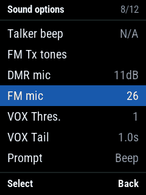

Aviso de fin de tiempo TOT, volumen de pitidos de teclado, pitidos de inicio/fin de transmisión DMR, tono de fin de portadora RX, tonos de transmisión en FM (cortesía, Roger beep, MDC1200 y eliminación de cola de squelch a 55 Hz o fase 240°), ganancia de micrófono para DMR y FM, ajustes de sensibilidad de VOX y control automático de ganancia de recepción DMR (Rx AGC).

### Idioma (Language)

En Opciones → Idioma (Language), pulsa la tecla de menú o ◀ ▶ para alternar entre **Español**, **English** y **中文**.

### Calibración

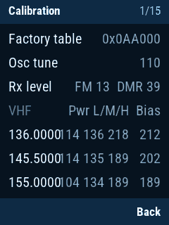

Menú informativo de solo lectura: muestra la tabla de calibración de fábrica (ajuste del oscilador, niveles de recepción y valores de excitación de potencia para cada segmento de frecuencia). **OpenDMR nunca altera ni sobrescribe la calibración del equipo.**

### Opciones de APRS

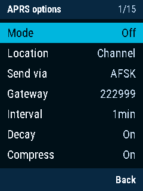 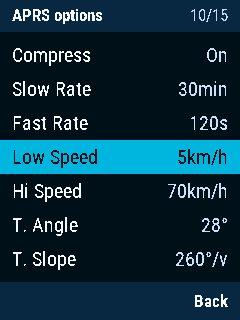

Modo de baliza (Desactivado / Manual con SK1 + 3 / Tras cada transmisión con PTT / Automático por intervalo con decaimiento / SmartBeaconing inteligente según velocidad y ángulo de giro), fuente de coordenadas (fija del canal o GPS en vivo), compresión de datos y función **Transmitir QSY** (inserta en el comentario de la baliza tu frecuencia de voz, subtono y desplazamiento actual para que otros colegas sintonizados puedan llamarte directamente).

- **Frecuencia de baliza** ("Beacon Tx frequency" de la configuración APRS, en el CPS): la baliza se envía en esa frecuencia en todos los modos salvo PTT (en PTT sale en el canal tras cada transmisión). Un canal solo emite balizas si tiene una configuración APRS asignada, y nunca si es de solo recepción. Sin frecuencia de baliza, un canal FM la envía en su propia frecuencia y un canal DMR, P25, NXDN, AM o USB no envía ninguna. El modo PTT solo emite balizas en canales FM. Durante la baliza la radio sintoniza FM en esa frecuencia y vuelve al canal: el canal elegido no cambia, y una llamada en curso aplaza la baliza a la siguiente ronda.
- **Enviar por**: **AFSK** (por defecto, la baliza FM) / **DMR** / **Ambos**. DMR: en un canal DMR la posición se envía a una pasarela APRS como informe de datos LRRP, sin cambiar de frecuencia, en el timeslot y el código de color del canal; antes espera a que el canal esté libre (2 s como máximo), y un PTT pulsado durante el envío espera a que termine. La radio necesita su ID de DMR. Ambos: cada vía que el canal permita; en un canal DMR con frecuencia de baliza primero sale la baliza AFSK y luego el informe LRRP.
- **Pasarela**: el ID de DMR de la pasarela que recibe los informes LRRP, 222999 por defecto (la pasarela APRS de BrandMeister); la tecla de menú abre la entrada numérica.
- "Enviar por" y la pasarela se guardan en la radio, no en los ajustes del CPS. El envío por DMR aún es experimental: no se ha confirmado que la pasarela decodifique el informe.

---

## 12. Bloqueo, teclas rápidas y configuración de teclas

### Bloqueo de teclado

- En el menú principal, pulsar **\*** bloquea el teclado y **#** bloquea el PTT;
- En pantalla principal, **mantener presionada la tecla SK2 sola** bloquea el teclado;
- Para desbloquear, presiona la combinación **SK1 + \***;
- Puedes configurar bloqueo automático tras un periodo de inactividad en Opciones generales → Bloqueo autom.

### Seguridad por PIN

Permite proteger el equipo mediante una clave numérica de 4 a 6 dígitos:
- **PIN de bloqueo**: al bloquearse el equipo, se oculta la pantalla del canal y se requiere el código para operar;
- **PIN de encendido**: solicita el PIN inmediatamente tras encender el radio con el receptor silenciado;
- **Importante: no olvides tu PIN.** Si lo olvidas, la única forma de restablecerlo es conectando el cable y ejecutando la herramienta de desbloqueo `tools/debug/pin_wipe.py COMx` con el radio apagado y encendiéndolo en los primeros 30 segundos.

### Teclas rápidas (SK2 + dígito)

- Estando posicionado sobre cualquier elemento de menú, canal, zona o contacto, mantén presionado **SK2 + un número del 0 al 9** para memorizarlo en esa tecla;
- En la pantalla principal, presionar **SK2 + ese número** abrirá ese menú o seleccionará ese contacto de forma instantánea.

### Configuración personalizada de teclas

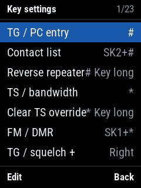 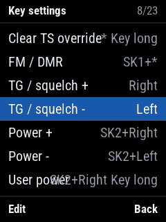 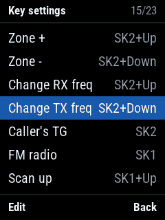

Desde Opciones → Config. teclas puedes reasignar libremente qué combinación de teclas ejecuta cada función del radio (pulsaciones cortas, largas, solas o combinadas con SK1 y SK2).

---

## 13. CPS, punto de acceso (hotspot) y actualización de firmware

### Edición de codeplug con OpenDMR CPS

Para gestionar tus frecuencias, repetidores y zonas, abre **`opendmr-cps.html`** con Google Chrome o Microsoft Edge en tu computadora. Conecta el cable, pulsa "Conectar radio" y podrás leer, modificar y escribir el codeplug de manera visual, además de importar o exportar archivos en formato compatible con OpenGD77.

### Base de datos de IDs de DMR con ciudades y países

OpenDMR incorpora un formato de base de datos optimizado que permite almacenar más de 300,000 estaciones de radioaficionados mundiales ocupando solo 3.5 MB:

```bash
py tools\ids\id_db.py build
py tools\ids\id_db.py write COM6
```
*(Puedes limitar la descarga a países específicos para acelerar la carga con `--countries "Colombia,Spain,Mexico,Argentina"`).*

### Modo Hotspot MMDVM / BlueDV

El Baofeng DM-32UV con OpenDMR puede funcionar directamente como módem de punto de acceso (hotspot):
1. En Opciones generales → Hotspot, selecciona **MMDVM** o **BlueDV**;
2. Conecta el cable al ordenador y ejecuta MMDVMHost o la aplicación BlueDV configurando el puerto serie correspondiente;
3. La pantalla del radio mostrará la interfaz de hotspot con la frecuencia activa, potencia e información de llamadas cursadas en tiempo real.

### Actualización de firmware

Con OpenDMR ya instalado, ejecutar:
```bash
python3 tools/debug/fw_update.py opendmr.bin --port COMx
```
Actualiza el equipo en apenas 35 segundos sin perder tus canales ni ajustes.

---

## 14. Limitaciones actuales

- No incluye avisos de voz por sintetizador (el hardware no dispone de muestras de voz en memoria).
- La tabla de calibración es de solo lectura (la potencia y el oscilador se preservan intactos con los valores de fábrica).
- Modos digitales P25 y NXDN operan exclusivamente en convencional simplex sin cifrado.
- Funciones en fase final de verificación en el aire: decodificación interna de tramas APRS en pantalla (las balizas de transmisión están totalmente operativas), CW ID del modo hotspot y clasificación dinámica de canales por proximidad.
