# OpenDMR 使用说明书

适用于装了 OpenDMR 固件的 **Baofeng DM-32 / DM-32UV**。English: [manual.en.md](manual.en.md) · Español: [manual.es.md](https://github.com/va3bpf/opendmr-languages/blob/main/docs/manual.es.md)。

图中都是电台上的真实截屏（`tools/debug/fshot.py`，240×320）。GPS 和电台信息里的位置做了模糊处理。

> 本说明书对应固件版本 25340747（2026-11-07）。装机、升级、恢复原厂见 [安装手册](installation.md)。
> **刷机前务必先备份两颗 Flash**，备份里有本机独有的校准数据。

## 目录

1. [按键](#1-按键)
2. [屏幕](#2-屏幕)
3. [信道模式](#3-信道模式)
4. [VFO 模式](#4-vfo-模式)
5. [接收](#5-接收)
6. [发射](#6-发射)
7. [扫描](#7-扫描)
8. [双守](#8-双守)
9. [联系人和呼叫对象](#9-联系人和呼叫对象)
10. [主菜单](#10-主菜单)
11. [选项](#11-选项)
12. [锁键盘、快捷键、按键设置](#12-锁键盘快捷键按键设置)
13. [写频、热点、升级](#13-写频热点升级)
14. [目前的限制](#14-目前的限制)

---

## 1. 按键

| 按键 | 作用 |
|---|---|
| **菜单键**（屏幕下方左边） | 菜单 / 确定。主界面上**短按打开本界面的菜单**（快捷菜单），**长按打开主菜单** |
| **返回键**（屏幕下方右边） | 返回 / 删除一位。**长按回到主界面**。信道界面上短按进 VFO，VFO 界面上短按回信道 |
| ▲ ▼ | 换信道（信道模式）、调频率（VFO）、在列表里移动 |
| ◀ ▶ | 在列表里改当前项的值；主界面上改组号（DMR）或静噪（FM） |
| 旋钮 | 同 ▲ ▼ |
| SK1、SK2（侧键） | 单按有各自的功能，按住再按别的键是组合键（见下表） |
| PTT | 发射 |
| 数字键、* 、# | 输入信道号、频率、号码；主界面上的快捷功能 |

屏幕底栏左右两个标签就是菜单键、返回键在当前界面的作用（选择、确定、保存、修改、返回、删除……）。

### 主界面上的快捷功能（出厂设置）

这些都可以在「选项 → 按键设置」里改（见 [12](#12-锁键盘快捷键按键设置)）。

| 按键 | DMR | FM |
|---|---|---|
| # | 输入组号 / 个呼号码（YSF：改 DG-ID） | 输入 DTMF |
| SK2 + # | 联系人列表 | DTMF 联系人列表 |
| # 长按 | 中继反转（只在信道模式） | 同左 |
| * | 切换时隙 | 切换带宽 12.5 / 25 kHz |
| * 长按 | 恢复信道（VFO）本来的时隙 | — |
| SK1 + * | 切换模式：FM → AM → USB → LSB → DMR → P25 → NXDN → M17 → YSF | 同左 |
| ▶ / ◀ | 组号 + / −（在组列表里换） | 静噪 + / − |
| SK2 + ▶ / ◀ | 功率 + / − | 同左 |
| SK2 + ▶ 长按 | 自定义功率 | 同左 |
| SK2 + ▲ / ▼ | 区域 + / −（信道模式）；选择 ▲ ▼ 和旋钮改接收还是发射频率（VFO） | 同左 |
| SK2 单按 | 回呼对方的组（刚收到的呼叫） | — |
| SK1 单按 | 收音机 | 同左 |
| SK1 + # | 锁键盘；锁定时再按解锁 | 同左 |
| SK1 + ▲ / ▼ | 向上 / 向下扫描 | 同左 |

**在信道上用按键改的都是临时的**：静噪、功率、时隙、模式、带宽，以及临时选的组号、联系人，换信道、切到 VFO、进「信道详情」
或关机后就恢复成信道本来的设置，不写进码表。要长期改，在「信道详情」（SK2 + 菜单键）里改。时隙以信道的设置为准，信道自己的
联系人不改变时隙；临时选的联系人（联系人列表、# 输入、回呼、在组列表里换组）带上它自己的时隙。VFO 上改的都会保存。
| SK1 + 1 | APRS 开 / 关 | 同左 |
| SK1 + 3 | 立即发一次 APRS 信标 | 同左 |

另外：SK2 + 菜单键直接进「信道详情」；SK2 + 数字键是快捷键（见 [12](#12-锁键盘快捷键按键设置)）。

---

## 2. 屏幕

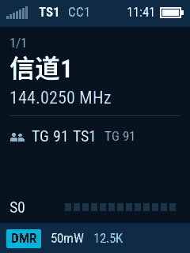 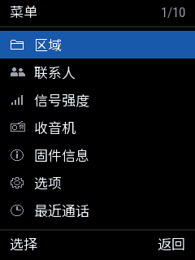

- **状态栏**（顶部，主题色带上）：信号格（和 S 表一样：格子都在，有信号的亮成白色）、时隙 `TS1`/`TS2`、色码 `CC1`（DMR）、扫描图标、GPS 图钉（GPS 打开时显示：搜星时暗，定位后亮）、时间、电池。接收时整条变绿，发射时整条变红（左上角的信号格换成发射图标，其他位置不变）。
- **主区**：信道界面是区域和位置、信道名（大字）、频率、发射对象（组号）、S 表。
- **底栏**（也在色带上）：主界面上是模式（`DMR`/`FM`/`AM`/`USB`/`LSB`）、功率、带宽；列表界面上是左右两个按键的作用。
- **列表界面**（菜单、设置）：标题栏写名称和位置（`1/10`），当前项用主题的高亮色（深海里是亮青色），一屏 7 行，▲ ▼ 到头会绕回。

颜色有固定含义：绿色 = 接收，红色 = 发射，高亮色 = 选中 / 当前，琥珀色 = 警告（低电、扫描、快超时）。具体颜色由主题决定（显示设置 → 主题）；本手册的截图是深海主题。

---

## 3. 信道模式

开机进入信道模式（上次在 VFO 就进 VFO）。


| 操作 | 按键 |
|---|---|
| 换信道 | ▲ ▼ 或旋钮 |
| 直接跳到第 N 个信道 | 输入数字，再按菜单键（返回键取消） |
| 换区域 | SK2 + ▲ ▼，或主菜单「区域」 |
| 换组号 / 调静噪 | ▶ ◀ |
| 功率 | SK2 + ▶ ◀ |
| 时隙 / 带宽 | * |
| 进 VFO | 返回键 |
| 本信道的菜单 | 菜单键 |
| 信道详情 | SK2 + 菜单键，或菜单里第一项 |

### 信道菜单（菜单键）

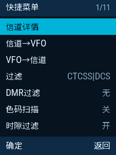 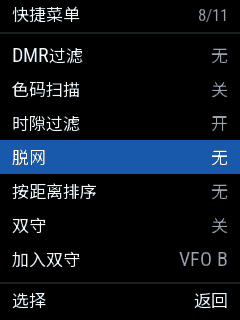

▲ ▼ 选项，◀ ▶ 或旋钮改值（马上生效，可以先听效果）；菜单键「确定」：保留改动（动作项就执行）并退出；返回键「取消」：恢复成打开菜单时的值再退出。VFO 菜单相同。

| 项 | 作用 |
|---|---|
| 双守 | 开关双守（见 [8](#8-双守)） |
| 信道详情 | 打开本信道的全部参数（见下） |
| 信道→VFO | 把本信道复制到当前 VFO，然后进 VFO |
| VFO→信道 | 用当前 VFO 覆盖本信道（要确认） |
| 过滤 | 模拟亚音过滤：`CTCSS\|DCS` 只听亚音对的信号，`无` 都听 |
| DMR过滤 | 无 / 只听本组 / 本联系人 / 接收组列表里的组 |
| 色码扫描 | 开：自动找色码（同时关掉色码过滤） |
| 时隙过滤 | 开：只听本信道的时隙 |
| 脱网 | 中继信道上直接用接收频率对讲（不经中继） |
| 按距离排序 | 区域里的信道按离本机的距离排（要设了位置） |

### 信道详情

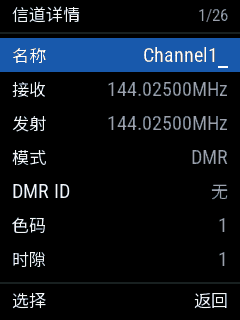 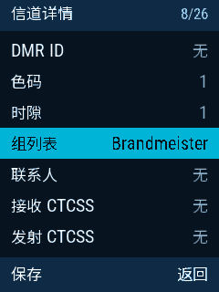 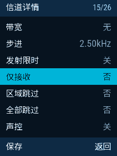 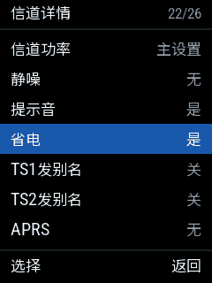

名称、收发频率、模式、DMR ID、色码（P25 信道是 NAC，NXDN 信道是 RAN，M17 信道是 CAN，YSF 信道是 DG-ID）、时隙、组列表、联系人、收发亚音、带宽、步进、发射限时、仅接收、区域跳过、全部跳过、声控、信道功率、静噪、提示音、省电、两个时隙是否发送讲话人别名、APRS 配置。

- ▲ ▼ 选项，◀ ▶ 或旋钮改值；
- 频率和 DMR ID 用数字键输入（8 位，◀ 删一位）；在接收 / 发射频率上按 ◀ ▶ 是把发射频率设成接收频率加中继差频；
- 名称：数字键打字母，◀ ▶ 移动，SK2 + ◀ 删除，SK2 + ▶ 插入；
- 组列表、联系人、APRS 配置按名字选；
- **菜单键保存**（写进码表）并回主界面；**返回键不保存**。

---

## 4. VFO 模式

信道界面按返回键进入，再按返回键回信道。两个 VFO（A、B），**长按返回键**切换，或在 VFO 菜单里选。

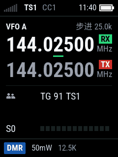 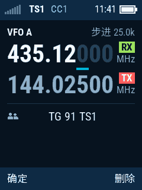

| 操作 | 按键 |
|---|---|
| 调选中的频率 | ▲ ▼ 或旋钮（按步进） |
| 选择改接收 / 发射频率 | SK2 + ▲ / SK2 + ▼ |
| 直接输入频率 | 数字键（如 `43500000`，输满 8 位自动生效，或按菜单键确定；返回键删一位） |
| 按住时收发对调 | SK1 + SK2 |
| 模式：FM → AM → USB → LSB → DMR → P25 → NXDN → M17 → YSF | SK1 + * |
| 静噪（FM、AM、SSB）/ 组号（DMR、P25、NXDN） | ▶ ◀ |

接收和发射两个频率都用大字显示，接收频率右边是绿色 `RX`，发射频率右边是红色 `TX`。正在改的那个频率是白色，步进会改动的每一位数字下面有一个同色的 ^：12.5 kHz 步进标小数第 2 ~ 4 位，25 kHz 标第 2、3 位，6.25 kHz 标第 3 ~ 5 位，5 kHz、10 kHz 各标一位。顶行是 VFO 和具体步进值。

**AM、USB、LSB 只能接收**（射频芯片只能发 FM）：底栏显示「仅接收」，按 PTT 提示「切换到FM或DMR才能发射」。这几种模式的静噪按信号强度（0 % 常开）；信号低于门限后 AM 等 0.2 秒、USB / LSB 等 0.5 秒才关，说话中间的停顿不会把声音切断。USB / LSB 下旋钮每格 100 Hz；先调到抑制载波频率（如 144.300 MHz），再左右微调到声音正常。模式跟着信道和 VFO 保存，CPS 里这样的信道显示为模拟。

**108 – 137 MHz（航空频段）只能接收**，任何模式都不发射：收听请切到 AM（SK1 + \*）。电台前端是为 137 MHz 以上设计的，这一段灵敏度会差一些；按 PTT 提示超出频段。

**P25**（APCO P25 Phase 1 常规语音，直通、组呼、明语）：底栏显示 `P25`；频率下面是通话组，
NAC 在这一行的右边（如 `NAC 293`）。

- **NAC**（网络接入码，12 位十六进制，默认 293）相当于 DMR 的色码：只收 NAC 相同的；设成 `F7E` 收所有的。在信道
  详情里改（P25 信道的“色码”一项变成 NAC，◀ ▶ 每次 1，按住每次 0x10）。
- **通话组**和 DMR 一样选（▶ ◀、输入组号、联系人），只发组呼。
- 加密的通话只显示锁，不放音。CPS 里 P25 信道显示为 DMR，**在 CPS 里改了这个信道 NAC 可能被改掉**。
- 已知问题和技术细节见 [P25 说明](p25.md)。

**NXDN**（NXDN48，6.25 kHz，常规直通语音，明语）：底栏显示 `NXDN` 和 `6.25K`；频率下面是发射目标（组或个呼），
RAN 在这一行的右边（如 `RAN 1`）。

- **RAN**（无线接入号，0 – 63，默认 1）相当于 DMR 的色码：只收 RAN 相同的通话；设成 0 收所有的（发射时用 0）。
  在信道详情里改（NXDN 信道的“色码”一项变成 RAN，◀ ▶ 每次 1，按住每次 8）。
- **发射目标**和 DMR 一样选（▶ ◀、输入组号、联系人）：组发组呼；个呼联系人发个呼。NXDN 的 ID 只有 16 位，
  超过 65535 的组号或联系人改发到组 1。发给别人的个呼不放音。
- **本机 NXDN ID** 在「常规设置 → NXDN ID」里设（1 – 65535，NXDN 的 ID 和 DMR ID 分开注册）；没设时用本机 DMR ID
  （大于 65535 时取低 16 位）。
- 收：电台录下鉴频器的输出，用软件解调解码；发：我们自己的 AMBE+2 编码，频偏按 NXDN48 的 ±1050 Hz。
  已经和 MMDVM 热点互通实测（误码率 0 %）。加密的通话不能解。
- CPS 0.7.1 之后的版本支持 NXDN 信道（模式、RAN、NXDN ID）。

**M17**（4FSK，12.5 kHz，直通语音，Codec 2 3200）：底栏显示 `M17` 和 `12.5K`；频率下面是发射目标 `全部`（ALL），
CAN 在这一行的右边（如 `CAN 0`）。

- **CAN**（信道接入号，0 – 15）在信道详情里改（M17 信道的“色码”一项变成 CAN）。发射时带上信道的 CAN；接收时不按 CAN
  过滤，收到的都放音。
- **发射**：目标固定为 ALL（广播），源呼号是 CPS「常规」里的呼号。收到呼叫时大字显示对方呼号。
- 收：和 NXDN 一样用软件解调解码；发：我们自己写的 Codec 2 3200 编码器。已经和参考实现 libcodec2 对比过，编码结果基本一致。
- **语音质量还不理想**：Codec 2 3200 本身比 DMR、NXDN 用的 AMBE+2 发闷，高音少。
- CPS 0.10.0 及以后支持 M17 信道（模式、CAN）。

**YSF**（八重洲 System Fusion，C4FM 4FSK，12.5 kHz，直通语音 DN 模式，AMBE+2）：底栏显示 `YSF` 和 `12.5K`；
频率下面是发射目标 `全部`（ALL），DG-ID 在这一行的右边（如 `DG-ID 0`）。

- **DG-ID**（0 – 99）在信道详情里改（YSF 信道的“色码”一项变成 DG-ID），默认 0。发射时带上信道的 DG-ID；
  接收时不按 DG-ID 过滤，收到的都放音，通话画面右边显示对方的 DG-ID。
- 主界面按 **#** 直接改 DG-ID：显示当前值，输入数字（第一个数字替换当前值）或 ▲ ▼ 加减 1，菜单键确定。信道上是
  临时的（换信道或关机后恢复信道本来的 DG-ID），VFO 上的会保存。
- **发射**：V/D 模式 2（八重洲电台上叫 DN），目标固定为 ALL，源呼号是 CPS「常规」里的呼号。收到呼叫时大字显示对方呼号
  （中途加入时，约半秒后收到呼号）。
- **接收**：DN（V/D 模式 2）和 V/D 模式 1 放音。VW（全速率语音，IMBE）只显示呼叫、不放音（状态栏显示 `VW`）。
- 收：和 P25 一样用软件解调；发：我们自己的 AMBE+2 编码，频偏按 YSF 的 ±2.7 kHz。已经和 MMDVM 热点互通实测
  （热点收我们的发射误码率 0.1 – 0.2 %），也用八重洲 FTM-400D 的真实录音测过接收。
- CPS 还不支持 YSF 信道：用 VFO，或在电台的信道详情里把模式改成 YSF。

### VFO 菜单（菜单键）

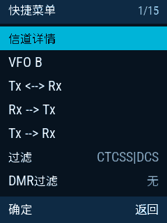 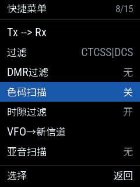 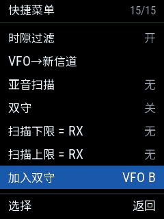

| 项 | 作用 |
|---|---|
| 双守 | 见 [8](#8-双守) |
| 信道详情 | 当前 VFO 的全部参数（同信道详情） |
| VFO B / VFO A | ◀ ▶ 或旋钮切换 VFO |
| Tx <--> Rx | 收发频率对调 |
| Rx --> Tx / Tx --> Rx | 把接收频率复制给发射 / 反过来 |
| 过滤、DMR过滤、色码扫描、时隙过滤 | 同信道菜单 |
| VFO→新信道 | 把当前 VFO 存成一个新信道（「新信道 N」，在「所有信道」里） |
| 亚音扫描 | 扫出对方用的 CTCSS / DCS（任意键停在当前的亚音） |
| 扫描下限 = RX / 扫描上限 = RX | 把当前接收频率设为 VFO 扫描的下限 / 上限 |

---

## 5. 接收

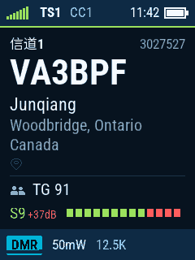 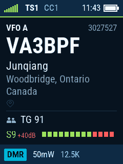

- 收到信号时状态栏整条变绿、信号格亮起，S 表数字变绿；超过 S9 的部分用小号红字写 `+xxdB`。
- S 表刻度：S1 为 -121 dBm，每格 6 dB，S9 为 -73 dBm。信号格跟随 S 表：S1 亮一格，S8 以上全亮。室外空闲信道显示 S0；室内电脑等电子设备的噪声可能让 S 表亮一两格。
- DMR 接收界面（各行位置固定，不管有没有内容）：
  - 顶行：信道名或 VFO 名，右边是对方的 DMR ID；
  - 对方呼号，大字（查不到时显示 DMR ID）；
  - 名字、城市和州/省、国家（来自 DMR ID 数据库，见 [13](#13-写频热点升级)；城市和州/省可以在「显示设置 → 对方地址」关掉）。没有数据库也能显示国家：由 ID 的前 3 位推出；
  - 位置：呼叫里带 GPS 位置（ETSI GPS Info）时图钉变绿，显示与您的距离和方向（如「12.3 km NE」）；没有本机位置时显示对方坐标。「最近通话」里保留简短的距离（或坐标）；
  - 组号（个呼时是呼叫对象）、S 表，底栏和待机时一样。

  约 0.7 秒内就能显示主叫。名字来自联系人、DMR ID 数据库或对方发来的讲话者别名。
- 收到的呼叫记在「最近通话」里。按 **SK2** 可以直接回呼对方的组（个呼就回给对方）。
- DMR / P25 信道在组号行下面显示「最近通话」里同制式的最近两个主叫（呼号和名字、多久以前、各自的组号或 `PC`）；约 0.7 秒内显示。
  「显示设置 → 显示最近主叫」可以关掉（默认开）；FM / AM / USB / LSB / NXDN 信道不显示。
- FM：静噪打开时出声；▶ ◀ 调静噪，调的时候屏幕上会显示一会儿。0 % 常开（能听到底噪），亚音仍然起作用。
  在信道上调的静噪是临时的（换信道、切 VFO 或关机后恢复）；VFO 上调的会保存。信道没设静噪时用「电台设置」里该频段的默认静噪。

---

## 6. 发射

按住 **PTT** 发射，松开结束。发射界面（这份说明书没有截图）：

- 状态栏整条变红，信号格换成发射图标（DMR 的时隙和色码照常显示）；
- 主区：呼叫对象（「组呼」+ 组号，或区域 + 信道 / VFO）、信道和频率、大号计时（有发射限时时显示剩余时间和进度条，快到时变琥珀色）、8 格话筒电平；
- 中继：唤醒中继时显示「唤醒中继」，中继不应答显示「无中继」；
- 不能发射的情况（超出频段、仅接收信道、超时、无中继）显示原因，直到松开 PTT。

发射时：

- **FM**：按 **SK2** 发 1750 Hz 中继启动音；按数字键发 DTMF；
- 开始 / 结束提示音、MDC1200、尾音消除在「声音设置 → FM发射」里设；
- **声控（VOX）**：「声音设置」里设声控门限（0 = 关）和拖尾；
- **PTT 锁定**（「电台设置 → PTT锁定」）：按下 PTT 开始发射，松开后继续发射；再按一下 PTT（或红键）结束。只在信道设了发射限时时起作用（以免一直发射），到时自动结束；声控（VOX）发射不锁定。

---

## 7. 扫描

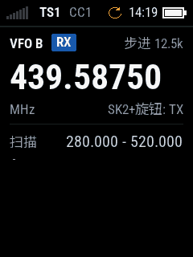

- **SK1 + ▲** 向上扫，**SK1 + ▼** 向下扫。信道模式扫当前区域（跳过设了「区域跳过」的信道；在「所有信道」里跳过设了「全部跳过」的）；VFO 扫上下限之间（没设上下限就扫整个频段）。状态栏有扫描图标。
- 扫描中：**▲** 马上跳到下一个；**◀** 反向；停住时按 **\*** 屏蔽这个信道 / 频率：**短按**（响一下）临时屏蔽到关机（最多 64 个）；**长按**（确认音）永久屏蔽：信道在码表里设上「区域跳过」（在「全部信道」里是「全部跳过」），VFO 频率存在电台里（最多 32 个）。扫描继续，并显示屏蔽了几个。**PTT** 停止扫描并发射；**其他键**停止扫描。
- 信道或 VFO 的快捷菜单里 **扫描屏蔽**（开 / 关，用 ◀ ▶ 或旋钮）是当前这个信道或频率：开 = 永久屏蔽（「停止」方式的扫描停在它上面后也可以这样屏蔽）；关 = 恢复扫描，不管它是怎么被屏蔽的。
- 主菜单 → **扫描屏蔽** 列出全部被屏蔽的，右边写类型：临时（到关机）、永久（VFO 频率）、区域跳过 / 全部跳过（码表里的信道，包括在 CPS 或信道详情里设的）。在一行上按菜单键解除这一个，最后一行全部解除。
- 「电台设置」里：扫描延时（停多久）、驻留时间（每个信道 / 频率停多久）、扫描方式（保持 / 暂停 / 停止）、开机扫描。
- DMR、P25 和 NXDN 信道每个至少停 50 ms；信号强度明显高于底噪时，最多等 0.4 秒找 DMR 同步（P25：数据单元），再最多等 3 秒出声音，所以通话进行到一半也能停住。

---

## 8. 双守

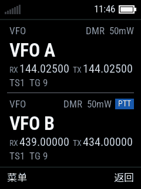

同时守听两路，每一路可以是**任意信道或 VFO A / B**（两路也可以相同）。双守就是主界面多守一路：**选中的一路**就是主界面当前的信道或 VFO，按键和主界面一样。

- **打开**：信道或 VFO 的菜单（菜单键）第一项「双守」：用 ◀ ▶ 或旋钮改成「开」，按菜单键确定。当前的信道 / VFO 成为选中的一路，放在上面；另一路是上次双守里的另一路（第一次用时是 VFO A，当前就是 VFO A 时是 VFO B）。
- **选中**：▲ / ▼ 选上面 / 下面一路，带 `PTT` 标签，主界面也跟着切到这一路。
- **改选中的一路**，和信道 / VFO 界面一样：旋钮换信道或调频率（VFO 用 SK2 + ▲ ▼ 选改接收还是发射，正在改的那个频率在步进会改动的数字下面有绿色或红色的 ^，和 VFO 界面一样）；数字键输入信道号或频率；◀ ▶ 组号或静噪；SK2 + ◀ ▶ 功率；\* 、# 、SK1 / SK2 组合键都一样；返回键在信道和 VFO 之间切换（长按：VFO A ↔ B）。想让一路换成别的信道或 VFO，就选中它直接换。
- 两路相同时上下都显示，内容一样，只守这一路；改一个另一个跟着变。
- 轮流守听，哪一路有信号就停在那一路，信号结束后再停一会儿（方便回话）。
- 每一路：抬头是信道号或 VFO、模式和功率；名称大字；接收和发射频率；时隙和组号，或亚音。
- 有信号的一路：左边绿色竖条，最下一行换成 S 表。收到 DMR 呼叫时，大字换成对方呼号（查不到时显示 ID），ID 挪到右上角，这一路的名字挪到抬头左边。
- **发射**：在选中的一路；另一路收到信号后 10 秒内按 PTT，在收到的那一路回话（`PTT` 标签这时在那一路上）。
- 底栏：左边「菜单」；右边是返回键要去的地方（「VFO」或「信道」），按住 SK2 时变成「关闭」。
- **关闭**：**SK2 + 返回键**；或菜单键打开选中一路的菜单，在第一项「双守」关闭。开始扫描（SK1 + ▲ ▼）时也自动关闭。关闭后回到选中那一路的主界面。长按菜单键：主菜单。关机后保持。

---

## 9. 联系人和呼叫对象

### 输入组号 / 个呼号码（#）

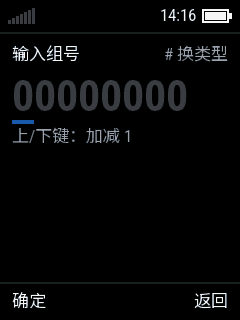

- 主界面按 **#**。**#** 依次切换：组号 → 个呼 → 全呼 → 联系人；▲ ▼ 加减 1。
- 菜单键确定：组号 / 个呼 / 全呼（16777215，不用输入）临时替代信道的联系人（在信道上：换信道、切 VFO 或关机后恢复）；选联系人同时用它的时隙。本机 ID 在设置里改（本机ID），不在这里。
- FM 下 # 是 DTMF 输入：数字、*、# 输入，◀ 删除，菜单键发送。发送的时序（每秒几位、首位前延时等）在写频软件的
  「电台设置 → DTMF」里设置；码表里没有设置时每秒 5 位。

### 联系人列表（SK2 + #）


主界面 SK2 + #：选一个按菜单键，马上作为发射对象。

### 主菜单 → 联系人

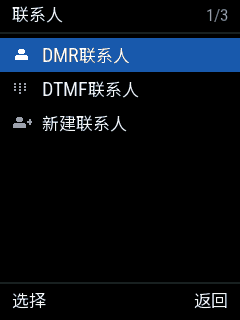 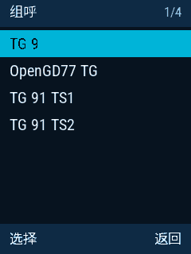 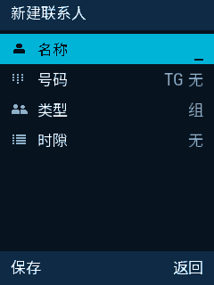

- **DMR联系人**：一次显示一种呼叫类型，**#** 切换（组呼 / 个呼 / 全呼）。菜单键打开操作：选为发射、编辑联系人、删除联系人（删除前要确认；接收组列表在用的组不能删）。
- **DTMF联系人**：FM 用的 DTMF 号码。
- **新建联系人**：名称（数字键打字母）、号码、类型、时隙；菜单键保存。

---

## 10. 主菜单

主界面**长按菜单键**。

 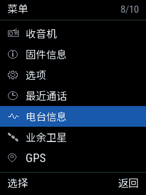

### 区域


选区域；「所有信道」是码表里全部信道。

### 信号强度

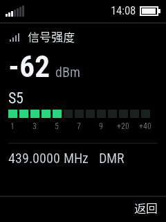

大字 dBm、S 表、频率和模式。* 显示原始的信号 / 噪声读数。

### 收音机（SK1）

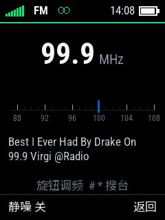

87 ~ 108 MHz 广播，显示 RDS 电台名和文字，状态栏有立体声标志。

- 旋钮或 ◀ ▶：100 kHz 一步；**#** / **\***：向上 / 向下搜台；数字直接输入（`999` = 99.9 MHz，`1071` = 107.1 MHz）；
- 菜单键：静噪开 / 关（开时没台就静音）；
- 返回键、SK1 或 PTT：退出（关收音机）。频率和静噪会保存；在收音机界面关机，下次开机还在收音机。

### 固件信息

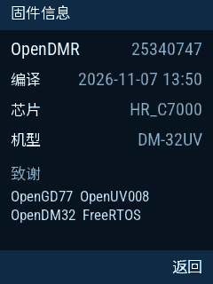

版本（git 提交号）、编译时间、芯片、机型、致谢。

### 最近通话

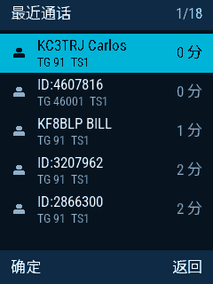

每次呼叫两行：主叫（呼号和名字，或 ID）、组号和时隙，右边是多久以前。▲ ▼ 移动（SK2 + ▲ ▼ 到第一 / 最后）；菜单键：以后发射到这个组（SK2 + 菜单键：个呼这个人）；**#** 长按清空。

### 短信

主菜单 →「短信」（后面显示未读条数）：**收件箱**、**发件箱**、**写短信**、**预设短语**。收件箱和发件箱各保存 32 条，满了覆盖最旧的。
DMR 信道上发 DMR 短信，M17 信道上发 M17 短信；其他模式的信道上不能发（提示「需要 DMR 或 M17 信道」），都能收。

**收件箱 / 发件箱**：每条两行：对方（呼号或 ID，组呼显示 TG 号）和时间（发件箱是状态：发送中 / 已发送 / 已送达 / 未发出），
下面是短信开头；未读的有信封图标。▲ ▼ 选，左键阅读。

**阅读**：标题是对方，下面是模式、号码和时间，正文自动换行，▲ ▼ 滚动。左键在收件箱里是**回复**（写给同一个人或同一个组），
在发件箱里是**重发**（原样再发一次，用现在的信道）。

**删除**：按住 **SK2**，左键的文字变成「删除」，这时按左键删除，先确认。在阅读界面删当前这条，在收件箱 / 发件箱列表里删选中的那条，
不用先打开。用 CPS 的短信页可以一次删很多条。

**写短信**：

- 上面一行是「至」：DMR 用数字键输入 ID，**#** 在组呼（TG）和个呼之间切换，◀ 删一位；默认是信道当前的发射目标。
  M17 输入呼号，空着就是发给所有人。
- 下面是正文：数字键多次按输入字母和数字，**\*** 输入符号，**#** 插入一条预设短语；◀ ▶ 移动光标，**SK2 + ◀** 删除光标前的字，
  **SK2 + ▶** 插入空格，长按 ◀ / ▶ 到开头 / 结尾。标题右边显示字数（最多 140）。
- ▲ ▼ 在「至」和正文之间切换，左键发送。发送结果在屏幕上方弹出提示，发件箱里也能看到。

**预设短语**：用 CPS 的短信页写入（可以是中文）。在菜单里选一条，直接用它写一条新短信；写短信时按 **#** 把它插到光标处。

**收到新短信**时弹出提示并响铃：左键直接阅读，右键关闭。状态栏显示未读条数。

**DMR 短信格式**在「选项 → 电台设置 → DMR短信格式」里选：**Motorola**（TMS，默认；对方会回执，发件箱显示「已送达」）、
**Hytera** 或 **DMR**（AnyTone 用的格式）。三种格式都能收。

### 电台信息

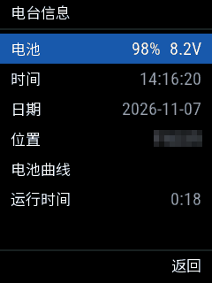

电池、时间、日期、位置（梅登海德网格）、电池曲线、运行时间。在时间、日期、位置上按菜单键可以用数字键设置（输完按菜单键；位置页 ▲ ▼ 选南北，SK2 + ▲ ▼ 选东西）。电池曲线每 40 秒一个点（6.4 ~ 8.2 V）。

### 业余卫星

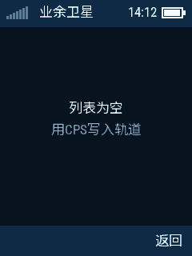

需要：**时间和位置已设置**（电台信息里，或用 GPS），**卫星轨道根数（keps）已用 CPS 写入**。之后显示各卫星即将过境的时间表；选一个看过境图（极坐标轨迹、方位 / 仰角）和多普勒修正后的频率（菜单键切换话音 / APRS / 其他）。过境界面会自动按多普勒调频，PTT 在当时的修正频率上发射。切到 **APRS** 频率时，PTT 不发话音，而是发一个 APRS 信标，经卫星的数字中继转发（和 OpenGD77 一样）：用**名字和卫星相同**的 APRS 配置（比如名叫 ISS 的配置，路径填 RS0ISS；SONATE-2 填 DP0SNX），用 CPS 的 APRS 页建好；位置用 APRS 选项里的 GPS 或固定位置。没有同名配置、没有位置时响错误音。没写 keps 时显示「列表为空，用CPS写入轨道」。

### GPS

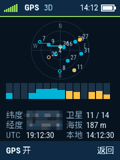

天空图（GPS 蓝色、北斗橙色，实心是正在用的卫星）、各卫星信号条、经纬度、卫星数、海拔、UTC 和本地时间。**菜单键开关 GPS**。定位后时间自动校准；APRS 和卫星可以用 GPS 位置。

---

## 11. 选项

主菜单 → 选项。所有设置界面：▲ ▼ 选项，**◀ ▶（或旋钮）改值**，菜单键打开子菜单或执行动作（不改值；左下角显示「选择」的地方菜单键才有作用），返回键返回。设置随时生效，关机时保存。**CPS 不读写这些设置**。

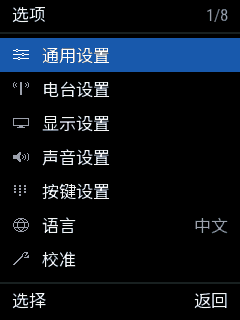

### 通用设置

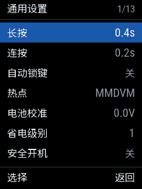 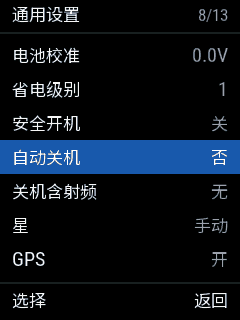

| 项 | 说明 |
|---|---|
| 长按 / 连按 | 长按判定时间、按住时重复的间隔 |
| 自动锁键 | 多久不操作自动锁键盘和 PTT（关 / 分钟） |
| 锁屏密码 / 开机密码 / 修改密码 | 见 [密码](#密码) |
| 热点 | 关 / MMDVM / BlueDV（见 [13](#13-写频热点升级)） |
| 电池校准 | 电压显示的修正（±0.5 V） |
| 省电级别 | 接收省电的程度 |
| 安全开机 | 保留项，本固件里暂时没有作用 |
| 自动关机 / 关机含射频 | 多久不操作自动关机；后者打开时收到信号也算操作 |
| 星 | 保留项（手动 / 自动），暂时没有作用 |
| GPS | 关 / 开 / NMEA（NMEA 语句从写频线输出） |
| 记住菜单位置 | 开：菜单位置关机后也记住（不开时只在开机期间记住） |
| 本机ID | 本机的 DMR ID，菜单键打开号码输入 |
| NXDN ID | 本机的 NXDN ID（1 – 65535），菜单键打开号码输入，输入 0 清除；没设时显示「(DMR ID)」，用 DMR ID |

### 电台设置

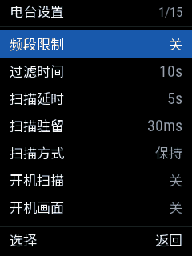 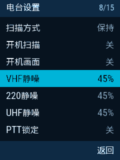 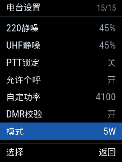

| 项 | 说明 |
|---|---|
| 频段限制 | 关 / 开（业余频段）/ CPS（按 CPS 里设的） |
| 过滤时间 | DMR 收到一个组后，在这段时间里只听这个组 |
| 扫描延时、扫描驻留、扫描方式、开机扫描 | 见 [7](#7-扫描) |
| 开机画面 | 开机时显示开机画面、放开机旋律（默认关，直接进主界面） |
| VHF / 220 / UHF 静噪 | 三个频段信道的默认静噪 |
| PTT锁定 | 按一下 PTT 开始发射，再按一下结束；信道要设发射限时 |
| 允许个呼 | 关 / 开 / PTT（收到个呼后按 PTT 回给对方） |
| 默认功率 | 新建信道和第一次使用的 VFO 的功率（之后各用各的），以及功率设为「电台」的旧信道 |
| 功率应用到全部 | 把默认功率写入所有信道和 VFO A / B（先确认） |
| 自定功率 | 「自定义功率」档（+W-）的功放驱动值，0 - 4100（SK2 按住时步进 10） |
| DMR校验 | 关掉时忽略 DMR 数据的 CRC 错误 |
| DMR短信格式 | 发 DMR 短信用的格式，见 [短信](#短信) |

RAS 中继台要把「DMR校验」设为「关」：它的 LC CRC 用密钥计算，标准校验必然失败。FEC 仍然做，只跳过最后的 CRC 检查。

功率档：50mW、500mW、1W、2W、3W、4W、5W、7W、10W、+W-。1W / 4W / 10W 是原厂低 / 中 / 高档的校准值，其余按校准值估算，
没有实测。每个信道、VFO A、VFO B 各有自己的功率；SK2 + ▶ ◀ 在 VFO 上改了会保存，在信道上是临时的（要长期改用「信道详情」）。

### 显示设置

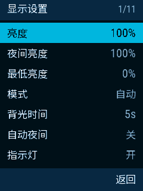 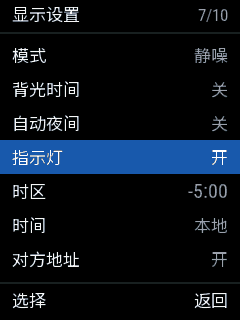

亮度（白天）、夜间亮度、最低亮度（背光「熄灭」时的亮度）；背光模式（自动 / 静噪 / 手动 / 按键）、背光时间；自动夜间；指示灯；时区（一小时一步，SK2 按住一刻钟一步）；时间显示 UTC 还是本地时间；对方地址（DMR 接收界面上是否显示对方的城市和州/省，国家总是显示）；显示最近主叫（DMR / P25 信道组号行下的最近两个主叫，默认开）；主题（整套外观：颜色和色带）：

| 主题 | |
|---|---|
| 自动（默认） | 日出后用浅色主题，日落后用深色主题。优先用 GPS 定位，其次用已保存的位置。没有位置时按本地时间 07:00–19:00 切换，没有有效时钟时用深色主题。开启「自动夜间」后，背光在相同的夜间时段使用夜间亮度 |
| 深海 | 深色：藏青底、海蓝色带、选中项亮青色 |
| 阳光 | 浅色，户外用：黑字，各层颜色都加深，强光下也看得清 |
| 晴空 | 浅色：白底、宝蓝色带、选中项橙色 |
| 石墨橙 | 深色：石墨灰配橙色 |
| 夜视琥珀 | 深色：黑底琥珀色，像夜视设备 |
| 高对比 | 浅色：白底黑字、黑色色带、选中项亮黄 |

在「显示选项」中开启「自动时区」，并将时间显示设为「本地」，即可按 GPS 定位或已保存的位置显示当地时间及夏令时。内置数据库覆盖 2026–2040 年。坐标无匹配或日期超出范围时，使用手动设定的「时区」。

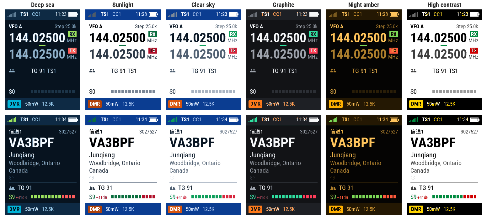

户外请用浅色主题并调高亮度：深色背景在白天基本看不见。新主题在源码里一个文件一套（`src/graphics/themes/`）。

### 声音设置

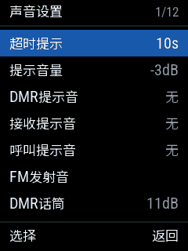 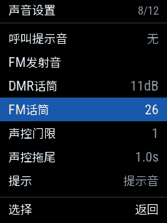

| 项 | 说明 |
|---|---|
| 超时提示 | 发射限时结束前多少秒开始提示 |
| 提示音量 | 按键音等提示音的音量 |
| DMR发射提示音 | DMR 发射的开始 / 结束音（本机） |
| 接收提示音 | 收到信号时本机的提示音：无 / 载波（信号结束时）/ 讲话人（DMR 讲完时）/ 讲话人首尾（开始时也响）/ 两者（载波和讲话人）/ 全部 |
| FM发射 | FM 发射的提示音（见下） |
| DMR话筒 / FM话筒 | 两种模式各自的话筒增益 |
| 声控门限 / 声控拖尾 | VOX：0 = 关，数字越小越灵敏；说完后再发多久 |
| 提示 | 静音（按键音和提示音都不响）/ 提示音 / 无按键音（只关按键音，提示音照响）；还没有语音提示 |
| DMR接收AGC | DMR 接收的自动增益（关 / 0 ~ 21 dB） |

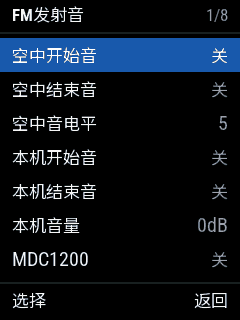

**FM发射**：空中开始音 / 结束音（发出去的，对方听到）、空中音电平；本机开始音 / 结束音（只在本机喇叭响）、本机音量；MDC1200 PTT ID（开始 / 结束 / 都发）；尾音消除（关 / 相移240° / 55Hz）。

### 按键设置

见 [12](#12-锁键盘快捷键按键设置)。

### 语言

在「选项 → Language」上按菜单键或 ◀ ▶ 切换语言：English（固件自带），加上用 OpenDMR CPS「界面语言」页写进电台的语言
（在 [opendmr-languages](https://github.com/va3bpf/opendmr-languages)，见安装手册第 5 节）。这一行在每种语言里都叫 Language，看不懂当前语言时也找得到。语言需要的字库
没写进电台时，界面文字显示“??”，菜单里这种语言显示英文名。

### 校准

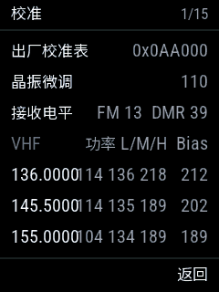

只读，显示出厂校准表（晶振微调、接收电平、各频点的功率值）。**本固件不改出厂校准数据。**

第一行是校准从哪里来：
- 一个地址（如 0x0C0000）：原厂的校准扇区。固件同时在自己的区域里留一份副本。
- **副本**：原厂扇区找不到了（被别的固件或工具覆盖），用的是以前留下的副本。
- **缺省**：原厂扇区和副本都没有，用的是一份通用的缺省表（两台机器的平均值，功率取较低的）。数字模式能正常收发，
  但频率和功率不是按这台机器校准的。

原厂扇区一旦恢复（比如把备份写回去），下次开机就会重新用它。

### APRS设置

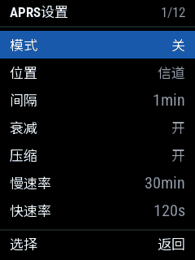 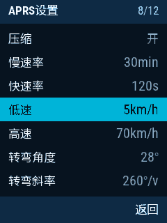

- 模式：关 / 手动（SK1 + 3 发一次）/ PTT（每次发射后发）/ 自动（按间隔，可以衰减）/ 智能信标；
- 位置：信道里 APRS 配置的固定位置，或 GPS；
- 间隔、衰减、压缩格式；智能信标的慢速 / 快速间隔、低速 / 高速、转弯角度 / 斜率 / 时间。
- SK1 + 1 随时开关 APRS。信标用 FM 的 AFSK（1200 波特）发射。
- 发信标时屏幕中间弹出提示气泡，在任何界面都会显示：手动发送（SK1 + 3、菜单里的立即发送）、PTT 模式和卫星界面先显示
  「APRS 正在发送…」，发完换成「APRS 已发送」，或者「信道忙，未发送」「未发送」「无定位」；自动和智能信标只在发出去时
  显示「APRS 已发送」（信道忙时会反复重试，不每次都提示）。气泡几秒后自动关闭，按任意键也会关闭（这一下只关气泡，
  PTT 照常发射）。
- APRS 配置的「Beacon Tx frequency」（CPS 里）是信标发射的频率，除 PTT 模式外都这样（PTT 模式在每次发射后于原
  信道发）。信道要选一个 APRS 配置才发信标，没选 APRS 配置或仅接收的信道都不发信标。配置里没有信标频率时，
  FM 信道在原频率发；DMR / P25 / NXDN / AM / USB 信道不发信标。PTT 模式只在 FM 信道发信标。电台的信道编辑界面
  只在 FM 信道提供 APRS 配置，DMR / P25 / NXDN 信道只能用 CPS 设置；DMR 信道的 APRS 一项显示 CPS 是否已指定配置
  （是 / 否）。信标发射时电台暂时切到 FM 的该频率，
  发完回到原信道，你选的信道不会被改；正在收通话时信标等下一轮。
- 「发送 QSY」（CPS 的 APRS 配置里）：勾选后信标注释开头加上当前信道的语音频率、发射亚音和频差，如「146.520MHz T100 +000」
  （Toff：无亚音；窄带信道用小写），aprs.fi 和带 APRS 的电台会把它当作呼叫你的频率。
- 发送方式：**AFSK**（默认，上面说的 FM 信标）/ **DMR** / **两者**。DMR：在 DMR 信道上把位置作为 LRRP 数据报告发给
  APRS 网关，不调频，用信道本身的时隙和色码，先等信道空闲（最多 2 秒），发送中按 PTT 会等报告发完再发话音；
  需要电台已设置 DMR ID。两者：信道能走哪条就走哪条，有信标频率的 DMR 信道上先发 AFSK 信标、再发 LRRP 报告。
- 网关：接收 LRRP 报告的网关的 DMR ID，默认 222999（BrandMeister 的 APRS 网关），按菜单键用数字键输入。
- 发送方式和网关存在电台里，不在 CPS 的设置里。DMR 发送还在试验中：网关能否正确解出报告尚未确认。

---

## 12. 锁键盘、快捷键、按键设置

### 锁键盘

- 主菜单里按 **\*** 锁键盘，按 **#** 锁 PTT（再按解锁 PTT）；锁定后回主界面。
- 主界面按 **SK1 + #** 也能锁键盘，锁定时再按 **SK1 + #** 解锁。「按键设置」里「锁定」和「解锁」是两行，可以分别改成自己喜欢的键（默认都是 SK1 + #）。
- 锁定、解锁时弹出气泡（合上 / 打开的锁头）；锁定期间状态栏有琥珀色的锁。锁定时按任何键再弹一次「已锁定 SK1 + # 解锁」（DM-32 按住 SK2 时读不到 1、4、7、\* 这几个键，所以不能用原版的 SK2 + \*）。键盘锁定但 PTT 没锁时仍可发射。
- 「通用设置 → 自动锁键」：一段时间不操作自动锁键盘和 PTT。
- 数据线通信时（写频、升级）不会锁定，自动锁键的时间从通信结束后重新计算。

### 密码

两种密码默认都关闭。在「通用设置」里打开 **锁屏密码**、**开机密码**（第一次会要求设置新密码，4 - 6 位数字，输两次）；**修改密码** 设置新的密码（两者共用）。

- **锁屏密码**：锁定（手动或自动）时同时锁 PTT，并显示锁屏界面（只有时间，不显示信道）；按任意键要求输入密码（按的是数字就当作第一位）。接收照常，VOX 不发射。开机也处于锁定状态。
- **开机密码**：开机时要求输入密码，接收关闭，输对之前什么都不能用。
- 等待输入开机密码、或锁屏密码锁定时，数据线什么都不响应：不能写频、不能升级、不能用热点。CPS 不能修改密码，升级固件也不会清除密码。
- 连续输错 5 次：等 30 秒才能再试。
- **请记住密码。** 忘了密码只能通过芯片的 bootloader 清除：先关机，运行 `tools/debug/pin_wipe.py COMx`，30 秒内开机（不按键）。它只清除密码，码表和设置都保留；之后关机再开机即可。
- 密码防的是别人使用电台，防不了读取 flash：任何人用数据线和工具，都能通过芯片的 bootloader 读出整个 flash。

### 快捷键（SK2 + 数字）

- 在菜单里某一项上，或联系人、区域列表里某一个上，按 **SK2 + 数字**：把它存到这个数字（有确认音）。
- 在主界面按 **SK2 + 数字**：直接打开那个菜单 / 切到那个区域 / 用那个联系人。

### 按键设置

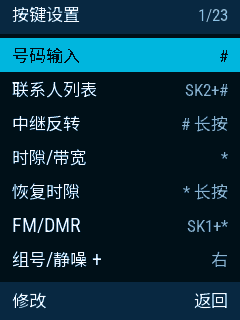 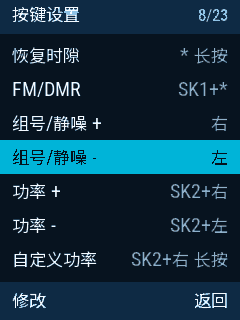 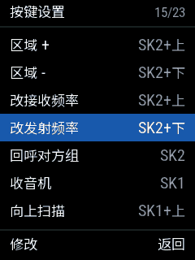

每一行是一个功能和它的按键（出厂设置见 [1](#主界面上的快捷功能出厂设置)）；长按写在按键后面（`SK2+右 长按`）。

- 在一行上按菜单键，然后按新的按键：可以按住 SK1 / SK2 再按别的键，可以短按或长按，也可以单按 SK1 或 SK2（侧键单按只有短按：侧键单独按住到长按时间再松开会响错误音，不改）。长按到「按键长按」设置的时间就生效，不用松手。返回键保留原来的。
- 菜单键、返回键、PTT 不能用；▲ ▼ 和数字键要带侧键。
- 新按键原来属于别的功能时，那个功能的按键会被清掉（会显示）。
- 最后一行恢复出厂设置。离开界面时保存。

---

## 13. 写频、热点、升级

### 写码表（CPS）

用 OpenGD77 CPS（从 <https://www.opengd77.com/> 下载，见 [安装手册](installation.md)），Radio type 选 **DM32/UV008**。读写时电台显示正在读写的部分（信道、区域、联系人……）和进度。CPS 不读写电台的设置。

可以写入：信道、区域、联系人、组列表、DTMF 联系人、APRS 配置、卫星轨道根数、DMR ID 数据库（显示主叫名字用）。

### 带地址的 DMR ID 数据库

OpenDMR 还能读自己格式的数据库，每条有呼号、名字、城市、州/省和国家（来自 RadioID 的名单：约 31.7 万个 ID，3.5 MB）。用编程线写入，电脑上需要 Python 3 和 pyserial：

```
py tools\ids\id_db.py build                  （下载 RadioID 名单并打包成 ids.bin）
py tools\ids\id_db.py write COM6             （电台开机，插好编程线）
```

`build --countries "Canada,United States"` 只保留这些国家（更小，写得更快）。第一次写入约 3 分钟（编程线最高 750 000 波特率；数据线不稳定时加 `--baud 250000` 之类指定速率）；以后写新名单只发送变化的部分。有这个数据库时就不用 CPS 写的那个；RadioID 的名单里没有姓。

### DMR 热点（MMDVM）

1. 「通用设置 → 热点」设为 **MMDVM** 或 **BlueDV**；
2. 插写频线，在电脑上运行 MMDVMHost（或 BlueDV），串口选写频线；
3. 电脑开始发 MMDVM 数据时，电台自动进入热点界面：显示收发的呼叫或电脑的 IP、频率和功率。

单工（DMO），频率、色码、功率由主机设定。MMDVMHost 20 秒没有数据就退出热点；BlueDV 按返回键退出。热点运行时写频照常可用。

### 升级固件

电台跑着 OpenDMR 时插着写频线运行 `python tools\debug\fw_update.py`：只写变了的扇区，约 35 秒，屏幕显示进度，写完自动重启。第一次安装和恢复原厂见 README。

---

## 14. 目前的限制

- 没有语音提示（电台里没有语音数据）。
- 校准只读，不能改功率和晶振。
- 「安全开机」「星（手动 / 自动）」暂时没有作用。
- P25 只有直通的组呼明语；已知问题见 [P25 说明](p25.md) 第 6 节。
- NXDN 只有 NXDN48 直通明语（没有 NXDN96、集群、加密）；来电只显示 ID，还没有 NXDN ID 到呼号的数据库。
- M17 只有直通语音和短信（没有其他数据、加密），发射目标只能是 ALL；语音质量不如 DMR / NXDN（Codec 2 3200）。
- YSF 只发 DN（V/D 模式 2）直通语音，目标只能是 ALL；VW（全速率语音）只显示不放音；没有 Wires-X、GPS、图片等数据。
- 以下功能还没有在空中完整实测：热点的 CW ID、卫星过境、脱网、按距离排序。
