# OpenDMR 使用说明书

适用于装了 OpenDMR 固件的 **Baofeng DM-32 / DM-32UV**。English: [manual.en.md](manual.en.md)。

图中都是电台上的真实截屏（`tools/debug/fshot.py`，240×320）。GPS 和电台信息里的位置做了模糊处理。

> 本说明书对应固件版本 25340747（2026-11-07）。装机、升级、恢复原厂见 [安装手册](installation.md)。
> **刷机前务必先备份两颗 Flash**，备份里有本机独有的校准数据。

## 目录

1. [按键](#1-按键)
2. [屏幕](#2-屏幕)
3. [信道模式](#3-信道模式)
4. [VFO 模式](#4-vfo-模式)
5. [接收](#5-接收)
6. [发射](#6-发射)
7. [扫描](#7-扫描)
8. [双守](#8-双守)
9. [联系人和呼叫对象](#9-联系人和呼叫对象)
10. [主菜单](#10-主菜单)
11. [选项](#11-选项)
12. [锁键盘、快捷键、按键设置](#12-锁键盘快捷键按键设置)
13. [写频、热点、升级](#13-写频热点升级)
14. [目前的限制](#14-目前的限制)

---

## 1. 按键

| 按键 | 作用 |
|---|---|
| **菜单键**（屏幕下方左边） | 菜单 / 确定。主界面上**短按打开本界面的菜单**（快捷菜单），**长按打开主菜单** |
| **返回键**（屏幕下方右边） | 返回 / 删除一位。**长按回到主界面**。信道界面上短按进 VFO，VFO 界面上短按回信道 |
| ▲ ▼ | 换信道（信道模式）、调频率（VFO）、在列表里移动 |
| ◀ ▶ | 在列表里改当前项的值；主界面上改组号（DMR）或静噪（FM） |
| 旋钮 | 同 ▲ ▼ |
| SK1、SK2（侧键） | 单按有各自的功能，按住再按别的键是组合键（见下表） |
| PTT | 发射 |
| 数字键、* 、# | 输入信道号、频率、号码；主界面上的快捷功能 |

屏幕底栏左右两个标签就是菜单键、返回键在当前界面的作用（选择、确定、保存、修改、返回、删除……）。

### 主界面上的快捷功能（出厂设置）

这些都可以在「选项 → 按键设置」里改（见 [12](#12-锁键盘快捷键按键设置)）。

| 按键 | DMR | FM |
|---|---|---|
| # | 输入组号 / 个呼号码 | 输入 DTMF |
| SK2 + # | 联系人列表 | DTMF 联系人列表 |
| # 长按 | 中继反转（只在信道模式） | 同左 |
| * | 切换时隙 | 切换带宽 12.5 / 25 kHz |
| * 长按 | 恢复信道本来的时隙 | — |
| SK1 + * | 切换模式：FM → AM → USB → LSB → DMR → P25 | 同左 |
| ▶ / ◀ | 组号 + / −（在组列表里换） | 静噪 + / − |
| SK2 + ▶ / ◀ | 功率 + / − | 同左 |
| SK2 + ▶ 长按 | 自定义功率 | 同左 |
| SK2 + ▲ / ▼ | 区域 + / −（信道模式）；发射频率 + / −（VFO） | 同左 |
| SK2 单按 | 回呼对方的组（刚收到的呼叫） | — |
| SK1 单按 | 收音机 | 同左 |
| SK1 + ▲ / ▼ | 向上 / 向下扫描 | 同左 |
| SK1 + 1 | APRS 开 / 关 | 同左 |
| SK1 + 2 | 立即发一次 APRS 信标 | 同左 |

另外：SK2 + 菜单键直接进「信道详情」；SK2 + 数字键是快捷键（见 [12](#12-锁键盘快捷键按键设置)）。

---

## 2. 屏幕

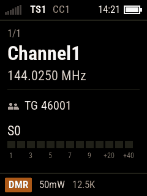 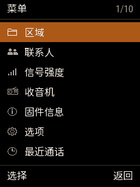

- **状态栏**（顶部）：信号格、时隙 `TS1`/`TS2`、色码 `CC1`、扫描图标、时间、电池。接收时下面一条绿线，发射时整条变红。
- **主区**：信道界面是区域和位置、信道名（大字）、频率、发射对象（组号）、S 表。
- **底栏**：主界面上是模式（`DMR`/`FM`/`AM`/`USB`/`LSB`）、功率、带宽；列表界面上是左右两个按键的作用。
- **列表界面**（菜单、设置）：标题栏写名称和位置（`1/10`），当前项橙底，一屏 7 行，▲ ▼ 到头会绕回。

颜色有固定含义：绿色 = 接收，红色 = 发射，橙色 = 选中 / 当前，琥珀色 = 警告（低电、扫描、快超时）。

---

## 3. 信道模式

开机进入信道模式（上次在 VFO 就进 VFO）。

| 操作 | 按键 |
|---|---|
| 换信道 | ▲ ▼ 或旋钮 |
| 直接跳到第 N 个信道 | 输入数字，再按菜单键（返回键取消） |
| 换区域 | SK2 + ▲ ▼，或主菜单「区域」 |
| 换组号 / 调静噪 | ▶ ◀ |
| 功率 | SK2 + ▶ ◀ |
| 时隙 / 带宽 | * |
| 进 VFO | 返回键 |
| 本信道的菜单 | 菜单键 |
| 信道详情 | SK2 + 菜单键，或菜单里第一项 |

### 信道菜单（菜单键）

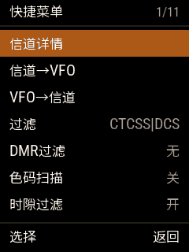 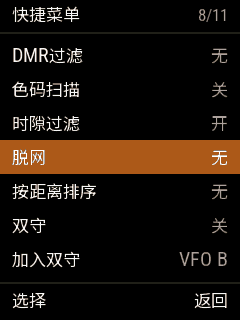

▲ ▼ 选项，◀ ▶ 改值，菜单键执行并退出，返回键不改就退出。

| 项 | 作用 |
|---|---|
| 信道详情 | 打开本信道的全部参数（见下） |
| 信道→VFO | 把本信道复制到当前 VFO，然后进 VFO |
| VFO→信道 | 用当前 VFO 覆盖本信道（要确认） |
| 过滤 | 模拟亚音过滤：`CTCSS\|DCS` 只听亚音对的信号，`无` 都听 |
| DMR过滤 | 无 / 只听本组 / 本联系人 / 接收组列表里的组 |
| 色码扫描 | 开：自动找色码（同时关掉色码过滤） |
| 时隙过滤 | 开：只听本信道的时隙 |
| 脱网 | 中继信道上直接用接收频率对讲（不经中继） |
| 按距离排序 | 区域里的信道按离本机的距离排（要设了位置） |
| 双守 | 开关双守（见 [8](#8-双守)） |
| 加入双守 | 把本信道放进双守的一路（右边写着要替换的那一路） |

### 信道详情

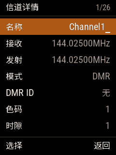 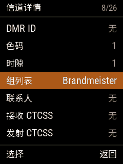 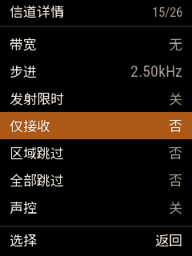 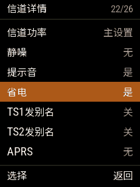

名称、收发频率、模式、DMR ID、色码（P25 信道是 NAC）、时隙、组列表、联系人、收发亚音、带宽、步进、发射限时、仅接收、区域跳过、全部跳过、声控、信道功率、静噪、提示音、省电、两个时隙是否发送讲话人别名、APRS 配置。

- ▲ ▼ 选项，◀ ▶ 或旋钮改值；
- 频率和 DMR ID 用数字键输入（8 位，◀ 删一位）；在接收 / 发射频率上按 ◀ ▶ 是把发射频率设成接收频率加中继差频；
- 名称：数字键打字母，◀ ▶ 移动，SK2 + ◀ 删除，SK2 + ▶ 插入；
- 组列表、联系人、APRS 配置按名字选；
- **菜单键保存**（写进码表）并回主界面；**返回键不保存**。

---

## 4. VFO 模式

信道界面按返回键进入，再按返回键回信道。两个 VFO（A、B），**长按返回键**切换，或在 VFO 菜单里选。

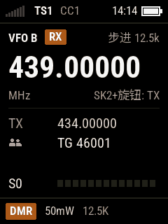 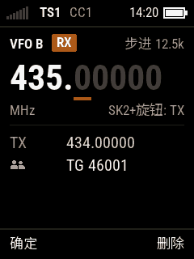

| 操作 | 按键 |
|---|---|
| 调接收频率 | ▲ ▼ 或旋钮（按步进） |
| 调发射频率 | SK2 + 旋钮，或 SK2 + ▲ ▼ |
| 直接输入频率 | 数字键（如 `43500000`，输满 8 位自动生效，或按菜单键确定；返回键删一位） |
| 按住时收发对调 | SK1 + SK2 |
| 模式：FM → AM → USB → LSB → DMR → P25 | SK1 + * |
| 静噪（FM、AM、SSB）/ 组号（DMR、P25） | ▶ ◀ |

顶行写着当前改的是接收（`RX`）还是发射（`TX`），以及步进。

**AM、USB、LSB 只能接收**（射频芯片只能发 FM）：底栏显示「仅接收」，按 PTT 提示「切换到FM或DMR才能发射」。这几种模式的静噪按信号强度（0 % 常开）；信号低于门限后 AM 等 0.2 秒、USB / LSB 等 0.5 秒才关，说话中间的停顿不会把声音切断。USB / LSB 下旋钮每格 100 Hz；先调到抑制载波频率（如 144.300 MHz），再左右微调到声音正常。模式跟着信道和 VFO 保存，CPS 里这样的信道显示为模拟。

**P25**（APCO P25 Phase 1 常规语音，直通、组呼、明语）：底栏显示 `P25`，状态栏显示 NAC（如 `NAC293`），频率下面是
通话组和 NAC。

- **NAC**（网络接入码，12 位十六进制，默认 293）相当于 DMR 的色码：只收 NAC 相同的；设成 `F7E` 收所有的。在信道
  详情里改（P25 信道的“色码”一项变成 NAC，◀ ▶ 每次 1，按住每次 0x10）。
- **通话组**和 DMR 一样选（▶ ◀、输入组号、联系人），只发组呼。
- 加密的通话只显示锁，不放音。CPS 里 P25 信道显示为 DMR，**在 CPS 里改了这个信道 NAC 可能被改掉**。
- 已知问题和技术细节见 [P25 说明](p25.md)。

### VFO 菜单（菜单键）

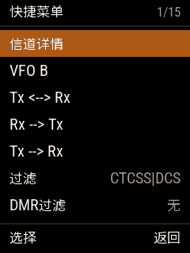 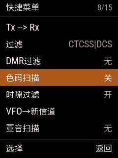 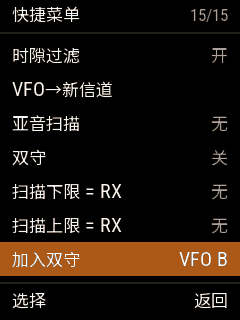

| 项 | 作用 |
|---|---|
| 信道详情 | 当前 VFO 的全部参数（同信道详情） |
| VFO B / VFO A | 在这一行按菜单键切换 VFO |
| Tx <--> Rx | 收发频率对调 |
| Rx --> Tx / Tx --> Rx | 把接收频率复制给发射 / 反过来 |
| 过滤、DMR过滤、色码扫描、时隙过滤 | 同信道菜单 |
| VFO→新信道 | 把当前 VFO 存成一个新信道（「新信道 N」，在「所有信道」里） |
| 亚音扫描 | 扫出对方用的 CTCSS / DCS（任意键停在当前的亚音） |
| 双守、加入双守 | 见 [8](#8-双守) |
| 扫描下限 = RX / 扫描上限 = RX | 把当前接收频率设为 VFO 扫描的下限 / 上限 |

---

## 5. 接收

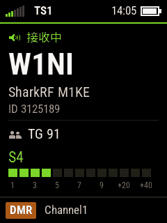 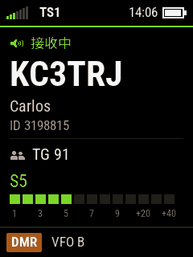

- 收到信号时状态栏下面是绿线、信号格变绿，S 表数字变绿；超过 S9 的部分用小号红字写 `+xxdB`。
- DMR：显示「接收中」、主叫（呼号或 DMR ID，大字）、名字、ID、组号。约 0.7 秒内就能显示主叫。名字来自联系人和 CPS 写入的 DMR ID 数据库。
- 收到的呼叫记在「最近通话」里。按 **SK2** 可以直接回呼对方的组（个呼就回给对方）。
- FM：静噪打开时出声；▶ ◀ 调静噪，调的时候屏幕上会显示一会儿。

---

## 6. 发射

按住 **PTT** 发射，松开结束。发射界面（这份说明书没有截图）：

- 状态栏整条变红，写 `TX`（DMR 还有时隙和色码）；
- 主区：呼叫对象（「组呼」+ 组号，或区域 + 信道 / VFO）、信道和频率、大号计时（有发射限时时显示剩余时间和进度条，快到时变琥珀色）、8 格话筒电平；
- 中继：唤醒中继时显示「唤醒中继」，中继不应答显示「无中继」；
- 不能发射的情况（超出频段、仅接收信道、超时、无中继）显示原因，直到松开 PTT。

发射时：

- **FM**：按 **SK2** 发 1750 Hz 中继启动音；按数字键发 DTMF；
- 开始 / 结束提示音、MDC1200、尾音消除在「声音设置 → FM发射」里设；
- **声控（VOX）**：「声音设置」里设声控门限（0 = 关）和拖尾；
- **PTT 锁定**（「电台设置 → PTT锁定」）：按一下 PTT 开始发射，再按一下结束。

---

## 7. 扫描

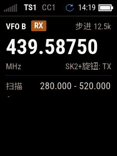

- **SK1 + ▲** 向上扫，**SK1 + ▼** 向下扫。信道模式扫当前区域（跳过设了「区域跳过」的信道；在「所有信道」里跳过设了「全部跳过」的）；VFO 扫上下限之间（没设上下限就扫整个频段）。状态栏有扫描图标。
- 扫描中：**▲** 马上跳到下一个；**◀** 反向；停住时按 **\*** 把这个信道 / 频率当干扰跳过（本次扫描）；**PTT** 停止扫描并发射；**其他键**停止扫描。
- 「电台设置」里：扫描延时（停多久）、驻留时间、扫描方式（保持 / 暂停 / 停止）、开机扫描。

---

## 8. 双守

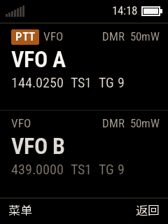

同时守听两路，每一路可以是**任意信道或 VFO A / B**（两路也可以相同）。

- 打开：信道或 VFO 菜单里「双守」。默认两路是 VFO A 和 VFO B；在信道或 VFO 上用「加入双守」把它换进去（替换的是右边写着的那一路，下次换另一路）。
- 轮流守听，哪一路有信号就停在那一路，信号结束后再停一会儿（方便回话）。
- 发射：自动跟随最近收到的一路（带 `PTT` 标签）；▲ / ▼ 固定用上面 / 下面一路发射。
- 菜单键：主菜单；长按菜单键：双守菜单（关闭、发射路）。返回键：回到单守。关机后保持。

---

## 9. 联系人和呼叫对象

### 输入组号 / 个呼号码（#）

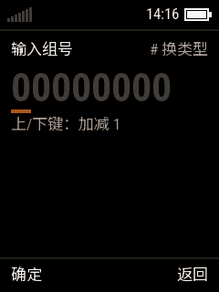

- 主界面按 **#**。**#** 依次切换：组号 → 个呼 → 联系人 → 本机 ID；▲ ▼ 加减 1。
- 菜单键确定：组号 / 个呼临时替代信道的联系人；选联系人同时用它的时隙；**本机 ID 写进码表**（关机后保留）。
- FM 下 # 是 DTMF 输入：数字、*、# 输入，◀ 删除，菜单键发送。

### 联系人列表（SK2 + #）

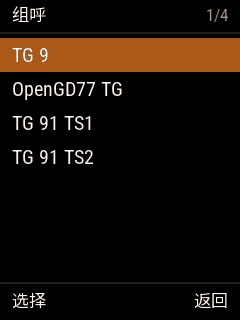

主界面 SK2 + #：选一个按菜单键，马上作为发射对象。

### 主菜单 → 联系人

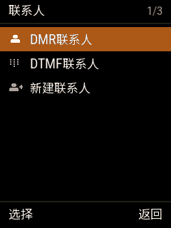  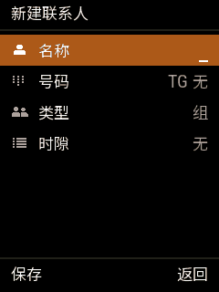

- **DMR联系人**：一次显示一种呼叫类型，**#** 切换（组呼 / 个呼 / 全呼）。菜单键打开操作：选为发射、编辑联系人、删除联系人（删除前要确认；接收组列表在用的组不能删）。
- **DTMF联系人**：FM 用的 DTMF 号码。
- **新建联系人**：名称（数字键打字母）、号码、类型、时隙；菜单键保存。

---

## 10. 主菜单

主界面**长按菜单键**。

 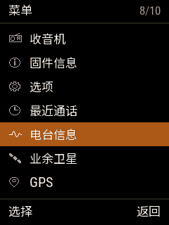

### 区域

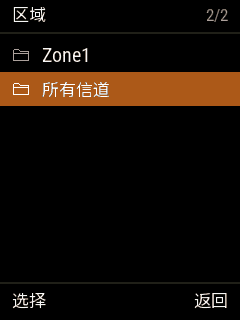

选区域；「所有信道」是码表里全部信道。

### 信号强度

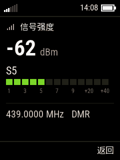

大字 dBm、S 表、频率和模式。* 显示原始的信号 / 噪声读数。

### 收音机（SK1）

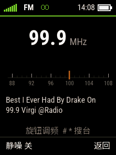

87 ~ 108 MHz 广播，显示 RDS 电台名和文字，状态栏有立体声标志。

- 旋钮或 ◀ ▶：100 kHz 一步；**#** / **\***：向上 / 向下搜台；数字直接输入（`999` = 99.9 MHz，`1071` = 107.1 MHz）；
- 菜单键：静噪开 / 关（开时没台就静音）；
- 返回键、SK1 或 PTT：退出（关收音机）。频率和静噪会保存；在收音机界面关机，下次开机还在收音机。

### 固件信息

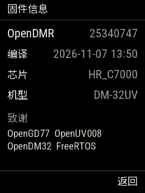

版本（git 提交号）、编译时间、芯片、机型、致谢。

### 最近通话

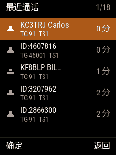

每次呼叫两行：主叫（呼号和名字，或 ID）、组号和时隙，右边是多久以前。▲ ▼ 移动（SK2 + ▲ ▼ 到第一 / 最后）；菜单键：以后发射到这个组（SK2 + 菜单键：个呼这个人）；**#** 长按清空。

### 电台信息

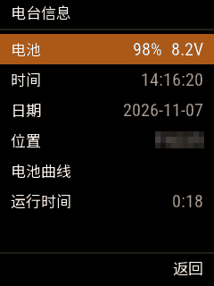

电池、时间、日期、位置（梅登海德网格）、电池曲线、运行时间。在时间、日期、位置上按菜单键可以用数字键设置（输完按菜单键；位置页 ▲ ▼ 选南北，SK2 + ▲ ▼ 选东西）。电池曲线每 40 秒一个点（6.4 ~ 8.2 V）。

### 业余卫星

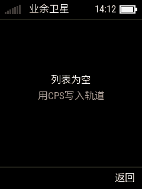

需要：**时间和位置已设置**（电台信息里，或用 GPS），**卫星轨道根数（keps）已用 CPS 写入**。之后显示各卫星即将过境的时间表；选一个看过境图（极坐标轨迹、方位 / 仰角）和多普勒修正后的频率（菜单键切换话音 / APRS / 其他）。过境界面会自动按多普勒调频，PTT 在当时的修正频率上发射。没写 keps 时显示「列表为空，用CPS写入轨道」。

### GPS

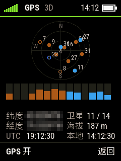

天空图（GPS 蓝色、北斗橙色，实心是正在用的卫星）、各卫星信号条、经纬度、卫星数、海拔、UTC 和本地时间。**菜单键开关 GPS**。定位后时间自动校准；APRS 和卫星可以用 GPS 位置。

---

## 11. 选项

主菜单 → 选项。所有设置界面：▲ ▼ 选项，**◀ ▶ 改值**，菜单键打开子菜单或切换开关，返回键返回。设置随时生效，关机时保存。**CPS 不读写这些设置**。

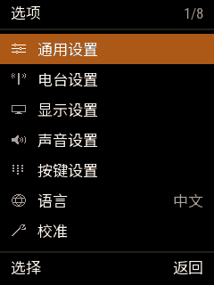

### 通用设置

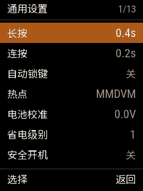 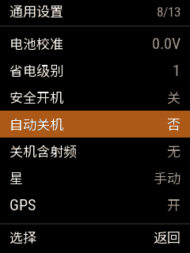

| 项 | 说明 |
|---|---|
| 长按 / 连按 | 长按判定时间、按住时重复的间隔 |
| 自动锁键 | 多久不操作自动锁键盘和 PTT（关 / 分钟） |
| 热点 | 关 / MMDVM / BlueDV（见 [13](#13-写频热点升级)） |
| 电池校准 | 电压显示的修正（±0.5 V） |
| 省电级别 | 接收省电的程度 |
| 安全开机 | 保留项，本固件里暂时没有作用 |
| 自动关机 / 关机含射频 | 多久不操作自动关机；后者打开时收到信号也算操作 |
| 星 | 保留项（手动 / 自动），暂时没有作用 |
| GPS | 关 / 开 / NMEA（NMEA 语句从写频线输出） |
| 记住菜单位置 | 开：菜单位置关机后也记住（不开时只在开机期间记住） |
| 本机ID | 本机的 DMR ID，菜单键打开号码输入 |

### 电台设置

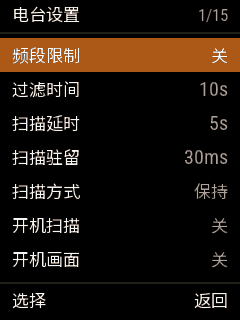 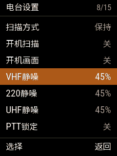 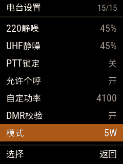

| 项 | 说明 |
|---|---|
| 频段限制 | 关 / 开（业余频段）/ CPS（按 CPS 里设的） |
| 过滤时间 | DMR 收到一个组后，在这段时间里只听这个组 |
| 扫描延时、扫描驻留、扫描方式、开机扫描 | 见 [7](#7-扫描) |
| 开机画面 | 开机时显示开机画面、放开机旋律（默认关，直接进主界面） |
| VHF / 220 / UHF 静噪 | 三个频段信道的默认静噪 |
| PTT锁定 | 按一下 PTT 开始发射，再按一下结束 |
| 允许个呼 | 关 / 开 / PTT（收到个呼后按 PTT 回给对方） |
| 默认功率 | 新建信道和第一次使用的 VFO 的功率（之后各用各的），以及功率设为「电台」的旧信道 |
| 功率应用到全部 | 把默认功率写入所有信道和 VFO A / B（先确认） |
| 自定功率 | 「自定义功率」档（+W-）的功放驱动值，0 - 4100（SK2 按住时步进 10） |
| DMR校验 | 关掉时忽略 DMR 数据的 CRC 错误 |

功率档：50mW、500mW、1W、2W、3W、4W、5W、7W、10W、+W-。1W / 4W / 10W 是原厂低 / 中 / 高档的校准值，其余按校准值估算，
没有实测。每个信道、VFO A、VFO B 各有自己的功率，SK2 + ▶ ◀ 改的是当前这个，并会保存。

### 显示设置

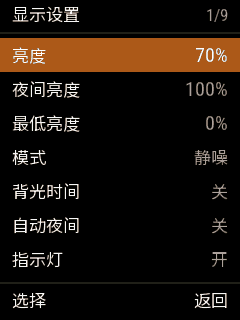 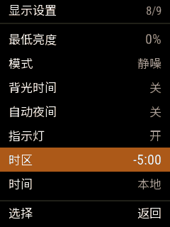

亮度（白天）、夜间亮度、最低亮度（背光「熄灭」时的亮度）；背光模式（自动 / 静噪 / 手动 / 按键）、背光时间；自动夜间；指示灯；时区（一小时一步，SK2 按住一刻钟一步）；时间显示 UTC 还是本地时间。

### 声音设置

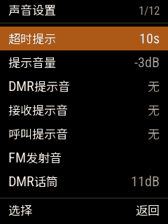 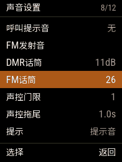

| 项 | 说明 |
|---|---|
| 超时提示 | 发射限时结束前多少秒开始提示 |
| 提示音量 | 按键音等提示音的音量 |
| DMR提示音 | DMR 发射的开始 / 结束音 |
| 接收提示音 | 载波 / 讲话人结束时的提示音 |
| 呼叫提示音 | 讲话人开始时也提示 |
| FM发射 | FM 发射的提示音（见下） |
| DMR话筒 / FM话筒 | 两种模式各自的话筒增益 |
| 声控门限 / 声控拖尾 | VOX：0 = 关，数字越小越灵敏；说完后再发多久 |
| 提示 | 静音 / 提示音 / 无按键音（还没有语音提示） |
| DMR接收AGC | DMR 接收的自动增益（关 / 0 ~ 21 dB） |

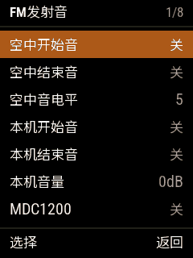

**FM发射**：空中开始音 / 结束音（发出去的，对方听到）、空中音电平；本机开始音 / 结束音（只在本机喇叭响）、本机音量；MDC1200 PTT ID（开始 / 结束 / 都发）；尾音消除（关 / 相移240° / 55Hz）。

### 按键设置

见 [12](#12-锁键盘快捷键按键设置)。

### 语言

在「选项 → 语言」上按菜单键或 ◀ ▶ 切换 中文 / English。

### 校准

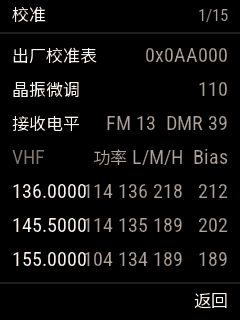

只读，显示出厂校准表（晶振微调、接收电平、各频点的功率值）。**本固件不改校准数据。**

### APRS设置

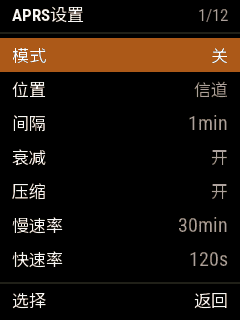 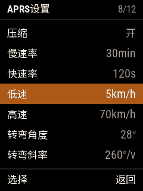

- 模式：关 / 手动（SK1 + 2 发一次）/ PTT（每次发射后发）/ 自动（按间隔，可以衰减）/ 智能信标；
- 位置：信道里 APRS 配置的固定位置，或 GPS；
- 间隔、衰减、压缩格式；智能信标的慢速 / 快速间隔、低速 / 高速、转弯角度 / 斜率 / 时间。
- SK1 + 1 随时开关 APRS。信标用 FM 的 AFSK（1200 波特）发射。

---

## 12. 锁键盘、快捷键、按键设置

### 锁键盘

- 主菜单里按 **\*** 锁键盘，按 **#** 锁 PTT（再按解锁 PTT）；锁定后回主界面。
- 锁定时按任何键会短暂显示锁定页；**SK2 + \*** 解锁。键盘锁定但 PTT 没锁时仍可发射。
- 「通用设置 → 自动锁键」：一段时间不操作自动锁键盘和 PTT。

### 快捷键（SK2 + 数字）

- 在菜单里某一项上，或联系人、区域列表里某一个上，按 **SK2 + 数字**：把它存到这个数字（有确认音）。
- 在主界面按 **SK2 + 数字**：直接打开那个菜单 / 切到那个区域 / 用那个联系人。

### 按键设置

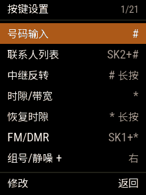 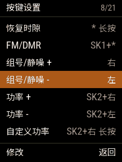 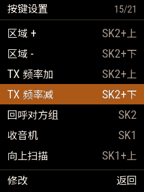

每一行是一个功能和它的按键（出厂设置见 [1](#主界面上的快捷功能出厂设置)）。

- 在一行上按菜单键，然后按新的按键：可以按住 SK1 / SK2 再按别的键，可以短按或长按，也可以单按 SK1 或 SK2。返回键保留原来的。
- 菜单键、返回键、PTT 不能用；▲ ▼ 和数字键要带侧键。
- 新按键原来属于别的功能时，那个功能的按键会被清掉（会显示）。
- 最后一行恢复出厂设置。离开界面时保存。

---

## 13. 写频、热点、升级

### 写码表（CPS）

用 OpenGD77 CPS（从 <https://www.opengd77.com/> 下载，见 [安装手册](installation.md)），Radio type 选 **DM32/UV008**。读写时电台显示正在读写的部分（信道、区域、联系人……）和进度。CPS 不读写电台的设置。

可以写入：信道、区域、联系人、组列表、DTMF 联系人、APRS 配置、卫星轨道根数、DMR ID 数据库（显示主叫名字用）。

### DMR 热点（MMDVM）

1. 「通用设置 → 热点」设为 **MMDVM** 或 **BlueDV**；
2. 插写频线，在电脑上运行 MMDVMHost（或 BlueDV），串口选写频线；
3. 电脑开始发 MMDVM 数据时，电台自动进入热点界面：显示收发的呼叫或电脑的 IP、频率和功率。

单工（DMO），频率、色码、功率由主机设定。MMDVMHost 20 秒没有数据就退出热点；BlueDV 按返回键退出。热点运行时写频照常可用。

### 升级固件

电台跑着 OpenDMR 时插着写频线运行 `python tools\debug\fw_update.py`：只写变了的扇区，约 35 秒，屏幕显示进度，写完自动重启。第一次安装和恢复原厂见 README。

---

## 14. 目前的限制

- 没有语音提示（电台里没有语音数据）。
- 校准只读，不能改功率和晶振。
- 主题不能改，界面用固定配色。
- 「安全开机」「星（手动 / 自动）」暂时没有作用。
- P25 只有直通的组呼明语；已知问题见 [P25 说明](p25.md) 第 6 节。
- 以下功能还没有在空中完整实测：APRS 解码、热点的 CW ID、卫星过境、脱网、按距离排序。
