# DM-32UV user interface

Status: **implemented; this document matches the firmware** (2026-11-03, firmware commit d09b2a6).
中文版：[ui-design.md](ui-design.md).

> Sections 1 - 5 were first built in the ucos firmware (RA4FHE's OpenDM32, `firmware/dh4570_IAP`) and carried over to the current firmware (`src/`). How `src/` builds its UI is section 6 of the Chinese version, [ui-design.md](ui-design.md).

The pictures are the screenshots of the [user manual](manual.en.md) (`docs/manual/en/`, `docs/manual/zh/`), real
screens of this firmware taken with `tools/debug/fshot.py`.

## 1. Why

The interface came from OpenGD77, designed for a 160x128 screen, and was stretched on the DM-32UV's 240x320
portrait screen (x1.5 across, x2.5 down): tall thin characters, a few fixed-width bitmap fonts, no Chinese.
It is now drawn at the native 240x320 resolution, in the style of Motorola radios (XPR / SL series).

## 2. Principles

- **Fast**: boot straight into the channel screen, power off as soon as the data is saved, no fixed waits or animations;
- **Extras are options, off by default** (boot screen, boot melody, ...);
- **Information hierarchy**: channel name > frequency > state; state shown with icons and colour, not abbreviations;
- **Colour means something**: white on black; colour only for state (blue = selected/current, green = receive,
  red = transmit, amber = warning);
- **Chinese and English** interface (Russian removed); Chinese channel and contact names;
- **Write little to the screen**: every LCD transfer leaves a little interference in the FM audio (see 6.1),
  only what changed is sent.

## 3. Keys

The DM-32UV has no orange key.

| Key | Action |
|---|---|
| Left key | Menu / OK (open, confirm, select, toggle); **long press = quick menu** |
| Right key | Back / Home (up one level, delete a digit; home on the main screen) |
| Up / down, knob | Channel, move in lists; frequency in the VFO |
| SK1 alone | FM broadcast radio |
| SK1 + * | FM / DMR in the VFO |
| SK2 + left / right | Power down / up (SK2 + long right: highest level) |
| SK2 + knob | Edit the receive or the transmit frequency in the VFO |
| SK1 + SK2 (VFO) | Swap Rx and Tx while held |
| PTT | Transmit |

The two labels of the bottom bar belong to the left and right keys and say what they do on that screen
(Select, OK, Save, Edit, Back, ...). The idle main screens show no key labels: the bottom bar shows the mode,
power and bandwidth or colour code.

## 4. Visual rules

Sizes are real screen pixels (240x320); the screenshots are 2x.

### 4.1 Colours

| Name | RGB | Use |
|---|---|---|
| Background | #050608 | Screen |
| Line | #1C2026 | Separators, bar background |
| Text | #F2F4F7 | Channel name, main values |
| Text 2 | #D5D9DF | Frequency, talk group |
| Label | #9AA1AB | Zone, labels, units |
| Dimmed | #6E7580 | Other path of the dual watch |
| Unlit | #3A3F47 | Empty signal / S meter segments |
| Selected | #1E5AA8 | Menu highlight, mode badge, RX/TX badge |
| Receive | #2BD47D | Receiving, signal bars, mic level |
| Transmit | #C9302C | Transmit status bar |
| Warning | #E9A23B | Low battery, scan, timeout near |

11 colours plus anti-aliasing greys make the fixed 16 colour palette (`graphics/gfxTheme.c`). Themes can change the
colours (Options > Theme options).

### 4.2 Fonts

- Digits and Latin: Roboto Condensed, made by `tools/fonts/mkfont.py`, 16 grey levels, in the program flash;
- Chinese: Noto Sans SC cut down to GB2312, made by `tools/fonts/mkcjk.py`: 17 px (all of GB2312) and 32 px bold
  (3755 common characters), 4 bit anti-aliased, in the data flash at 0x280000 (2.6 MB), written by
  `tools/fonts/upload_cjk.py`;
- Sizes: 13 (status bar, bottom bar, units), 17 (lists, labels), 20 (frequency, talk group), 32~44 bold
  (channel name, caller, timer, large frequency).

### 4.3 Layout

```
y=0   ┌──────────────────────────────┐
      │ status bar                     │ signal · slot · colour code …… time · battery
      ├──────────────────────────────┤ line (green when receiving; the whole bar red when transmitting)
      │ main area, 12 px margins        │
      ├──────────────────────────────┤ line
      │ bottom bar                      │ mode badge · power · bandwidth/CC, or key labels
y=320 └──────────────────────────────┘
```

List screens (menus, settings) have a title and position (`4/9`) at the top instead of the signal status bar.

## 5. Screens

### 5.1 Channel (DMR idle)

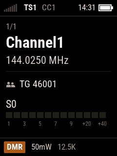

- Status bar: signal bars, `TS1`, `CC1`, time, battery;
- Main area: zone and position (`Zone1 1/1`) → channel name (large) → frequency → line → talk group →
  S meter (always shown in receive, the value turns green when the squelch opens);
- Bottom bar: `DMR` badge, power, bandwidth.

### 5.2 VFO (FM)

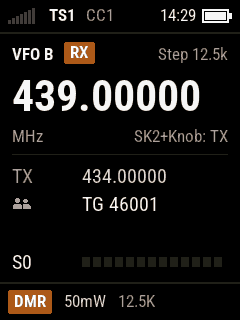

- Top line: `VFO A`, which frequency is edited (`RX` or `TX`), step;
- Large frequency (the digit being entered is underlined); `MHz` and the hint `SK2+Knob: TX`;
- The other frequency, offset; compact S meter;
- Bottom bar: `FM`, power, bandwidth.

### 5.3 DMR receive


- Green line under the status bar, green signal bars;
- Main area: `Receiving` and the call time → caller (large; the DMR ID when not in the contacts) → name (if known)
  → talk group → S meter;
- Bottom bar: mode and channel name. The caller shows within about 0.7 s of the call start (embedded LC).

### 5.4 Transmit

(No screenshot of the transmit screen.)

- Red status bar, `TX` (and slot / colour code in DMR);
- Main area: what is called (`Group Call` + talk group, or zone + channel/VFO) → channel and frequency →
  large timer (with a timeout: time left, "Time left of m:ss" and a bar, amber from the timeout warning on;
  without: elapsed time) → 8 segment mic level;
- Bottom bar: mode, power, colour code (DMR) or bandwidth (FM);
- Repeater: "Waking repeater" while waking it, "No repeater" when it doesn't answer; out of band, Rx only,
  timeout and no repeater stay on the screen until the PTT is released.

### 5.5 Dual watch

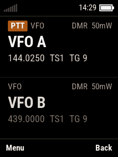

- Two paths, each **any channel or VFO**, both may be the same; **no main/sub, no A/B naming**;
- Switched on and paths added from the quick menu; kept over power off;
- Two panels; the transmit path has a `PTT` badge, the path being received `Receiving` and a green line on the left;
- Transmit follows the path last heard, or the one chosen with up/down; Back returns to the single watch;
  soft keys Menu / Back.

### 5.6 Menus and settings

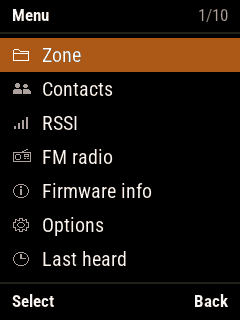 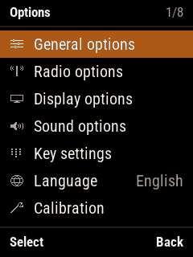 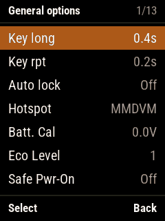

- Title bar: name and position (`1/11`);
- Rows: icon (main menu, options) + name, the value right aligned; 7 rows a page;
- Selected row white on blue;
- Bottom bar: left `Select` (or `Edit`, `Save`, `OK`), right `Back`.

Same style: zones, contacts, contact lists, DTMF contacts, radio / display / sound / APRS options, channel details,
language, theme chooser, theme options, edit contact (see the [user manual](manual.en.md)).

### 5.7 Quick menus (long press on the menu key)

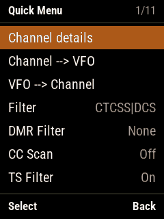 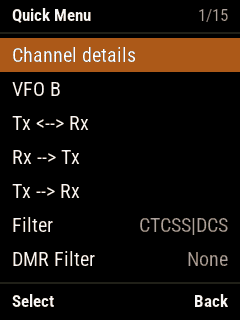

Dual watch, add to dual watch, channel ↔ VFO, filters, DMR filter; in the VFO also frequency bind and Rx/Tx swap and copy.

### 5.8 Other screens

| Screen | Screenshot | Notes |
|---|---|---|
| Radio info | 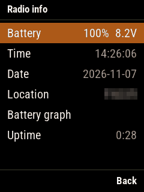 | Battery, time, date, location, battery graph; time/date/location with the digit entry widget |
| RSSI | 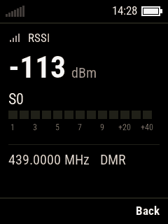 | dBm (large), S meter, frequency and mode |
| Last heard | 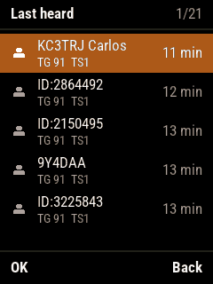 | Two lines per call: ID/callsign, talk group and slot, how long ago |
| Number entry | 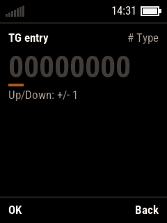 | `#` cycles TG / PC / contact / own ID; OK saves the own ID for good |
| Firmware info | 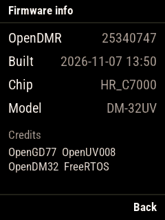 | Version, build time, chip, model, credits |
| GPS | 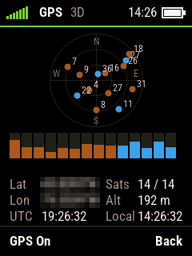 | Sky plot (GPS blue, BeiDou amber, filled when received), position, satellites, height, UTC and local time; OK switches the GPS |
| Satellites | 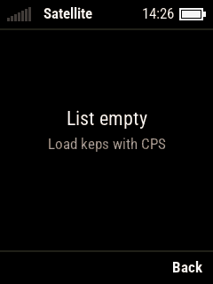 | Asks for the location first when none is set; then the passes list and the pass (polar track, Doppler corrected frequencies) |
| FM radio | 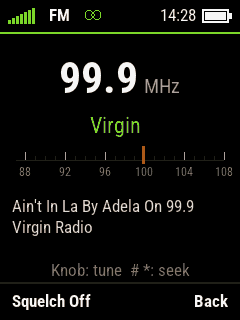 | Large frequency, RDS name, 87~108 MHz dial, RDS text; knob 100 kHz, # / * seek |

## 6. Implementation

### 6.1 Drawing

- `hardware/lcd/lcdFrameBuffer.c`: 240x320, 4 bits a pixel (16 colour palette), 37.5 KB (screen and notification copy);
- **Only what changed is sent to the LCD**: a hash of each 32 pixel segment of each row, only the rectangle of the
  changed segments is sent (d09b2a6). Reason: the LCD is an 8 bit parallel bus, 150 KB a frame, and every
  transfer was heard as a tick in the FM audio; the stock firmware also only writes what changes;
- `HX8353E.c` keeps OpenGD77's 160x128 drawing API and maps it to the new screen; legacy text uses the new fonts;
- `graphics/`: font engine (proportional, grey levels, UTF-8), theme colours, icons (20x18), shapes (anti-aliased discs, rings);
- `ui/widgets/`: statusBar, channelPanel, bottomBar, listView, txPanel, sMeter, digitEntry, toast;
- Screen logic keeps OpenGD77's structure; the drawing calls the widgets.

### 6.2 Text

- `user/INCLUDE/user_interface/languages/`: `chinese.h` (UTF-8) replaced `russian.h`; a language is one file;
- Strings up to 25 bytes (8 Chinese characters).

### 6.3 Screenshots

```
py tools/debug/fshot.py shot.png [--scale 2]     # the frame buffer of this firmware
```

The screenshots of this document were taken with the programming cable plugged in, each screen opened with the debug
call `menuSystemPushNewMenu(<screen number>)`; the transmit screens were drawn with `uiUtilityDrawTxScreen()`
without transmitting; DMR receive was captured during a real call from a DM1801.

## 7. Problems seen in the screenshots (to fix)

- **English quick menus**: "Add to dual watch" and "Replace VFO B" overlap (not in Chinese);
- **English left in the Chinese interface**: `Tx <--> Rx`, `Rx --> Tx`, `Tx --> Rx` in the quick menu, the `OK`
  soft key, the VFO's `RX`/`TX` badge;
- **S meter in DMR receive**: reads S7 while no or only 4 segments are lit (maybe a redraw during the capture;
  to check on the radio);
- **Theme options colour swatches**: written straight to the LCD, not in the frame buffer, so empty in the
  screenshots; to check on the radio that they show;
- **Lock notice**: a short band above the bottom bar, gone before the capture.
