# DM-32UV user interface

Status: **implemented; this document matches the firmware** (2026-11-15, firmware commit 9aff18c).
中文版：[ui-design.md](ui-design.md).

> Sections 1 - 5 were first built in the ucos firmware (RA4FHE's OpenDM32, `firmware/dh4570_IAP`) and carried over to the current firmware (`src/`). Section 6 outlines how `src/` builds its UI; the details are in section 6 of the Chinese version, [ui-design.md](ui-design.md).

The pictures are the screenshots of the [user manual](manual.en.md) (`docs/manual/en/`, `docs/manual/zh/`), real
screens of this firmware taken with `tools/debug/fshot.py`, all in the Deep sea theme.

## 1. Why

The interface came from OpenGD77, designed for a 160x128 screen, and was stretched on the DM-32UV's 240x320
portrait screen (x1.5 across, x2.5 down): tall thin characters, a few fixed-width bitmap fonts, no Chinese.
It is now drawn at the native 240x320 resolution, in the style of Motorola radios (XPR / SL series).

## 2. Principles

- **Fast**: boot straight into the channel screen, power off as soon as the data is saved, no fixed waits or animations;
- **Extras are options, off by default** (boot screen, boot melody, ...);
- **Information hierarchy**: channel name > frequency > state; state shown with icons and colour, not abbreviations;
- **Colour means something**: colour only for state (accent = selected/current, green = receive, red = transmit,
  amber = warning); the colours themselves come from the theme (4.1);
- **Values change only with the arrows and the knob**: the menu key opens and confirms, it never changes a value;
- **Chinese and English** interface (Russian removed); Chinese channel and contact names;
- **Write little to the screen**: every LCD transfer leaves a little interference in the FM audio (see 6.1),
  only what changed is sent.

## 3. Keys

The DM-32UV has no orange key.

| Key | Action |
|---|---|
| Left key | Menu / OK (open, confirm, select); on the main screens **short press = the menu of that screen (quick menu), long press = main menu**; never changes a value |
| Right key | Back / Home (up one level, delete a digit; home on the main screen) |
| Up / down, knob | Channel, move in lists; frequency in the VFO |
| SK1 alone | FM broadcast radio |
| SK1 + * | FM / DMR in the VFO |
| SK2 + left / right | Power down / up (SK2 + long right: highest level) |
| SK2 + up / down | Choose the receive (up) or the transmit (down) frequency to change in the VFO |
| SK1 + SK2 (VFO) | Swap Rx and Tx while held |
| PTT | Transmit |

The two labels of the bottom bar belong to the left and right keys and say what they do on that screen
(Select, OK, Save, Edit, Back, ...). The idle main screens show no key labels: the bottom bar shows the mode,
power and bandwidth or colour code. The left key has no label when it has nothing to do: on a settings row that is a
value (on/off, a choice, a number).

## 4. Visual rules

Sizes are real screen pixels (240x320), and so are the screenshots.

### 4.1 Colours

| Role (`THEME_COLOUR_`) | Use | Deep sea | Sunlight |
|---|---|---|---|
| `BACKGROUND` | Screen | #07131F | #FFFFFF |
| `LINE` | The main area's separators, the empty part of bars | #1C3448 | #7A8696 |
| `OFF` | Unlit: signal and S meter segments, digits not entered yet | #24425A | #C2CAD3 |
| `TEXT_DIM` | The other path of the dual watch | #5E7D96 | #4F5B69 |
| `TEXT_LABEL` | Zone, labels, units, place | #8FB0C9 | #2E3A48 |
| `TEXT_SECOND` | Frequency, talk group | #CFE3F1 | #101820 |
| `TEXT` | Channel name, callsign, main values | #F4FAFF | #000000 |
| `ACCENT` | Selected / current: the list row, mode chip, PTT chip | #00B4D8 | #B0420A |
| `RX` | Receive: the green line under the status bar, the S meter, RX chip | #9BE15D | #0A6E3E |
| `TX` | Transmit: the status bar while transmitting, TX chip | #FF5D5D | #B0102A |
| `WARNING` | Warning: low battery, scan, timeout near | #FFC145 | #8A5600 |
| `WHITE` | Text on the receive, transmit and warning colours | #FFFFFF | #FFFFFF |
| `ON_ACCENT` | Text on the accent | #04111C | #FFFFFF |
| `PANEL` | The band: status bar, list title, bottom bar | #0E2A44 | #0B3D91 |
| `PANEL_TEXT` | Text on the band | #F4FAFF | #FFFFFF |
| `PANEL_LABEL` | Labels on the band, unlit signal bars (a stub at the foot) | #8FC3E6 | #A9C6F2 |

These 16 colours are the whole palette: the frame buffer holds 4 bits a pixel, a palette index; anti-aliasing takes no
colours of its own, it looks up a blend table by foreground, background and level. A theme is a palette
(`graphics/theme.c`), one file a theme (`graphics/themes/`, listed in `themes.c` and compiled in). Users choose a whole
theme in Display options, not single colours:

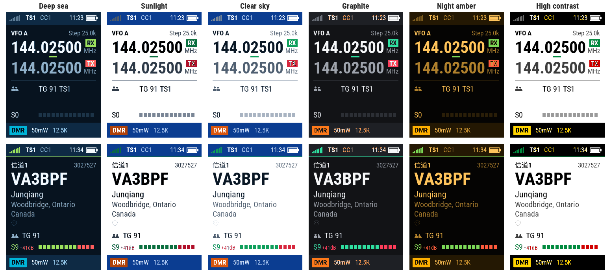

| Theme | Dark/light | |
|---|---|---|
| Deep sea | Dark | Navy, a sea blue band, cyan accent; the default at night |
| Sunlight | Light | For outdoors: pure white, black text, every layer darker, readable in bright light; the default by day |
| Clear sky | Light | White, a royal blue band, orange accent |
| Graphite | Dark | Graphite and orange |
| Night amber | Dark | Amber on black, keeps the eyes dark adapted |
| High contrast | Light | Black on white, a black band, yellow accent |

- **Auto** (the default): the first light theme of the list (Sunlight) from 7:00 to 19:00 local time, the first dark
  one (Deep sea) at night and without a clock;
- Text on the accent, receive, transmit and warning colours is not anti-aliased (`fb_set_solid_backgrounds()`): solid
  letters with clean edges;
- The light themes are made for outdoors: on this transmissive LCD a dark background can't be seen in sunlight (tried
  outdoors), so the text contrast is as high as it goes;
- Icons and text on the band use the band's own colours (`PANEL_TEXT`, `PANEL_LABEL`): no grey on grey.

### 4.2 Fonts

- Digits and Latin: Roboto Condensed, made by `tools/fonts/mkfont.py`, 16 grey levels, in the program flash;
- Chinese: Noto Sans SC cut down to GB2312, made by `tools/fonts/mkcjk.py`: 17 px (all of GB2312) and 32 px bold
  (3755 common characters), 4 bit anti-aliased, in the data flash at 0x280000 (2.6 MB), written by
  `tools/fonts/upload_cjk.py`;
- Sizes: 13 (status bar, bottom bar, units), 17 (lists, labels), 20 (frequency, talk group), 32~44 bold
  (channel name, caller, timer, large frequency).

### 4.3 Layout

```
y=0   ┌──────────────────────────────┐
      │ status bar (band)              │ signal · slot · colour code …… scan · GPS · time · battery
      │                              │ a green line under it when receiving; all red when transmitting
      │ main area, 12 px margins        │ the separators in the main area stay
      │                              │
      │ bottom bar (band)               │ mode chip · power · bandwidth/CC, or key labels
y=320 └──────────────────────────────┘
```

The status bar, list titles and bottom bar are the theme's band, set apart from the main area by colour, with no
lines. List screens (menus, settings) have a title and position (`4/9`) at the top instead of the signal status bar.
The main screens (channel, VFO, DMR receive, dual watch) all have the same compact S meter: one line, S value and
segments.

## 5. Screens

### 5.1 Channel (DMR idle)

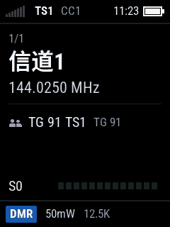

- Status bar: signal bars, `TS1`, `CC1`, time, battery;
- Main area: zone and position (`Zone1 1/1`) → channel name (large) → frequency → line → talk group →
  compact S meter (always shown in receive, the value turns green when the squelch opens);
- Bottom bar: `DMR` chip (accent), power, bandwidth.

### 5.2 VFO

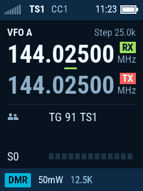

- Top line: `VFO A` (17 px bold), step;
- Receive and transmit frequency equally large (42 px bold, 5 decimals), each with an `RX` (green) / `TX` (red) chip
  on the right and `MHz` under it;
- The frequency being changed in the text colour, the other in the second text colour; the digit the step changes
  is underlined in the RX / TX colour, so the line shows both which frequency and what step; **SK2 + up / down**
  chooses receive or transmit, up/down and the knob change it by the step, the digits enter it;
- Under the line: the talk group (DMR) or the tones (CTCSS / DCS, FM); compact S meter;
- Bottom bar: mode, power, bandwidth.

### 5.3 DMR receive

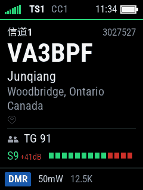 

- Green line under the status bar, the (white) signal bars lit; the status bar still shows slot and colour code;
- Top line: the channel or VFO name (17 px bold, the size and place of the VFO screen's `VFO A`), the caller's DMR
  ID on the right;
- Callsign (44 px bold; the DMR ID when neither the ID database nor the contacts know it) → name (22) → city,
  state (20, label colour) → country (20) → position (pin icon; lit when the call carries GPS data, with distance
  and direction);
- Every line has a fixed place, empty when not known: nothing moves when the position comes mid-call;
- Line → talk group → compact S meter; bottom bar as when idle (mode, power, bandwidth);
- Names and places come from the radio's ID database (written by `tools/ids/id_db.py`, an OpenGD77 database as
  fallback); city and state can be switched off in Display options (Caller's place), the country always shows
  (from the ID's first three digits when there is no database).

### 5.4 Transmit

(No screenshot of the transmit screen.)

- Red status bar, `TX` (and slot / colour code in DMR);
- Main area: what is called (`Group Call` + talk group, or zone + channel/VFO) → channel and frequency →
  large timer (with a timeout: time left, "Time left of m:ss" and a bar, amber from the timeout warning on;
  without: elapsed time) → 8 segment mic level;
- Bottom bar: mode, power, colour code (DMR) or bandwidth (FM);
- Repeater: "Waking repeater" while waking it, "No repeater" when it doesn't answer; out of band, Rx only,
  timeout and no repeater stay on the screen until the PTT is released.

### 5.5 Dual watch

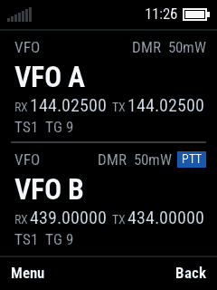

- Two paths, each **any channel or VFO**, both may be the same; **no main/sub, no A/B naming**;
- Switched on and paths added from the quick menu; kept over power off;
- Two panels, each: name (channel or VFO), mode and power, receive and transmit frequency (small grey `RX` / `TX`,
  both frequencies in the normal colour);
- The transmit path has a `PTT` chip (accent) top right, no background tint;
- The path being received: a green line on the left, the S meter on its last line;
- A DMR call: the caller's callsign replaces the large name, the channel/VFO name moves to the panel's header, the
  ID top right; without a callsign the ID is large;
- Transmit follows the path last heard, or the one chosen with up/down; Back returns to the single watch;
  soft keys Menu / Back.

### 5.6 Menus and settings

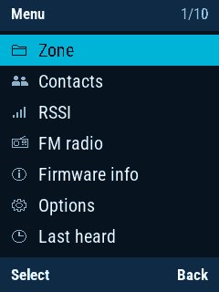 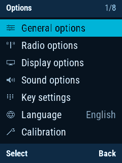 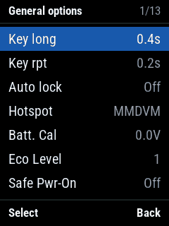

- Title bar (band): name and position (`1/11`);
- Rows: icon (main menu, options) + name, the value right aligned; 7 rows a page;
- Selected row on the accent, its text solid in `ON_ACCENT`;
- Values (on/off, choices, numbers) change with left/right and the knob only, not with the menu key;
- When name and value don't fit: the value a size smaller (17 px, same baseline), then the name too, and only then
  the name cut; the key combinations of Key settings are always a size smaller (`small_value`), the same on the
  whole page;
- Bottom bar left key: `Select` on rows that open a submenu or screen, no label on a value row; `Save` in the
  channel details, `OK` in the quick menus; right key `Back`.

Same style: zones, contacts, contact lists, DTMF contacts, radio / display / sound / APRS options, channel details,
edit contact (see the [user manual](manual.en.md)). Language and theme are rows of Options and Display options,
chosen with left/right.

### 5.7 Quick menus (short press on the menu key on a main screen)

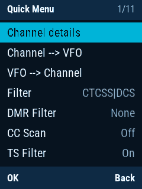 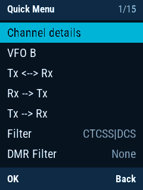

Dual watch, add to dual watch, channel ↔ VFO, filters, DMR filter; in the VFO also frequency bind and Rx/Tx swap and copy.

### 5.8 Other screens

| Screen | Screenshot | Notes |
|---|---|---|
| Radio info | 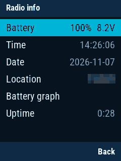 | Battery, time, date, location, battery graph; time/date/location with the digit entry widget |
| RSSI | 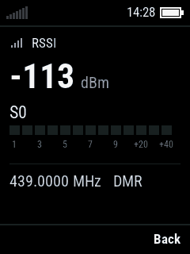 | dBm (large), S meter, frequency and mode |
| Last heard | 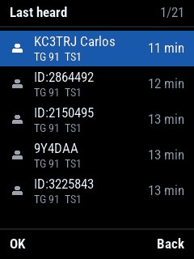 | Two lines per call: ID/callsign, talk group and slot, how long ago |
| Number entry | 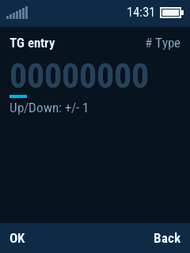 | `#` cycles TG / PC / contact / own ID; OK saves the own ID for good |
| Firmware info | 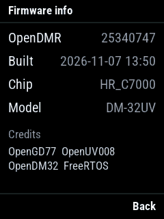 | Version, build time, chip, model, credits |
| GPS | 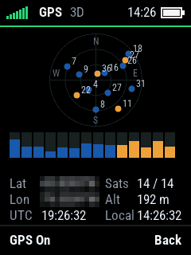 | Sky plot (GPS blue, BeiDou amber, filled when received), position, satellites, height, UTC and local time; OK switches the GPS |
| Satellites | 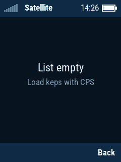 | Asks for the location first when none is set; then the passes list and the pass (polar track, Doppler corrected frequencies) |
| FM radio | 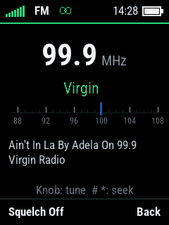 | Large frequency, RDS name, 87~108 MHz dial, RDS text; knob 100 kHz, # / * seek |

## 6. Implementation (outline)

- **Event driven** (`src/ui/ui.c`): the UI task waits on an event queue (keys, knob, data changes, timers); nothing
  runs when nothing happens. Screens sit on a stack (`ui_push()` / `ui_pop()` / `ui_home()`).
- **Screens describe what the screen is now**: each redraw draws the whole screen into the frame buffer;
  `drivers/framebuffer.c` (240x320, 4 bits a pixel = a palette index) sends only the rectangles that changed, as
  every LCD transfer is heard as a tick in the FM audio.
- **Menus and settings are tables** (`src/ui/list.c`, `ui_list_t`): label, icon, type (screen, submenu, bit, choice,
  number, custom), target. Left/right and the knob change values; the menu key opens screens and submenus only, and
  the bottom bar says `Select` only where it does (`item_selectable()`).
- `graphics/`: fonts (proportional, grey levels, UTF-8; Chinese from the data flash), drawing, icons, `theme.c`
  (the palette from a theme) and `themes/` (one file a theme);
- `ui/widgets/`: status_bar, bottom_bar (with the soft keys), list_view, channel_panel, s_meter, digit_entry;
- `app/`: the screens (channel, VFO, receive panel `qso_panel.c`, dual watch, menus ...);
- Text: `src/ui/text/` (one table a language), generated by `tools/text/gen_text.py`; strings up to 25 bytes.

Screenshots:

```
py tools/debug/fshot.py shot.png      # the frame buffer as a PNG
py tools/debug/fkey.py down green     # key events into the UI queue, to step through screens with fshot
```

## 7. Problems seen in the screenshots (to fix)

- **English quick menus**: "Add to dual watch" and "Replace VFO B" overlap (not in Chinese);
- **English left in the Chinese interface**: `Tx <--> Rx`, `Rx --> Tx`, `Tx --> Rx` in the quick menu, the VFO's
  `RX`/`TX` chips;
- **S meter in DMR receive**: reads S7 while no or only 4 segments are lit (maybe a redraw during the capture;
  to check on the radio);
- **Lock notice**: a short band above the bottom bar, gone before the capture.
