# DM-32UV 界面设计

状态：**已实现，本文档和固件一致**（2026-11-03，固件提交 d09b2a6）。
English version: [ui-design.en.md](ui-design.en.md)。

> 1～5 节的设计最早在 ucos 版固件（RA4FHE 的 OpenDM32，`firmware/dh4570_IAP`）上实现，现在的固件（`src/`）沿用。第 6 节是 `src/` 的实现。

截图和 [使用说明书](manual.md) 是同一套（`docs/manual/zh/`、`docs/manual/en/`，`tools/debug/fshot.py` 截的本固件真实画面）。

## 1. 为什么改

原来的界面来自 OpenGD77，是给 160×128 小屏设计的，在 DM-32UV 的 240×320 竖屏上被拉伸（横 ×1.5、纵 ×2.5），
字又高又瘦；字体只有几套固定宽度的点阵；没有中文。现在按 240×320 原生分辨率重画，界面参考 Motorola（XPR / SL 系列）的风格。

## 2. 原则

- **快**：开机直接进信道界面，关机写完就断电，不加固定等待和装饰动画；
- **额外的东西做成选项，默认关**（开机画面、开机音乐等）；
- **信息分层**：信道名 > 频率 > 状态；状态用图标和颜色，不用一串英文缩写；
- **颜色有含义**：平时黑底白字，颜色只表示状态（蓝 = 选中/当前，绿 = 接收，红 = 发射，黄 = 警告）；
- **中文和英文**界面，去掉俄文；信道名、通讯录支持中文；
- **少写屏**：每次往屏幕写数据都会在 FM 音频里留下一点干扰（见 6.1），界面只发变化的部分。

## 3. 按键

DM-32UV 没有橙色键。

| 按键 | 作用 |
|---|---|
| 左键 | 菜单 / OK（进入菜单、确认、选择、切换开关）；**长按 = 快捷菜单** |
| 右键 | 返回 / Home（返回上一级、删除一位；在主界面回主页） |
| 上下键、旋钮 | 切信道、在列表里移动；VFO 里改频率 |
| SK1 单按 | FM 收音机 |
| SK1 + * | VFO 里切换 FM / DMR |
| SK2 + 左 / 右 | 功率降 / 升（按住 SK2 长按右键直接到最高档） |
| SK2 + 旋钮 | VFO 里选择编辑接收或发射频率 |
| SK1 + SK2（VFO） | 按住时交换收发频率 |
| PTT | 发射 |

底栏左右两个标签对应左键、右键，写的是这个界面下按键的具体作用（选择、确认、保存、修改、返回……）。
待机主界面不显示按键标签，底栏放模式、功率、带宽或色码。

## 4. 视觉规范

尺寸都是屏幕实际像素（240×320）；截图放大了 2 倍。

### 4.1 颜色

| 名称 | RGB | 用途 |
|---|---|---|
| 背景 | #050608 | 全屏底色 |
| 分隔线 | #1C2026 | 状态栏、底栏的分隔线，进度条底色 |
| 主文字 | #F2F4F7 | 信道名、重要数值 |
| 次文字 | #D5D9DF | 频率、通话组 |
| 辅助文字 | #9AA1AB | 区域名、标签、单位 |
| 淡化文字 | #6E7580 | 双守时另一路 |
| 未点亮 | #3A3F47 | 信号格空格、S 表空格 |
| 选中 / 当前 | #1E5AA8 | 菜单高亮、模式标签、RX/TX 标签 |
| 接收 | #2BD47D | 接收状态、信号条、话筒电平 |
| 发射 | #C9302C | 发射状态栏 |
| 警告 | #E9A23B | 低电量、扫描、超时将到 |

11 种颜色加上抗锯齿过渡灰阶，组成固定的 16 色调色板（`graphics/gfxTheme.c`）。主题可以改颜色（选项 → 主题设置）。

### 4.2 字体

- 数字和英文：Roboto Condensed，`tools/fonts/mkfont.py` 生成，16 级灰度抗锯齿，放在程序 flash；
- 中文：思源黑体（Noto Sans SC，裁到 GB2312），`tools/fonts/mkcjk.py` 生成 17 px（全部 GB2312）和
  32 px 粗体（3755 个常用字），4 位抗锯齿，放在数据 flash 0x280000（2.6 MB），用 `tools/fonts/upload_cjk.py` 写入；
- 常用字号：13（状态栏、底栏、单位）、17（列表、标签）、20（频率、通话组）、32~44 粗体（信道名、呼号、计时、大字频率）。

### 4.3 布局骨架

```
y=0   ┌──────────────────────────────┐
      │ 状态栏                         │ 信号格 · 时隙 · 色码 …… 时间 · 电池
      ├──────────────────────────────┤ 分隔线（接收时绿色；发射时整条红底）
      │ 主区，左右各留 12px             │
      ├──────────────────────────────┤ 分隔线
      │ 底栏                           │ 模式标签 · 功率 · 带宽/色码，或左右按键标签
y=320 └──────────────────────────────┘
```

列表界面（菜单、设置）没有信号状态栏，顶上是标题和位置（`4/9`）。

## 5. 各界面

### 5.1 信道（DMR 待机）

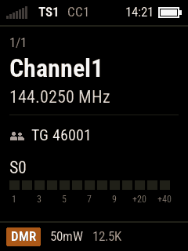

- 状态栏：信号格、`TS1`、`CC1`、时间、电池；
- 主区：区域名和序号（`Zone1 1/1`）→ 大字信道名 → 频率 → 分隔线 → 通话组 → S 表（接收时一直显示，静噪打开时数值变绿）；
- 底栏：`DMR` 蓝色标签、功率、带宽。

### 5.2 VFO（FM）

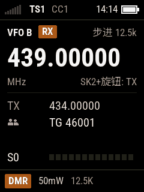

- 第一行：`VFO A`、当前编辑的是接收（`RX`）还是发射（`TX`）、步进；
- 大字频率（正在输入时，输入的那一位下面有下划线）；`MHz` 和提示 `SK2+旋钮: TX`；
- 另一个频率、差频；S 表（紧凑的一行）；
- 底栏：`FM`、功率、带宽。

### 5.3 DMR 接收


- 状态栏分隔线变绿，信号格变绿；
- 主区：`接收中` 和通话时长 → 大字呼号（通讯录里没有就显示 DMR ID）→ 姓名（有的话）→ 通话组 → S 表；
- 底栏：模式和信道名。主叫在通话开始约 0.7 秒内显示（嵌入 LC）。

### 5.4 发射

（发射界面没有截图）

- 状态栏整条红底，`TX`（DMR 还有时隙、色码）；
- 主区：呼叫对象（`组呼` + 通话组，或区域 + 信道/VFO）→ 信道和频率 → 大字计时（有发射超时时显示剩余时间
  和"剩余 m:ss"、下面一条超时条，进入超时提示后变黄；没有超时时显示已发射时间）→ 话筒电平 8 格；
- 底栏：模式、功率、DMR 显示色码 / FM 显示带宽；
- 中继：唤醒时显示"正在唤醒中继"，中继没应答显示"无中继"；超出频段、只收、超时、无中继的提示保持到松开 PTT。

### 5.5 双守

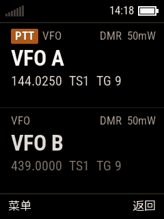

- 两路，每一路可以是**任意信道或 VFO**，两路可以选成一样；**不分主副，不叫 A/B**；
- 在快捷菜单里开关、"加入双守"；关机保存；
- 上下两栏；正在发射的一路有 `PTT` 小标签，收到信号的一路标 `接收中`、左边一条绿线；
- 发射：自动跟随最近收到的一路，上下键可以选发射的那一路；返回键回到单守；软键 菜单 / 返回。

### 5.6 菜单和设置

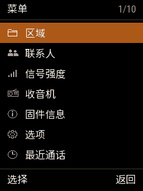 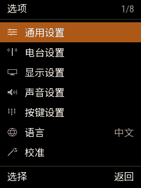 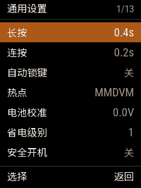

- 标题栏：名称和位置（`1/11`）；
- 列表每行：图标（主菜单、选项）+ 名称，右边是当前值；一屏 7 行；
- 当前行整行蓝底白字；
- 底栏：左 `选择`（有的界面是 `修改`、`保存`、`OK`），右 `返回`。

同样样式的还有：区域、联系人、通讯录、DTMF 联系人、电台设置、显示设置、声音设置、APRS 设置、信道详情、
语言、主题选择、主题设置、编辑联系人（截图见 [使用说明书](manual.md)）。

### 5.7 快捷菜单（长按菜单键）

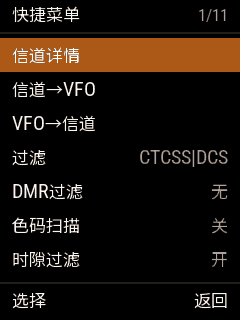 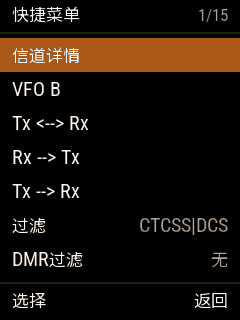

双守开关、加入双守、信道 ↔ VFO、过滤、DMR 过滤；VFO 里还有频率绑定、收发互换和复制。

### 5.8 其他界面

| 界面 | 截图 | 说明 |
|---|---|---|
| 电台信息 | 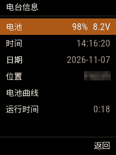 | 电池、时间、日期、位置、电池曲线；时间/日期/位置用数字输入控件 |
| 信号强度 | 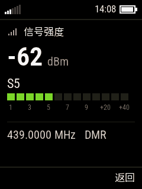 | dBm 大字、S 表、频率和模式 |
| 最近通话 | 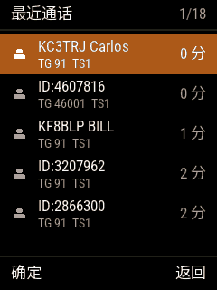 | 两行一项：ID/呼号、通话组和时隙、多久以前 |
| 数字输入 | 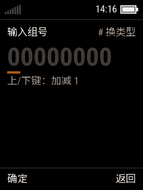 | `#` 在 TG / PC / 联系人 / 本机 ID 之间切换；本机 ID 按 OK 永久保存 |
| 固件信息 | 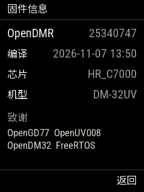 | 版本、编译时间、芯片、机型、致谢 |
| GPS | 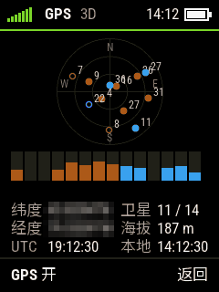 | 天空图（GPS 蓝、北斗黄，收到的实心）、经纬度、卫星数、海拔、UTC 和本地时间；OK 开关 GPS |
| 业余卫星 | 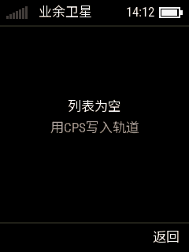 | 没设位置时先输入位置；之后是过境列表、过境详情（极坐标轨迹、多普勒修正频率） |
| FM 收音机 | 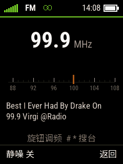 | 大字频率、RDS 台名、87~108 MHz 刻度、RDS 文字；旋钮 100 kHz，# / * 搜台 |

## 6. 实现（`src/` 的界面框架）

外观就是上面 1～5 节的设计；代码结构没有照搬 OpenGD77 的 `menuSystem.c` 和各个菜单文件（3.8 万行），而是写了一个精简的、
事件驱动的框架（`src/ui/`），各界面（`src/app/`）在它上面重写，原工程只作为功能和文字的参考。

### 6.1 目标

1. **事件驱动**：没有按键、没有数据变化时，界面代码一行都不运行。
2. **界面只描述“现在应该是什么样”**：每次重画都整屏画进帧缓冲，由帧缓冲比较、只送变化的部分（编码风格和架构文档里的规则）。界面不记录“哪里要重画”。
3. **菜单和设置用表描述**：大多数设置菜单只是一张表（名字、图标、取值、怎么改），不需要每个菜单写一个文件。
4. **小**：框架本身目标 1000 行以内。

### 6.2 组成

```
输入服务 services/input        键盘矩阵、侧键、PTT 每 10 ms 扫描（行线和 LCD 共用，不能用中断）；
                                去抖、长按、连按、组合键；旋钮由 1 ms 中断计数，有变化才发事件
        │ ui_event_t（FreeRTOS 队列）
        ▼
UI 任务 ui/ui.c                 阻塞在事件队列上；把事件交给界面栈顶的界面；需要时整屏重画、fb_flush()
        │
        ├── 界面栈               ui_push() / ui_pop() / ui_replace() / ui_home()，最深 8 层
        ├── 列表界面 ui/list.c   菜单和设置：由 ui_list_t 表描述
        ├── 覆盖层               提示（toast）、消息框：画在界面之上
        └── 文字 ui/text.c       字符串 ID → 当前语言的文字（中文、英文）

数据变化（电量、时间的分钟、信号……）由各服务发 UI_EVENT_DATA 事件，界面据此决定要不要重画。
```

### 6.3 事件

```c
typedef enum {
    UI_EVENT_KEY_PRESS,   // key: 按下
    UI_EVENT_KEY_LONG,    // 按住超过长按时间（设置 keypad_timer_long）
    UI_EVENT_KEY_REPEAT,  // 长按之后按连按间隔重复（设置 keypad_timer_repeat）
    UI_EVENT_KEY_RELEASE, // 松开；long_pressed: 之前是否已经发过 LONG
    UI_EVENT_ROTARY,      // steps: 正数顺时针
    UI_EVENT_DATA,        // what: 哪类数据变了（电量、时间、信号、接收状态……）
    UI_EVENT_TIMER,       // 界面自己申请的定时器到了
} ui_event_type_t;

typedef struct {
    ui_event_type_t type;
    uint8_t key;          // UI_KEY_x：键盘 18 个键、SK1、SK2、PTT
    uint8_t modifiers;    // 按下时按住的 SK1 / SK2（组合键：SK2 + 左 / 右 = 功率）
    int16_t steps;
    uint16_t what;
} ui_event_t;
```

### 6.4 界面

```c
typedef struct ui_screen {
    void (*enter)(void *arg);              // 进入（压栈或回到栈顶时）
    void (*leave)(void);                   // 离开
    bool (*handle)(const ui_event_t *ev);  // 处理事件；返回 true：要重画
    void (*draw)(void);                    // 把整屏画进帧缓冲（状态栏、内容、底栏）
    const codeplug_channel_t *(*channel)(void); // 收信机该在的频道，由界面现在的数据算出；NULL：用下面界面的
} ui_screen_t;
```

- 进入界面、回到栈顶、`handle()` 返回 true，都会触发一次重画：清帧缓冲 → `draw()` → 覆盖层 → `fb_flush()`。
- 界面不直接读按键、不自己延时；要定时就向框架申请定时器（`ui_timer_start(ms)`），到时收到 `UI_EVENT_TIMER`。
- 主界面（信道、VFO）在栈底；`ui_home()` 回到它。
- 收信机的频道和显示一样由框架负责：界面只改自己的数据，不调用 `radio_set_channel()`。每个事件处理完（包括
  `handle()` 里的压栈、出栈、替换都做完以后），框架从栈顶往下找第一个有 `channel()` 的界面，把它算出的频道交给
  收信机（`ui_tune()`）；频道没变时收信机什么都不做。菜单这类界面没有 `channel()`，用的是下面主界面按最新数据
  算出的频道，所以在菜单里改的东西马上生效。有 `channel()` 的界面：信道、VFO、双守、卫星（打开某次过境以后）；
  热点返回 `UI_CHANNEL_KEPT`，由热点服务自己调谐；`UI_CHANNEL_UNDER` 表示这时用下面界面的。发射前
  `tx_screen_open()` 先调用一次 `ui_tune()`。

### 6.5 列表界面（菜单和设置）

一屏 7 行、当前行蓝底、标题栏显示名称和位置、底栏是左右键的作用（见 5.6）。一张表描述一个菜单：

```c
typedef enum {
    UI_ITEM_SCREEN, // 打开另一个界面（target 为 NULL：“尚未实现”页）
    UI_ITEM_LIST,   // 打开子菜单（另一张 ui_list_t）
    UI_ITEM_BIT,    // 设置里某个字的一位：开 / 关（可反相，如“全部 LED 关闭”）
    UI_ITEM_CHOICE, // 一个字节在几个选项里选
    UI_ITEM_NUMBER, // 8 位数字：最小、最大、步长、小于某值时步长 1、单位、0 显示“关”
    UI_ITEM_CUSTOM, // 其他：format() 显示，change(方向, 组合键) 改，select() 切换
} ui_item_type_t;

typedef struct {
    text_id_t label;     // 文字 ID
    icons_id_t icon;     // ICONS_x，ICONS_COUNT 为没有
    ui_item_type_t type;
    const void *target;  // 界面 / 子菜单 / 设置项描述
    void *arg;
} ui_item_t;
```

取值显示在行的右边。按键：

| 键 | 作用 |
|----|------|
| UP / DOWN | 移动（按住连续） |
| LEFT / RIGHT | 减小 / 增大当前项的值（按住连续） |
| 旋钮 | 只调值，不移动；当前项没有值时不起作用 |
| 左键（菜单） | 打开子菜单 / 界面，切换开关和选项 |
| 右键（返回） | 松开时返回，长按回主界面 |

信道和 VFO 主界面上：**短按左键打开本界面的菜单**（快捷菜单，第一项是信道详情），**长按左键打开主菜单**；SK2 + 左键直接进信道详情。和当前信道有关的项只放在本界面的菜单里，主菜单只放全局的项。

菜单记住位置（`ui_list_recall()` / `ui_list_remember()`）：每个菜单（列表界面、信道 / VFO 快捷菜单）按英文标题的哈希记住上次选中的项，开机期间一直有效；“通用设置 → 记住菜单位置”（缺省关）打开后，关机时写进自定义数据块 0x4D454E55，重启后还在。

改动立即写进 `settings`（内存）并记下“有改动”；离开列表时 `settings_save_if_changed()`。关机时中断只发请求（power.c），输入任务先保存再断电；2 秒内没断电，中断自己断电。

### 6.6 文字

- `src/ui/text/text_zh.c`、`text_en.c`：同一个字符串 ID 枚举（`text.h`），各自一张表；设置里的语言决定用哪张。
- 文字最初由 `tools/text/gen_text.py` 从原工程的 `languages/chinese.h`、`english.h`（存在 `tools/text/languages/`）生成，
  之后加的字符串直接写进这三个文件（同时记进 `gen_text.py` 的 EXTRA）。
- 最长 25 字节（8 个汉字），超出由控件截断。

### 6.7 任务

| 任务 | 优先级 | 做什么 |
|---|---|---|
| input | 3 | 每 10 ms 扫描按键，有变化就往 UI 队列里发事件 |
| ui | 2 | 等事件、处理、重画 |

其他任务（radio、hotspot、gps……）用 `ui_post()` 发 `UI_EVENT_DATA`，`what` 说明什么变了。`ui_set_event_hook()` 注册的函数先于栈顶界面看到每个事件，用来把某个界面压到所有界面之上（`app/main.c` 的 `screen_hooks()`：热点界面在主机来了时压上，写频界面在写频软件开始读写码表时压上）。


### 6.8 截图

```
py tools/debug/fshot.py shot.png      # 帧缓冲读出来存成 PNG（放大 2 倍）
py tools/debug/fkey.py down green     # 往界面队列里发按键事件，配合 fshot 不碰电台就能一屏屏截
```

## 7. ucos 版截图时发现的问题（待修，现在的固件里要逐条确认）

- **英文 VFO/信道快捷菜单**："Add to dual watch" 和 "Replace VFO B" 两段文字重叠（中文不重叠）；
- **中文界面里还有英文**：快捷菜单的 `Tx <--> Rx`、`Rx --> Tx`、`Tx --> Rx`，软键 `OK`，VFO 的 `RX`/`TX` 标签；
- **DMR 接收时 S 表**：数值显示 S7，但下面的格子没有点亮或只亮 4 格，数值和格子不一致（也可能是截图时正在重画，要上机确认）；
- **主题设置里的颜色样块**：直接写到屏幕、不在帧缓冲里，截图里是空框；要上机确认屏幕上是否正常显示；
- **锁屏提示**：是底栏上方的一条提示，出现时间短，没有截到。
